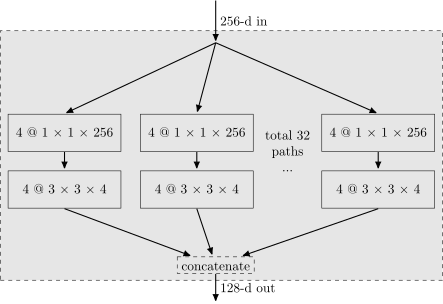
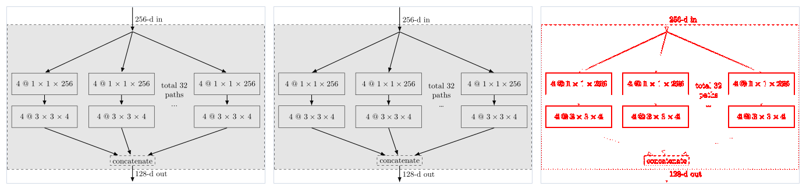
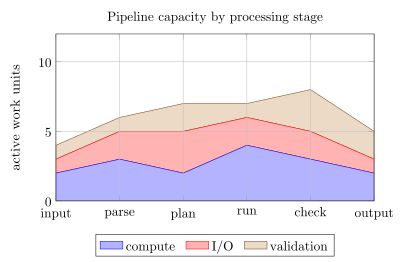
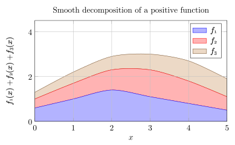
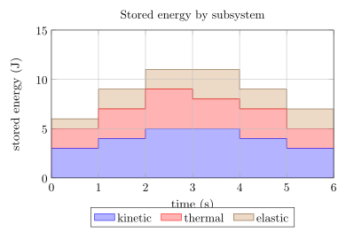
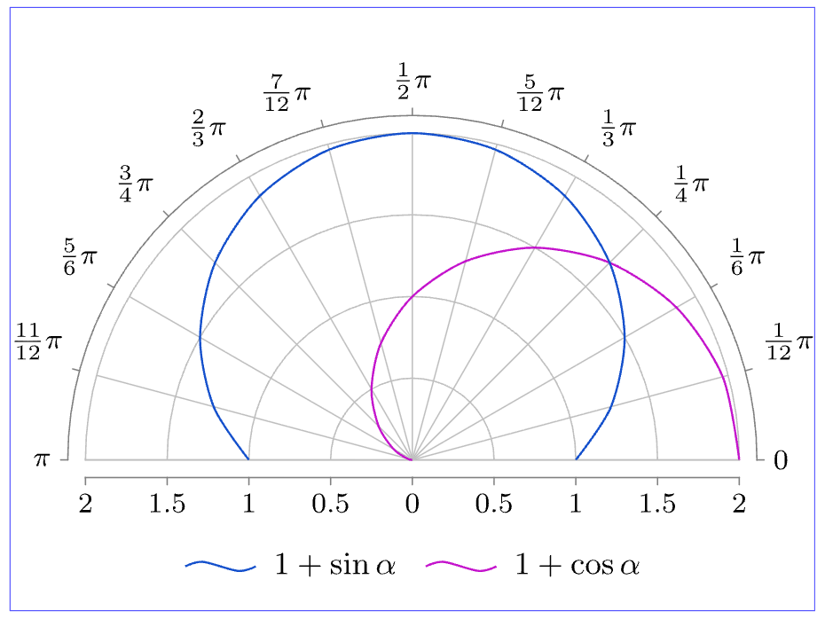
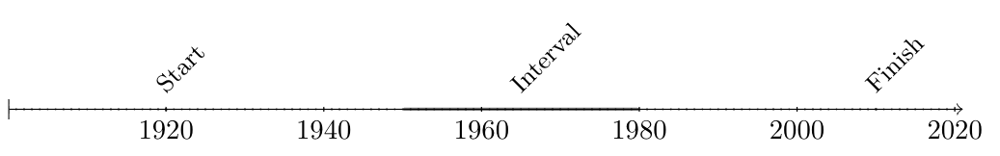

# Public Examples

This page contains curated artifacts that are committed to the repository and
can be linked from GitHub, npm, issues, and external documentation. The full
comparison gallery is generated locally and is intentionally not committed.

## Aggregation Blocks

[](images/examples/aggregation-blocks.svg)

This flow diagram exercises named nodes, reusable styles, math labels,
positioning, dashed paths, and `Latex` arrow tips.

- [Open the TikZKit SVG](images/examples/aggregation-blocks.svg)
- [Open the TikZ source](../test/fixtures/examples/latex-examples/aggregation-blocks.tex)
- [Open the visual comparison](images/examples/aggregation-blocks-comparison.png)

The comparison sheet places the `tikztosvg` reference, TikZKit rendering, and
pixel difference from left to right.

[](images/examples/aggregation-blocks-comparison.png)

## PGFPlots Stacked Areas

| Algorithm | Mathematics | Physics |
| --- | --- | --- |
| [](../test/fixtures/examples/pgfplots/stacked-area/algorithm.tex) | [](../test/fixtures/examples/pgfplots/stacked-area/math.tex) | [](../test/fixtures/examples/pgfplots/stacked-area/physics.tex) |

These examples exercise `stack plots=y`, `area style`, `\closedcycle`, legends,
grids, and sharp, smooth, or constant plot handlers.

## PGFPlots Measurement Errors

See also [statistical boxplots](#pgfplots-boxplots) for distributions rather than individual uncertainties.

The three measurements below have a symmetric uncertainty, different upper and
lower uncertainties, and no reported uncertainty, respectively. Only the three
measurements are joined; the endpoints affect the automatic range but do not
become extra data points.

```tex
\begin{tikzpicture}
  \begin{axis}[xlabel=Time,ylabel=Reading]
    \addplot+[error bars/.cd,y dir=both,y explicit] coordinates {
      (1,2) +- (0,.5)
      (2,3) += (0,.7) -= (0,.2)
      (3,2.5)
    };
  \end{axis}
\end{tikzpicture}
```

Requires `\usepackage{pgfplots}`. [Standalone source with x and y errors](../test/fixtures/native-pgfplots-error-bars/fixed-scatter.tex)
and [native/browser comparison](qa/2026-11-25-pgfplots-error-bars.md).

On a logarithmic axis the uncertainty is still in **data units**. For
example, `(2,4) +- (0,2)` ends at 2 and 6 on the y-axis. The lower arm
is longer on the page because `log(4/2) > log(6/4)`. Use
`y explicit relative` for fractional errors instead (e.g. `.2` for 20%).
See the [original double-log table example](../test/fixtures/native-pgfplots-log-errors/manual-log-relative.tex)
and its [browser comparison](qa/2026-11-25-pgfplots-log-errors.md).

## PGFPlots Boxplots

The statistics library accepts raw observations or a five-number summary.
For example, this plots the median, middle half and whiskers of twelve
observations without first calculating them in JavaScript:

```tex
\usepackage{pgfplots}
\usepgfplotslibrary{statistics}
\pgfplotsset{compat=1.18}
% Inside the document:
\begin{tikzpicture}
  \begin{axis}[y=1cm]
    \addplot+[boxplot] table[row sep=\\,y index=0] {
      data\\1\\2\\1\\5\\4\\10\\7\\10\\9\\8\\9\\9\\
    };
  \end{axis}
\end{tikzpicture}
```

To draw a supplied summary, use `boxplot prepared`;
the coordinates then contain **outliers**, not observations to connect.
An empty coordinate list still draws the box.
[Raw sample source](../test/fixtures/examples/pgfplots/boxplot-manual-samples.tex)
 · [Three prepared groups](../test/fixtures/examples/pgfplots/boxplot-manual-prepared.tex)
 · [Browser and native comparison](qa/2026-11-25-pgfplots-boxplots.md).

## PGFPlots Histograms

To count observations in the x column, select `data=x` explicitly. This
example has two bins of width 2. Their counts are 2 and 3, so the cumulative
fractions are 0.4 and 1:

```tex
\begin{tikzpicture}
  \begin{axis}[xmin=0,xmax=4,ymin=0,ymax=1]
    \addplot+[hist={data=x,bins=2,cumulative,density}] coordinates {
      (0,0) (1,0) (2,0) (3,0) (4,0)
    };
  \end{axis}
\end{tikzpicture}
```

Requires `\usepackage{pgfplots}`. For an ordinary density, omit `cumulative`;
the **area**, not the sum of the heights, is then one. Try the manual's
[step histogram](../test/fixtures/examples/pgfplots/hist-manual-const.tex)
or its [8,000-observation example](../test/fixtures/examples/pgfplots/hist-manual-cumulative-x.tex)
with the accompanying [data file](../test/fixtures/examples/pgfplots/plotdata/pgfplots.randn.dat).
The [visual comparison](qa/2026-11-25-pgfplots-histograms.md) shows what changed.

## Matrix Heatmaps

Each coordinate is the **center** of a cell; its bracketed value selects the
color. Here the first row is at the top and the middle cell is left blank.

```latex
\begin{tikzpicture}
  \begin{axis}[enlargelimits=false,colorbar]
    \addplot[matrix plot,mesh/cols=3,point meta=explicit] coordinates {
      (0,0)[0] (1,0)[1]   (2,0)[2]
      (0,1)[3] (1,1)[nan] (2,1)[5]
      (0,2)[6] (1,2)[7]   (2,2)[8]
    };
  \end{axis}
\end{tikzpicture}
```

Requires `\usepackage{pgfplots}`. Use `matrix plot*` to keep the axis's
original direction. Try the manual's [table input](../test/fixtures/native-pgfplots-matrix-plots/matrix-manual-table.tex)
or [missing value with numbered cells](../test/fixtures/native-pgfplots-matrix-plots/matrix-manual-nan-colorbar.tex).
See the [browser and native comparison](qa/2026-11-25-pgfplots-matrix-plots.md) for the supported options and limits.

## Polar Functions

| TikZKit in Chromium | Local tikztosvg in Chromium |
| --- | --- |
| [](images/examples/polar-half-plane.svg) |  |

[TikZ source](../test/fixtures/remaining-layout-failures/polar-half-plane.tex)
uses `datavisualization.polar`, function-format data, clean half-plane axes,
pi-fraction ticks, smooth curves and an outside legend. The thin blue frame
is a shared alignment control included in the source.

The browser comparison checks all 69 glyph origins at a fixed physical scale.
It does not independently stretch either image to make it match. Curves can
still differ in paint order at their intersections; native-PDF raster edges
are not certified pixel-identical.

## Chronology

| TikZKit in Chromium | Local tikztosvg in Chromium |
| --- | --- |
| [](images/examples/chronology.svg) |  |

[TikZ source](../test/fixtures/visual-followups/chronology-core.tex):

```tex
\documentclass[border=2pt]{standalone}
\usepackage{chronology}
\begin{document}
\begin{chronology}[20]{1900}{2020}{9cm}[12cm]
  \event{1920}{\small Start}
  \event[1950]{1980}{\small Interval}
  \event{2010}{\small Finish}
\end{chronology}
\end{document}
```

The JS adapter covers annual and major ticks, point/span events, rotated
labels and whole-picture resizing. The browser check includes all 43 glyphs
and the three events' bounds, fill, opacity and absence of a stroke.
Custom event styles and general document layout remain partial. The local
tikztosvg reference captures chronology's native savebox before standalone
cropping; it does not reproduce the layout in JavaScript.

Both screenshot pairs were captured on 2026-10-25 using the default JS
renderer and packaged MacTeX fonts. Exported SVG-text was checked separately.
See the [full validation record](qa/2026-10-25-polar-timeline.md) for local
source references, commands, thresholds and remaining differences. These
examples describe the GitHub checkout; they may be ahead of the npm release.

## CircuitikZ Potentiometers

Name a potentiometer to connect another wire to its slider. `wiper pos` is
a fraction of the resistor body, not the whole connection:

```tex
\begin{circuitikz}[american]
  \draw (0,0) to[pR, name=P, wiper pos=.25] (4,0);
  \draw (P.wiper) -- ++(0,1);
\end{circuitikz}
```

See the [standalone source with three slider settings](../test/fixtures/native-circuitikz-potentiometers/manual-wipers.tex)
and the [browser and native comparison](qa/2026-11-25-circuitikz-potentiometers.md).
This example requires the GitHub version.

## Variable Resistors and Sensors

`vR` draws an adjustable resistor with a diagonal arrow; `sR` draws a sensor
with a bent bar. The component's name lets later wires use its saved contacts:

```tex
\begin{circuitikz}[european]
  \draw (0,0) to[vR, name=V] (2,0) to[sR, name=S] (4,0);
  \draw[blue] (V.wiper) -- ++(0,-0.6);
  \node[below] at (S.label) {$T$};
\end{circuitikz}
```

Switch to `[american]` for zigzag bodies. The [original manual example](../test/fixtures/native-circuitikz-resistor-modifiers/manual-thickness.tex)
shows how to vary the modifier thickness independently of the body.
See the [browser/native comparison](qa/2026-11-25-circuitikz-resistor-modifiers.md) for this GitHub version.

## Petri Nets

Load `petri` for places, transitions and tokens. Edges in this example are
specified from the transition: `pre` points **toward** it, and `post` points
**away** from it. The label `2` belongs to the outgoing edge, not the place.

```tex
\usetikzlibrary{petri,positioning}
\begin{tikzpicture}
  \node[place,tokens=2] (ready) {};
  \node[transition,right=of ready] (fire) {};
  \node[place,right=of fire] (done) {};
  \path (fire) edge[pre] (ready) edge[post] node[above] {2} (done);
\end{tikzpicture}
```

Try the [weighted transition](../test/fixtures/native-petri/petri-manual-transition.tex),
[numbered token atlas](../test/fixtures/native-petri/petri-manual-structured-atlas.tex),
or [mutual-exclusion network](../test/fixtures/native-petri/mutual-exclusion.tex) in the checkout.
See the [browser results alongside MacTeX and tikztosvg](qa/2026-11-25-native-petri.md#visual-results).

## Picture Backgrounds

Load `backgrounds` to frame the completed drawing. Here the grid is declared
after the opaque yellow background, so it stays visible behind the ellipse.

```tex
\usetikzlibrary{backgrounds}
\tikzset{background rectangle/.style={rounded corners,fill=yellow},
         background grid/.style={thick,draw=red,step=.5cm}}
\begin{tikzpicture}[framed,gridded]
  \draw (0,0) ellipse (10mm and 5mm);
\end{tikzpicture}
```

Try the [original manual input](../test/fixtures/native-backgrounds/backgrounds-manual-framed-gridded.tex)
or [four individually extended sides](../test/fixtures/native-backgrounds/backgrounds-manual-four-sides.tex).
See the [browser and native comparison](qa/2026-11-25-native-backgrounds.md#visual-results).

To put particular paths behind the drawing, use a background scope. Put
the color *inside* the option's braces so it is applied after the switch:

```tex
\usetikzlibrary{backgrounds}
\begin{tikzpicture}
  \fill[blue] (0,0) circle (1);
  \scoped[on background layer={color=yellow}]
    \fill (-1,-1) rectangle (1,1);
\end{tikzpicture}
```

Try the [four overlapping shapes](../test/fixtures/native-background-scopes/scopes-manual-interleaved.tex)
or the [crossed pens](../test/fixtures/native-background-scopes/scopes-manual-crossed-pens.tex).
The [visual comparison](qa/2026-11-26-native-background-scopes.md) shows both against native TeX.
These background features are in the GitHub version.

## Smooth curves

Use `smooth` for a line through observations and `smooth cycle` for a
continuous outline. A tension of one makes a four-point circle approximation:

```tex
\begin{tikzpicture}
  \draw[blue, thick, dashed] plot[smooth cycle, tension=1]
    coordinates {(1,0) (0,1) (-1,0) (0,-1)};
\end{tikzpicture}
```

Try the [three tensions](../test/fixtures/native-smooth-plots/smooth-manual-tensions.tex)
or the [sampled parametric curve](../test/fixtures/native-smooth-plots/smooth-manual-parametric.tex).
The [native comparison](qa/2026-11-26-native-smooth-plots.md) covers the browser and exported SVG.
This update is in the GitHub version.

## Selecting plot marks

To keep a smooth curve through every observation but mark only the second
and fifth points, use `mark phase=2,mark repeat=3`:

```tex
\begin{tikzpicture}
  \draw[blue] plot[smooth,mark=*,mark phase=2,mark repeat=3]
    coordinates {(0,0) (1,1) (2,.6) (3,-.4) (4,0) (5,1)};
\end{tikzpicture}
```

For an irregular selection, replace both keys with `mark indices={1,4,6}`.
The same keys work on PGFPlots series; a new series starts its own count.
See the [browser, native TeX and tikztosvg comparison](qa/2026-11-26-plot-mark-selection.md).

In the GitHub version, use `plot file` with an in-memory table when the
observations come from your application. No network request is made:

```js
const { svg } = await tikzToSvgAsync(
  String.raw`\tikz \draw plot[mark=x,mark repeat=2] file {observations.table};`,
  { dataFiles: { "observations.table": "0 0\n1 2\n2 1" } }
);
```

## Step Plots

To hold each measurement until the next one arrives, use a constant plot.
The jump version leaves the change of level unstroked:

```tex
\begin{tikzpicture}
  \draw[blue] plot[const plot] coordinates {(0,1) (1,2) (3,1)};
  \draw[red]  plot[jump mark left] coordinates {(0,0) (1,.5) (3,0)};
\end{tikzpicture}
```

For a change halfway between observations, use `const plot mark mid` or
`jump mark mid`. For a level determined by the next observation, use the
`mark right` variants. See the [sources and visual comparison](qa/2026-11-26-step-plots.md).

## Bars and unequal bins

In ordinary TikZ, use a fixed physical width for individual observations.
For unequal bins, specify both bin edges: the last coordinate ends the final
bin and does not add a bar.

```tex
\begin{tikzpicture}
  \fill[blue] plot[ybar,bar width=6pt] coordinates {(0,1) (1,-.5) (2,1.4)};
  \fill[red] plot[ybar interval,bar interval width=.5]
    coordinates {(3,1) (4,.5) (6,0)};
\end{tikzpicture}
```

Use `xbar` or `xbar interval` for horizontal bars. See the
[four source examples and browser/native comparison](qa/2026-11-26-bar-plots.md).

## Fill Between Curves

Give each boundary a name. The fill follows the plotted curves, including
spline controls and step corners, even if the second path runs right to left.

```tex
\usepackage{pgfplots}
\usepgfplotslibrary{fillbetween}
\pgfplotsset{compat=1.18}
\begin{tikzpicture}
  \begin{axis}[xmin=0,xmax=3,ymin=0,ymax=4]
    \addplot[blue,smooth,name path=upper] coordinates {(0,2) (1,3) (2,2) (3,3)};
    \addplot[red,name path=lower] coordinates {(3,1) (0,.5)};
    \addplot[fill=teal!35] fill between[of=upper and lower];
  \end{axis}
\end{tikzpicture}
```

See the [four editable examples and browser/reference comparison](qa/2026-11-26-fill-between-boundaries.md).

To shade just part of the curves, clip the fill boundaries, not the drawing.
For example, this keeps both original strokes visible outside the window:

```tex
\path[name path=window] (axis cs:1,-1) rectangle (axis cs:3,4);
\addplot[fill=teal!35] fill between[of=upper and lower,soft clip={name=window}];
```

Use `soft clip first` and `soft clip second` for different windows on the two
boundaries. See the [three rectangular clipping examples](qa/2026-11-26-fill-between-rectangles.md).

## Local Comparison Gallery

Generate the complete local gallery from the repository root:

```bash
npm install
npm run web:output
npm run examples:diff
PORT=5174 npm run web
```

Open <http://127.0.0.1:5174/>. Generated SVG, PNG, MacTeX, `tikztosvg`, and
diff artifacts are written below `test/fixtures/examples/output/`. They are
local evidence, not public repository files. See the
[generated artifact policy](generated-artifacts.md) for the directory rules.
