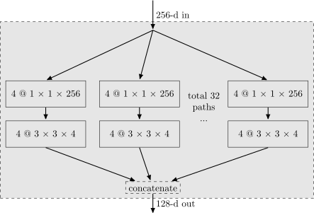
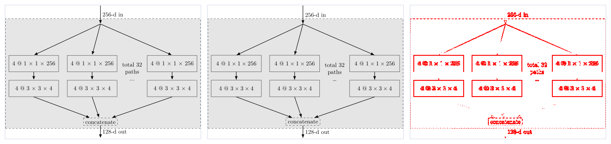
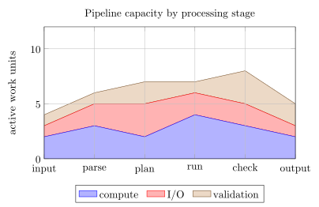
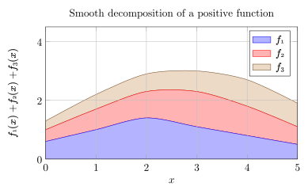
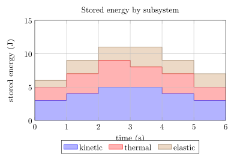
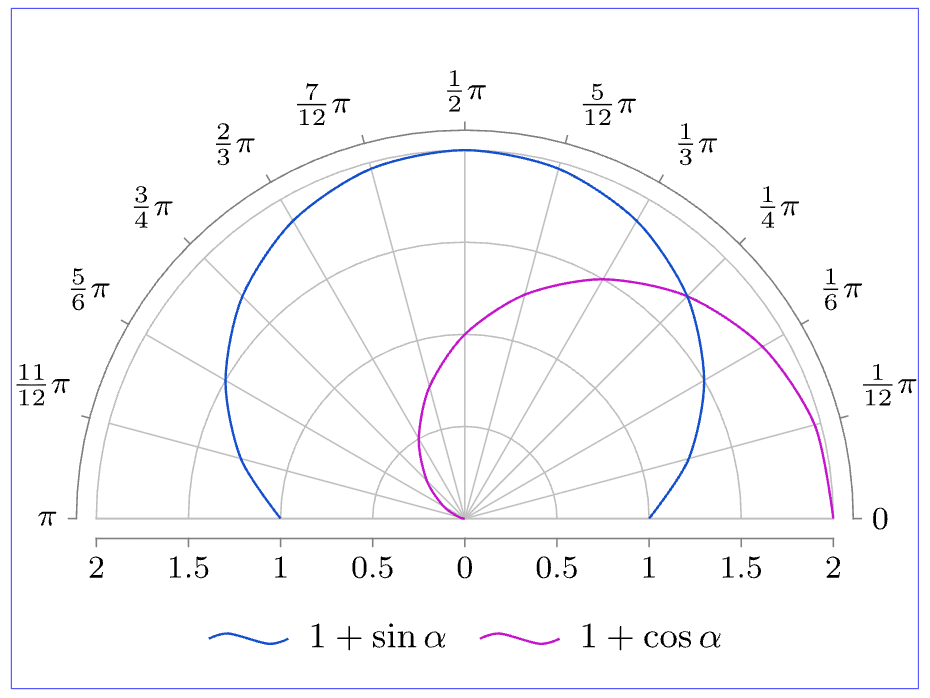
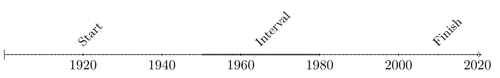

# Public Examples

This page contains curated artifacts that are committed to the repository and
can be linked from GitHub, npm, issues, and external documentation. The full
comparison gallery is generated locally and is intentionally not committed.

## Aggregation Blocks

[](images/examples/aggregation-blocks.svg)

This flow diagram exercises named nodes, reusable styles, math labels,
positioning, dashed paths, and `Latex` arrow tips.

- [Open the TikZKit SVG](images/examples/aggregation-blocks.svg)
- [Open the TikZ source](../test/fixtures/examples/latex-examples/aggregation-blocks.tex)
- [Open the visual comparison](images/examples/aggregation-blocks-comparison.png)

The comparison sheet places the `tikztosvg` reference, TikZKit rendering, and
pixel difference from left to right.

[](images/examples/aggregation-blocks-comparison.png)

## PGFPlots Stacked Areas

| Algorithm | Mathematics | Physics |
| --- | --- | --- |
| [](../test/fixtures/examples/pgfplots/stacked-area/algorithm.tex) | [](../test/fixtures/examples/pgfplots/stacked-area/math.tex) | [](../test/fixtures/examples/pgfplots/stacked-area/physics.tex) |

These examples exercise `stack plots=y`, `area style`, `\closedcycle`, legends,
grids, and sharp, smooth, or constant plot handlers.

## Polar Functions

| TikZKit in Chromium | Local tikztosvg in Chromium |
| --- | --- |
| [](images/examples/polar-half-plane.svg) |  |

[TikZ source](../test/fixtures/remaining-layout-failures/polar-half-plane.tex)
uses `datavisualization.polar`, function-format data, clean half-plane axes,
pi-fraction ticks, smooth curves and an outside legend. The thin blue frame
is a shared alignment control included in the source.

The browser comparison checks all 69 glyph origins at a fixed physical scale.
It does not independently stretch either image to make it match. Curves can
still differ in paint order at their intersections; native-PDF raster edges
are not certified pixel-identical.

## Chronology

| TikZKit in Chromium | Local tikztosvg in Chromium |
| --- | --- |
| [](images/examples/chronology.svg) |  |

[TikZ source](../test/fixtures/visual-followups/chronology-core.tex):

```tex
\documentclass[border=2pt]{standalone}
\usepackage{chronology}
\begin{document}
\begin{chronology}[20]{1900}{2020}{9cm}[12cm]
  \event{1920}{\small Start}
  \event[1950]{1980}{\small Interval}
  \event{2010}{\small Finish}
\end{chronology}
\end{document}
```

The JS adapter covers annual and major ticks, point/span events, rotated
labels and whole-picture resizing. The browser check includes all 43 glyphs
and the three events' bounds, fill, opacity and absence of a stroke.
Custom event styles and general document layout remain partial. The local
tikztosvg reference captures chronology's native savebox before standalone
cropping; it does not reproduce the layout in JavaScript.

Both screenshot pairs were captured on 2026-10-25 using the default JS
renderer and packaged MacTeX fonts. Exported SVG-text was checked separately.
See the [full validation record](qa/2026-10-25-polar-timeline.md) for local
source references, commands, thresholds and remaining differences. These
examples describe the GitHub checkout; they may be ahead of the npm release.

## Local Comparison Gallery

Generate the complete local gallery from the repository root:

```bash
npm install
npm run web:output
npm run examples:diff
PORT=5174 npm run web
```

Open <http://127.0.0.1:5174/>. Generated SVG, PNG, MacTeX, `tikztosvg`, and
diff artifacts are written below `test/fixtures/examples/output/`. They are
local evidence, not public repository files. See the
[generated artifact policy](generated-artifacts.md) for the directory rules.
