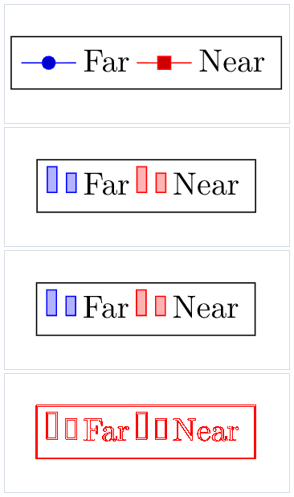
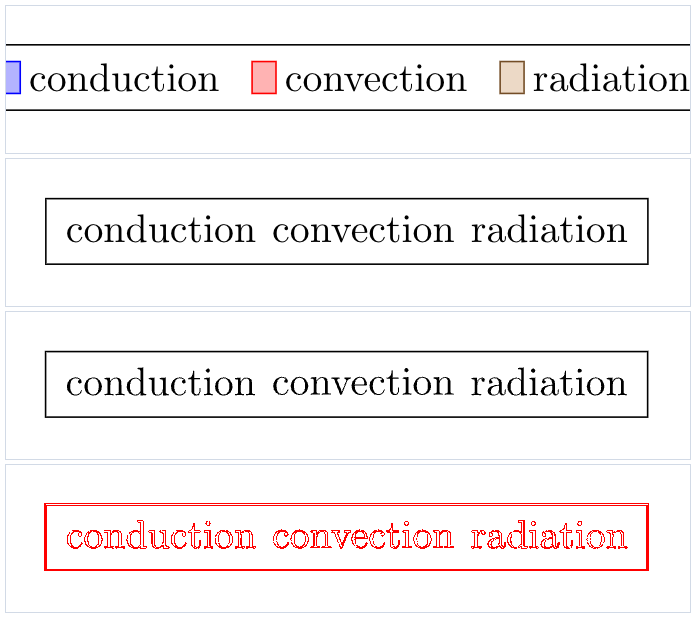

# PGFPlots filled legend images

Scope: the stock area and bar images and their image/text matrix, not the
entire chart. The six sources are in the [fixture manifest](../../test/fixtures/pgfplots-filled-legends/manifest.json).
Five come from the existing gallery; the grouped population chart is from the
installed PGFPlots manual (`pgfplots.reference.2dplots.tex`).

| Case | What changed | Before: frame size error | After: maximum glyph origin error |
| --- | --- | ---: | ---: |
| Stacked energy areas | Three color samples and text share a measured row | 12.01 pt | 0.002 pt |
| Stacked functions | Three rows align their rectangles with subscripted math | 1.67 pt | 0.003 pt |
| Grouped population bars | Two unequal 3 pt wide bars per entry, not a line and mark | 16.14 pt | 0.003 pt |
| Horizontal stacks | Single 6 pt thick bar shifted up by 0.2 ex | 12.02 pt | 0.004 pt |
| Vertical stacks | Single 6 pt wide bar shifted down by 0.2 em | 12.02 pt | 0.003 pt |
| Stacked intervals | Text only; the one-coordinate image has no interval to paint | 31.23 pt | 0.008 pt |

Before errors are rounded; after values are upper bounds in TeX points.
The strips below show **before, live editor, local tikztosvg, pixel difference**,
top to bottom. They use unchanged full-browser screenshots at one physical
scale, registered on the lower-left corner of the axes, not on the legend.
Text outlines can have different antialiasing even when glyph origins match.





## Native implementation

- TeX Live 2025: `kpsewhich pgfplots.code.tex`. The area image is a fixed
  0.6 by 0.2 cm rectangle. The ordinary bar image sets its own 3 pt width and
  samples 0.8 em and 0.6 em, regardless of the width of the data bars.
  The single horizontal and vertical images have *different* baseline shifts.
- `kpsewhich pgflibraryplothandlers.code.tex`: an interval handler stores the
  first coordinate and paints on the next. Both stacked-interval styles install
  a single-coordinate legend plot, so neither draws a rectangle. The ordinary
  x-interval and y-interval handlers use the same input points, not transposes.
- `kpsewhich pgfmodulematrix.code.tex`: each column and row shares signed image
  bounds, including the stroke where painted. The alternating text cells keep
  their own font metrics and forced depth. The [independent TeX probe](../../test/fixtures/pgfplots-filled-legend-metrics.tex)
  runs the installed image macros and prints the picture extents.

## Verification

The local reference was `/Library/TeX/texbin/tikztosvg` with pdfLaTeX,
rasterized by `rsvg-convert`; a separate MacTeX document render was also
inspected. Six live editor and six SVG-text comparisons had zero diagnostics.
In the editor: 16 rectangles, 97 glyph origins, maximum frame origin error
0.005 pt, sample corner or dimension error 0.004 pt, glyph error 0.008 pt.
Stroke width and opacity agreed within 0.001; RGB differed by at most one
8-bit channel value. These are geometry/paint gates, not pixel identity.

```sh
F=test/fixtures/pgfplots-filled-legends
Q=outputs/qa/2026-11-21-filled-legends/after
node --test test/pgfplots-filled-legends.test.js test/pgfplots-stacked-plots.test.js
pdflatex -halt-on-error -output-directory=/tmp test/fixtures/pgfplots-filled-legend-metrics.tex
node scripts/render-example-fixtures.js --fixtures "$F" --output "$Q" --tikztosvg-engine pdflatex --native-reference --math-renderer svg-text --no-comparison-grid
node scripts/audit-module-regressions.js --fixtures "$F" --output "$Q" --browser-module "$PLAYWRIGHT_MODULE" --workbench
node scripts/measure-text-legend.mjs "$Q" "$PLAYWRIGHT_MODULE" --filled area-energy area-functions manual-grouped stacked-horizontal stacked-vertical stacked-interval
```

Set `PLAYWRIGHT_MODULE` to the local Playwright `index.mjs`. The audit directory
contains `browser-audit.html`, `mactex-png/`, `tikztosvg-svg/`, `tikztosvg-png/`,
the live editor SVG/PNG pairs and `text-legend-metrics.json`. Pass
`--before <saved-audit-directory>` to the browser audit for the extra before panel.

**Still visible outside the legend:** in the grouped population chart the two
data series overlap instead of standing side by side, and the value labels use
the raw population rather than the authored `point meta=y *10^-7`. The default
standalone page margins also differ in several charts. Custom legend image code
and arbitrary per-series plot handlers are not certified here.
