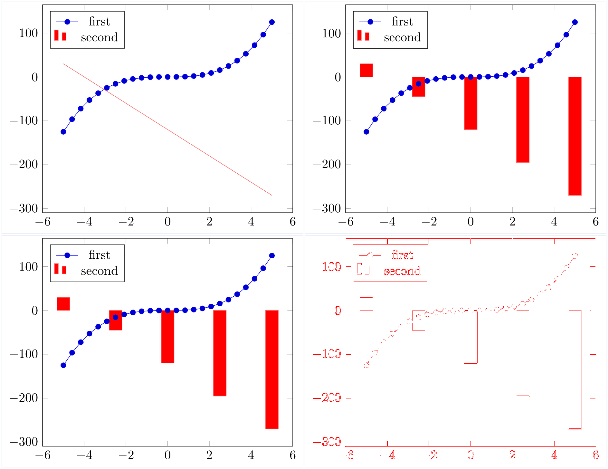

# Sampled bars and marker paint order

The blue cubic in the PGFPlots manual is a line with marks; its second
expression is five red bars. TikZKit used to connect both expressions with
lines. Restoring the rectangles exposed a second bug: a later bar covered
blue marks which TeX paints in front of it.



In reading order: before, live workbench, local tikztosvg, registered
difference. The difference is not empty: glyph antialiasing and thin
edges still differ. The plots were registered at the lower-left axis corner,
without stretching either picture.

| [Source cases](../../test/fixtures/pgfplots-function-bars/manifest.json) | Checked against MacTeX |
| --- | --- |
| Manual cubic + bars | The cubic keeps its markers; the five samples of the second expression become red rectangles with a separate outline. The blue marks remain visible where they overlap the bars. |
| Individual clipping | Three later red bars cover the three blue dots; the blue connecting line is still visible in the gaps. |
| Function + coordinates | Both series have five bars, their own slots and their own value labels. |
| Nonuniform horizontal bars | Four explicit samples supply the data ticks. Negative labels sit on the left; positive labels sit on the right. |

## Native implementation

- TeX Live 2025: the installed manual example is in
  `pgfplots.reference.axisdescription.tex` (the `ybar legend` example).
  In `pgfplotscoordprocessing.code.tex:5474-5558`, expression input prepares
  a coordinate stream and the domain or explicit samples; the selected
  handler still decides whether to connect points or draw bars.
- `pgfplots.markers.code.tex:34-108` selects when to draw marks.
  With global clipping, unclipped marks are postponed. With individual
  clipping or clipped marker paths they stay with their own series.
  `pgfplots.code.tex:9642-9652` flushes postponed marks after the axis pass.

## Reproduce

`PLAYWRIGHT_MODULE` is the absolute path to a local Playwright `index.mjs`.
The reference SVGs used `/Library/TeX/texbin/tikztosvg`, and a separate
pdfLaTeX run produced the native PNGs.

```sh
F=test/fixtures/pgfplots-function-bars
Q=outputs/qa/2026-11-21-function-bars/release
node --test test/pgfplots-function-bars.test.js test/pgfplots-grouped-bars.test.js
node scripts/render-example-fixtures.js --fixtures "$F" --output "$Q" --native-reference --tikztosvg-engine pdflatex --math-renderer svg-text --no-comparison-grid
node scripts/audit-module-regressions.js --fixtures "$F" --output "$Q" --browser-module "$PLAYWRIGHT_MODULE" --workbench
node scripts/measure-grouped-bars.mjs "$Q" "$PLAYWRIGHT_MODULE" --solid-paint
```

`browser-audit.html` holds the live output, reference, SVG-text export and
a link to the native PNG for each chart. `bar-metrics.json` records the
frame-registered measurements. In a clean checkout the four charts produced
zero diagnostics. The maximum error for measured bounds and glyph positions
was below 0.03 TeX pt. All 31,195 sampled flat-color interiors in the live
charts matched within two RGB levels; the same check caught the hidden blue
marks even when the bar bounds already matched.

This verifies ordinary two-dimensional function bars, not stacked or
interval function handlers, arbitrary marker layers, or whole-page pixel identity.
