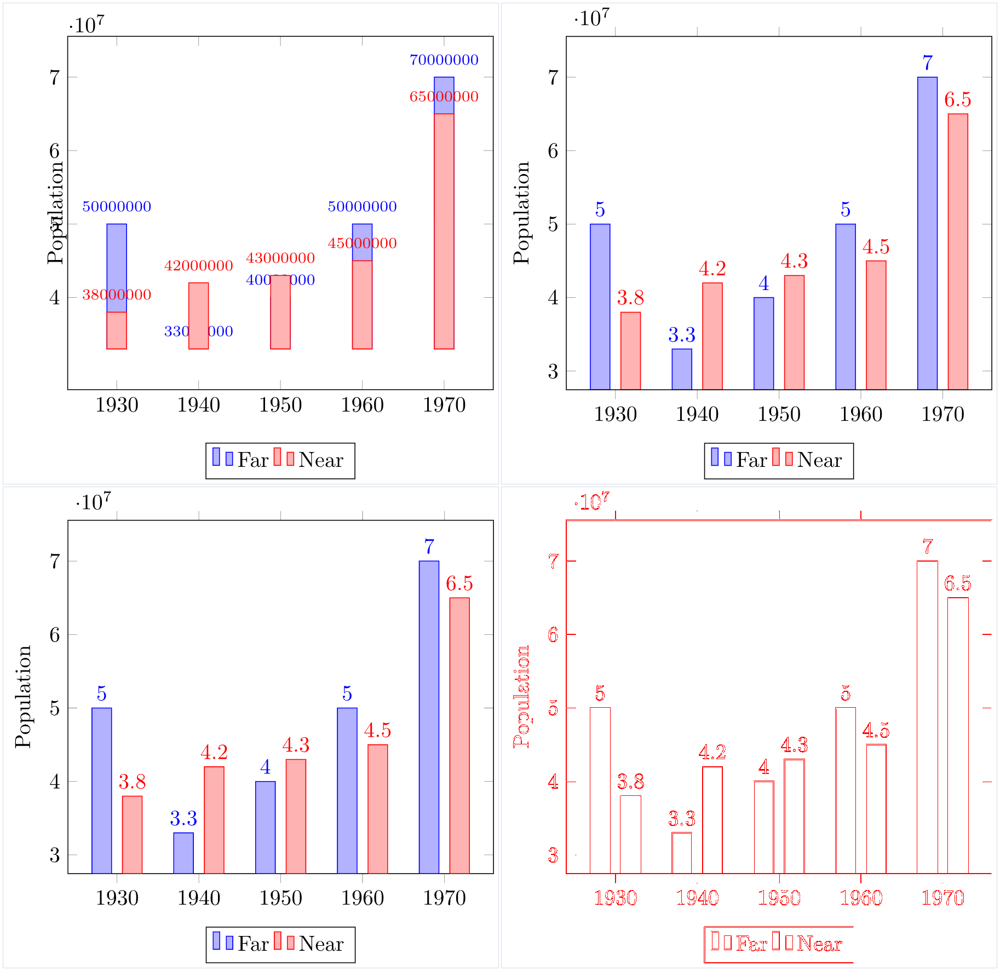

# PGFPlots grouped data bars

This follows the [filled-legend audit](2026-11-21-filled-legends.md). The
[four sources](../../test/fixtures/pgfplots-grouped-bars/manifest.json) exercise
ordinary two-dimensional `xbar` and `ybar` coordinate series on boxed axes.
Three are examples from the installed PGFPlots manual, not drawings traced from screenshots.

| Example | Before | Verified in the live editor |
| --- | --- | --- |
| Population | Two series overpainted each other; bars floated above the frame. Numbers were raw populations. | Each year has two 9 pt bars separated by 5 pt. Both start at the visible lower bound; the first pair reads 5 and 3.8. The 30-million tick, multiplier and vertical title are in place. |
| Participant counts | The labels printed the category indices and the x title overlapped the ticks. | The ends read 3 and 7. Both bars are 10 pt thick. The title sits below the tick labels. |
| Horizontal bars in data units | The second series covered the first. | At each category the two 2-unit-wide bars touch, with no gap or overlap. |
| Mixed signs with a line | Positive and negative bars used the same slot across series. | Only bar series count towards spacing. Labels follow their own tip, above positive and below negative values. |

In reading order: before, live editor, local tikztosvg, registered pixel difference.
All four crops have the same physical scale and lower-left axis origin.



## Native implementation

- `pgfplots.code.tex:3401-3491`: the shift is `(seriesIndex - (count-1)/2) * (width + gap)`, with a default gap of 2 pt. The style sets category ticks outside and incorporates the shift into nodes near coordinates. A bare TikZ handler does not install this PGFPlots style.
- `pgflibraryplothandlers.code.tex`: a regular bar extends half its width on each side of the shifted category position; the initial width is 10 pt. `pgfplotsplothandlers.code.tex:414-491` distinguishes physical lengths from unitless widths and shifts (category units from compatibility 1.7, points before then).
- `pgfplotscoordprocessing.code.tex`: metadata expressions run on surveyed coordinates; counts are per actual plot handler. `pgfplots.code.tex:4875-4927` uses the metadata source and sign for automatic node alignment. The horizontal default is x, not the symbolic y index.
- `pgfplotsticks.code.tex:460-496,1140-1148`: descriptions clear the measured tick boxes and automatic ticks are checked against final axis limits. `pgfplots.code.tex:888-901` puts the modern y multiplier at the starred tick coordinate `1.03,-0.3em`, independently of the widths of the tick labels.

## Reproduce

```sh
F=test/fixtures/pgfplots-grouped-bars
Q=outputs/qa/2026-11-21-grouped-bars/after
node --test test/pgfplots-grouped-bars.test.js test/pgfplots-stacked-plots.test.js
node scripts/render-example-fixtures.js --fixtures "$F" --output "$Q" --native-reference --tikztosvg-engine pdflatex --math-renderer svg-text --no-comparison-grid
node scripts/audit-module-regressions.js --fixtures "$F" --output "$Q" --browser-module "$PLAYWRIGHT_MODULE" --workbench
node scripts/measure-grouped-bars.mjs "$Q" "$PLAYWRIGHT_MODULE"
```

`PLAYWRIGHT_MODULE` is the local Playwright `index.mjs`. To add the before
panel, pass `--before <baseline-audit-directory>` to the browser audit.
`browser-audit.html`, `bar-metrics.json`, the independent `mactex-png/`
render and `tikztosvg-svg/` and `tikztosvg-png/` are in the output directory.
The reference used TeX Live 2025, `/Library/TeX/texbin/tikztosvg` and
`rsvg-convert`. Geometry comes from the actual browser transforms, not
resized thumbnails. Cairo can batch the fill and outline of several bars
separately, so the comparison reads both and checks each against the JS rectangles.

In an isolated checkout with only this change, all four live charts and all
four SVG-text exports passed: 28 bars, 32 colored glyph origins, all tick
and axis-description glyph origins, zero diagnostics. Maximum error for
those positions and dimensions was below 0.03 TeX pt; RGB differences were
at most one channel value. The population bar bounds previously differed
by up to 18.69 pt. This verifies the plotted geometry, not pixel identity or
the outer page margins. Function-sampled bars, error bars, custom metadata
callbacks and arbitrary per-series paint styles are not certified by these cases.
