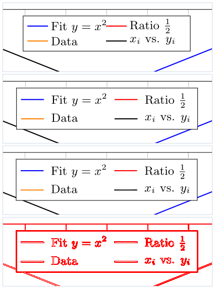
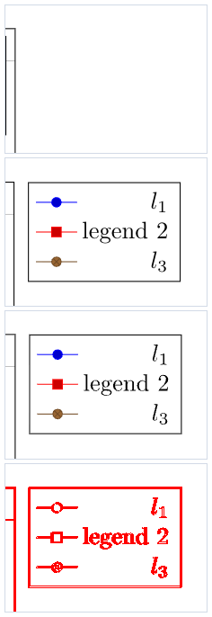
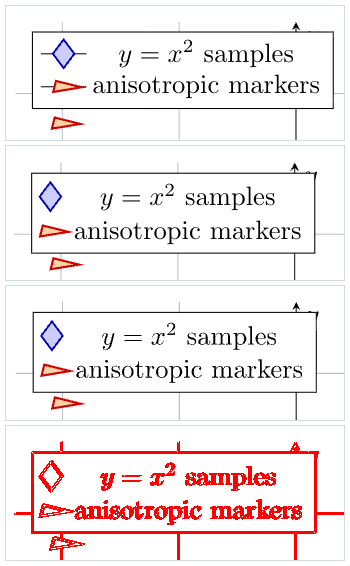

# PGFPlots line and scatter legends with inline math

The [manual example](../../test/fixtures/pgfplots-mixed-legends/manual-east.tex)
used to obscure the ends of three curves: its nested legend position was ignored.
The [fraction example](../../test/fixtures/pgfplots-mixed-legends/fraction-rows.tex)
put the second column's red line against a superscript. The
[scatter plot](../../test/fixtures/examples/plotmarks/mark-options-math.tex)
showed horizontal lines through its legend marks, although the data had none.

## What native TeX does

- In TeX Live 2025, `pgfplots.reference.axisdescription.tex` illustrates
  `cells={anchor=east},legend pos=outer north east` with `$l_1$, legend $2$,$l_3$`.
  In `pgfplots.code.tex` a position preset sets both `at` and `anchor` at that
  point in the key list. A later `at` or `anchor` can override it independently.
- `pgfplots.code.tex` builds alternating image/text matrix cells. Text and
  inline math share one TeX baseline. `font=\small` selects the actual 9pt
  text and smaller math-script fonts; the forced node depth stays `.15em`
  in the enclosing node font. The browser uses the packaged MacTeX metrics.
- `pgfmodulematrix.code.tex` measures signed extents about each cell origin.
  `only marks` discards the connecting path. The single mark at `.3cm`
  contributes its transformed shape, not the two unpainted endpoints at 0 and
  .6cm. Neither the triangle nor its bounds have to be symmetric.
- In `pgflibraryplotmarks.code.tex`, `otimes*` fills and strokes a single path
  containing both the circle and cross. In the default `color` cycle its pen is
  `brown!60!black` and its fill is `brown!80!black`; using the fill for the pen
  makes the cross disappear. `pgfcorepathconstruct.code.tex` closes the round
  subpath and moves back to its center. We retain it until the single quick
  paint, preserving the original physical radius and the next segment's origin.

## Browser evidence

Chrome rendered the authored TeX through the editable workbench. The independent
references were local `/Library/TeX/texbin/tikztosvg` (PDFLaTeX and librsvg) and
a native MacTeX PDF raster. No fixture produced a render diagnostic or a browser
error. Physical offsets are measured relative to a **data point**, not fitted to
the legend. Values below are maximum absolute differences in TeX points:

| Case | Before: visible discrepancy | Live frame position / size | Live glyph origins |
| --- | --- | ---: | ---: |
| Manual, east-aligned | Frame almost 70pt too far inside | 0.008 / 0.006 | 11/11, <0.003 |
| Small two-column legend | Frame 10.4pt too narrow; glyphs displaced up to 16.2pt | 0.002 / 0.002 | 25/25, <0.005 |
| Affine scatter marks | Two extra strokes; frame 6.7pt too wide | 0.002 / 0.004 | 29/29, <0.005 |

The table is from the working tree. A separate checkout containing only this
change also passed: all 65 glyphs within 0.005pt, frame origins within 0.009pt,
and marker bounds within 0.021pt of tikztosvg.
As a control, the existing KIT chart kept all 50 glyphs within 0.006pt and
all three marker bounds within 0.003pt of the reference.

Each strip shows **before, live browser, tikztosvg, pixel difference**. The
manual example's old upper-right margin is empty because its frame was inside
the plot. Residual antialiasing and document margins are not pixel-identical.





## Coverage and reproduction

Checked: `\legend`, `\addlegendentry`, `\addplot … coordinates`, `legend pos`,
`legend style`, `at`, `anchor`, `cells={anchor=east}`, `legend cell align=left`,
`legend columns=2`, `column sep=3pt`, `row sep=2pt`, `font=\small`,
literal/inline/pure math, `^`, `_`, `\frac`, default line samples, `mark=none`,
`only marks`, `mark size=4pt`, `mark options`, `every mark/.append style`,
`scale`, `xscale`, `yscale` and `rotate`. Custom legend images, text marks,
rich or multiline TeX cells, and bar/area images are not certified here.

The [TeX probe](../../test/fixtures/pgfplots-mixed-legend-metrics.tex) reports
matrix anchors and text baselines independently of SVG. Set `PW` to a local
Playwright module with Chrome installed to also repeat the browser comparison:

```sh
fixtures=test/fixtures/pgfplots-mixed-legends
out=outputs/qa/mixed-legends
pdflatex -interaction=batchmode -output-directory=/tmp test/fixtures/pgfplots-mixed-legend-metrics.tex
node --test test/pgfplots-legend-metrics.test.js
node scripts/render-example-fixtures.js --fixtures "$fixtures" --output "$out" \
  --tikztosvg-engine pdflatex --native-reference --math-renderer svg-text --no-comparison-grid
node scripts/audit-module-regressions.js --fixtures "$fixtures" --output "$out" \
  --browser-module "$PW" --workbench
node scripts/measure-text-legend.mjs "$out" "$PW" manual-east fraction-rows affine-marks
```

The audit writes `browser-audit.html`, `text-legend-metrics.json`, the workbench
captures, `tikztosvg-svg/`, `tikztosvg-png/` and `mactex-png/`. Passing
`--before <baseline-directory>` to the browser audit adds the old rendering.
