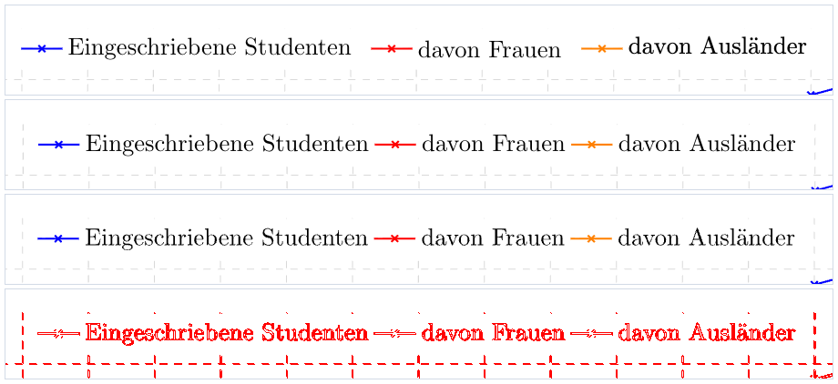
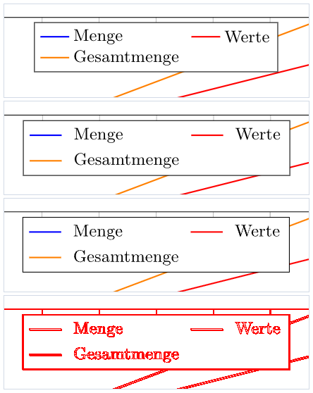

# PGFPlots multi-column text legends

The [KIT student-count chart](../../test/fixtures/examples/latex-examples/csv-line-plot-kit-students.tex)
and a [two-column control](../../test/fixtures/pgfplots-text-legend/small-rows.tex)
now lay out line samples and literal upright Computer Modern labels as a PGF matrix.
Previously the student legend spread its three entries too far apart, and
the entire third label used fallback typography because of the accent in *Ausländer*.
The small control had the opposite fault: its frame was too narrow, the colored
samples were too short, and the second row sat too close to the first.

## Source and scope

- TeX Live 2025, `pgfplots.code.tex`: `every axis legend` uses 3pt horizontal
  and 2pt vertical padding around the matrix, not around each entry. Cell nodes
  have 2pt padding and a forced text depth of .15em. The default line image
  visits 0, .3 and .6cm and puts the mark in the middle.
- `pgfmodulematrix.code.tex` takes the widest cell in each physical column and
  the highest row extent. Image and text are separate cells; explicit `column sep`
  applies both between them and between entries. `font=\small` changes the text
  hbox, not the line length or the surrounding node font used for the forced depth.
- `pgfplots.code.tex` declares `yticklabel style` as an alias for `y tick label
  style`. The plot geometry and tick renderer now read the same styles.
  `pgfplots.scaling.code.tex` subtracts 45pt from the requested width of this
  unscaled-tick axis. Mistaking it for a scaled-tick axis had also displaced the
  centered legend by 0.70pt.
- `ot1enc.def` declares the diaeresis as a separate accent. The bundled MacTeX
  metrics determine its horizontal centering, elevation above the font's x-height,
  and single base-glyph advance. The reference SVG likewise places accent and
  base as separate glyphs. The browser group retains the original readable text.

Checked here: `\legend`, `\addplot` with lines and center marks, `legend columns=-1`
and `2`, `at`, `anchor=north`, `draw=none`, left and centered cells, `column sep`,
`row sep`, `font=\small`, a short final row, and literal ä/ö/ü and their uppercase
forms in upright CM. The student chart uses `table` with three CSV columns and
`scaled ticks=false` inside `yticklabel style`. This does not change CSV parsing.
It does not certify arbitrary T1 fonts/accents, formatted or mixed-text cells,
bar/area legend images, or complete PGFPlots coverage.

## Browser evidence

Chrome rendered each source through the editor with its real data. We checked
this SVG, the exported SVG, `/Library/TeX/texbin/tikztosvg`, and independent
native PDF-to-PNG output. The table gives maximum differences in TeX pt against
tikztosvg, with no resizing. Frame placement uses the first blue **data point**
as a common origin; individual labels are not independently aligned.

| Chart | Frame size error, before / live | Frame placement, before / live | Live sample error | Live glyph origins |
| --- | ---: | ---: | ---: | ---: |
| KIT students | 11.550 / 0.002 | 6.475 / 0.002 | 0.004 | 50/50; at most 0.006pt |
| Small, incomplete row | 12.391 / 0.003 | 6.192 / 0.002 | 0.002 | 21/21; at most 0.004pt |

Each case had zero render diagnostics and no browser errors. The native geometry
check is not a pixel-identity claim: the wrapper's document crop and the
rasterization of the outlined reference glyphs still differ from browser text.

Aligned crops below: **before, live browser, local tikztosvg, pixel difference**
from top to bottom. Both renderers retain their authored scale.




## Reproduce

The [independent MacTeX probe](../../test/fixtures/pgfplots-text-legend-metrics.tex)
prints the text boxes, sample origins, and cell baselines. The numeric regression
is in [pgfplots-legend-metrics.test.js](../../test/pgfplots-legend-metrics.test.js).
For the browser comparison, set `PW` to the installed Playwright module path and run:

```sh
verify_legend() {
  fixtures="$1"; id="$2"; out="outputs/qa/text-legends/$id"
  node scripts/render-example-fixtures.js --fixtures "$fixtures" --only "$id" --output "$out" \
    --tikztosvg-engine pdflatex --native-reference --math-renderer svg-text --no-comparison-grid &&
  node scripts/audit-module-regressions.js --fixtures "$fixtures" --only "$id" --output "$out" \
    --browser-module "$PW" --workbench &&
  node scripts/measure-text-legend.mjs "$out" "$PW" "$id"
}
verify_legend test/fixtures/examples latex-examples-csv-line-plot-kit-students
verify_legend test/fixtures/pgfplots-text-legend small-rows
```

Each audit writes `browser-audit.html`, `text-legend-metrics.json` and
`browser/<id>-legend-sheet.png`. The strip shows live browser, reference,
and pixel difference; passing `--before <previous-output>` to the browser
audit prepends the old rendering. Native PNGs are in `mactex-png/` and
reference SVGs in `tikztosvg-svg/`.
