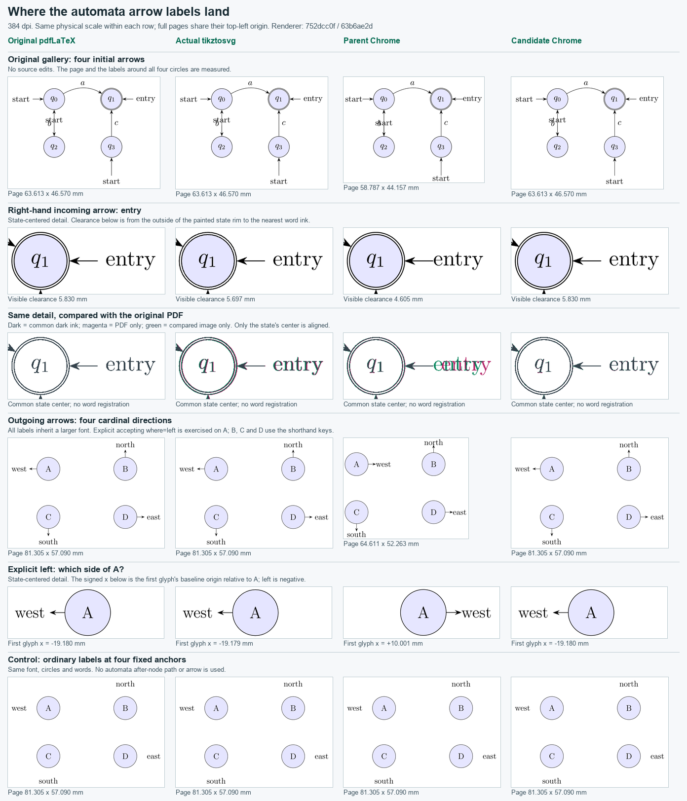

# Where automata arrow labels start

In the [original automaton](../../test/fixtures/examples/automata/initial-accepting-states.tex),
the horizontal arrows used to run directly into `start` and `entry`; the
bottom `start` was too close to its shaft. The browser picture was 4.826 mm
narrower and 2.413 mm shorter than the original PDF. The widths of the words
were already right. Enlarging the font or moving the state circles would have
fixed neither the gap nor the cropped page.

| Measurement | Previous Chrome | Corrected Chrome | Original PDF |
| --- | ---: | ---: | ---: |
| Original automaton page | 58.787 x 44.157 mm | 63.613 x 46.570 mm | 63.613 x 46.570 mm |
| Visible gap, accepting circle rim to incoming word `entry` | 4.605 mm | 5.830 mm | 5.830 mm |
| First glyph of `west`, relative to state A on an outgoing arrow | +10.001 mm | -19.180 mm | -19.180 mm |

The original diagram puts the upper `start` on top of another transition
label. That overlap is also present in the native drawing; it has not been
silently rearranged. The unchanged plain-node control keeps the same page.

## Native rules

- MacTeX's `tikzlibraryautomata.code.tex` adds a separate edge after the state.
  Its distant coordinate is the state's numeric angle anchor shifted by the
  chosen distance (default `3ex`). Its other endpoint is the state itself, so
  the connecting ray is intersected with the state border. Rotation can make
  this ray different from the original angle. Entry and exit use the same
  geometry with opposite arrow directions.
- At the distant coordinate PGF places an ordinary rectangular node. On the
  left it uses the east anchor, on the right the west anchor, above the south
  anchor, and below the north anchor. `pgfmoduleshapes.code.tex` includes
  outer separation in these anchors, not in the rectangle's background.
  Even an empty label has a background extent in the picture, without ink.
- In `tikz.code.tex`, the state text group ends before the arrow path starts.
  An unnamed state gets an internal reference. The edge has its own font,
  pen, separation and color settings. `\tikzaddafternodepathoption` both
  assigns a parameter and prepends its assignment for replay, so the *first*
  assignment on the node wins at arrow time. Picture-level values are defaults.
  The examples and the four cardinal aliases are documented in
  `pgfmanual-en-library-automata.tex`.

The library now uses the normal inline-node layout for that rectangle rather
than a separate SVG text-placement formula. At 10 pt the `entry` text box
starts 3.533 TeX pt beyond the arrow endpoint: 0.3333 em inner separation
plus the default 0.2 pt outer separation. The state remains in place.

## Coverage

The [native probe](../../test/fixtures/automata-arrow-labels.tex) measures label
centers and picture dimensions in 17 configurations. It covers `state`,
`initial`, `initial by arrow`, `accepting by arrow`, the four directional
shorthands, `initial/accepting where`, `text`, `distance`, the edge and node
style hooks, anonymous states, unpainted empty labels, math, rotation and
uniform scaling with and without `transform shape`. Another test checks that
a later unrelated node and line keep their original font, color and pen.

Run the independent measurements with
`AUTOMATA_PDFLATEX="$(command -v pdflatex)" node --test test/automata-arrow-labels.test.js test/automata.test.js`.

The [browser replay](../../test/fixtures/native-automata-arrow-labels/README.md)
compares the loaded Chrome workbench, an actual downloaded SVG, and CLI output
to the original PDF and to `/Library/TeX/texbin/tikztosvg` rasterized with
`rsvg-convert`. The converter SVG has glyph paths in definitions and
positioned `use` elements; its original page and glyph positions are measured
without fitting each image to the other. All 72 JS-to-native comparisons and
24 reference cross-checks passed (previously 48 of 96 passed). The original
gallery's first-glyph offsets relative to the state centers agree with the
PDF within 0.002 mm in Chrome. Raster ink varies by backend; the full
acceptance limits are 0.02 mm for vectors and 0.20 mm for ink.

This is a label and picture-boundary check, not a certification of arbitrary
custom after-node code, all curved transition paths or every arrow-tip contour.
