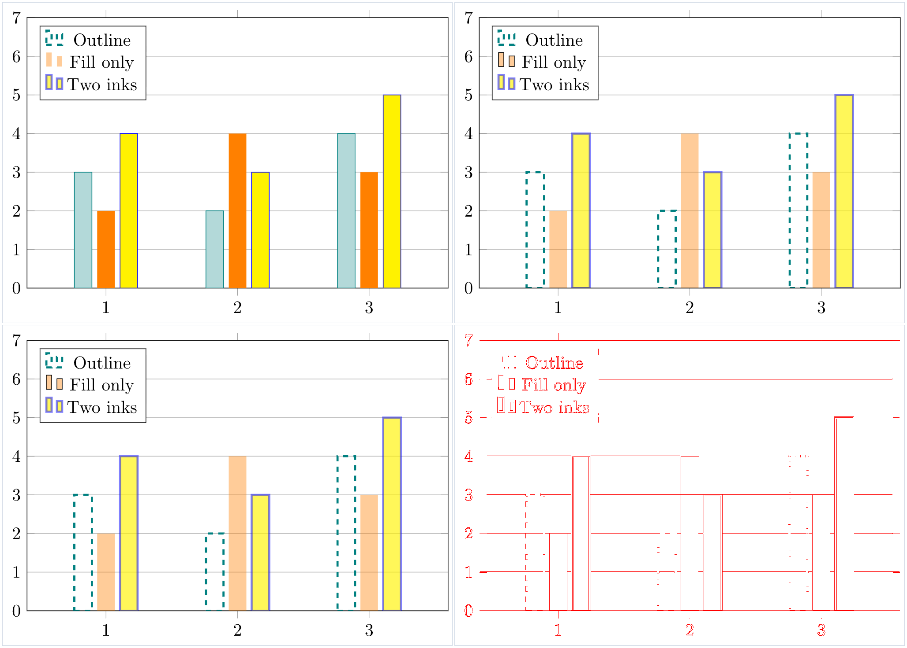

# Hollow bars, marker positions and legend paint

The PGFPlots manual's per-series `\addplot+[ybar]` and `\addplot+[xbar]`
examples are hollow and have a dot at every sample. TikZKit used to add a
pale blue fill and omit all eleven dots. An axis-wide bar style is different:
its default cycle explicitly enables a fill and disables marks.



In reading order: previous output, live workbench, local tikztosvg, and
their registered difference. The orange bars have no outline in the plot,
but the two orange legend bars do have a black outline in TeX. The teal
series is hollow and dashed; the yellow fill and blue outline have separate
opacities. Remaining differences are concentrated along thin edges and text.

## What the five fixtures verify

| [Source fixtures](../../test/fixtures/pgfplots-bar-paint/manifest.json) | Browser observation |
| --- | --- |
| Manual vertical and horizontal | Five and six unshifted sample dots, respectively. No fill inside the rectangles. |
| Grouped ink | Hollow dashes, fill only, and separate fill and pen. The three miniature legend samples inherit the inks but start new draw paths. |
| Horizontal ink | A bare fill uses the current fill color, not the pen. Later opacity keys override the appropriate channel. Custom dash lengths and round joins survive. |
| Cycle ink | A bare color replaces both cycle inks. An explicit pen changes only the stroke. Marks use the surveyed point even if grouping moves its bar. |

In a clean checkout, all five live charts and SVG-text exports were compared
to local `tikztosvg`, with a separate native PDF-to-PNG reference for each.
The live comparison covered 34 data bars, 13 data dots, 18 miniature bars
and two legend dots. Rectangle and marker bounds agreed within 0.024 TeX pt;
the effective opacities matched and the largest RGB channel difference was
one byte. Of 22,441 flat-color interior samples in Chrome, 19,879 differed
before the fix and none afterwards (two-byte tolerance). This is not a
claim of whole-image pixel identity or support for arbitrary patterns,
custom legend programs or error bars.

## MacTeX sources

- TeX Live 2025, `pgfplots.reference.2dplots.tex`: the documented `xbar` and
  `ybar` examples supply coordinates to the per-plot handler.
- `pgflibraryplothandlers.code.tex:405-436`: the handler builds rectangles;
  it does not choose a fill. `pgfplots.code.tex:3370-3400` defines the axis
  bar cycle and the stock legend sample paths; `5843-5851` applies the plot
  style to a scope and invokes the legend drawing code inside it.
- `tikz.code.tex:242-274,507-531`: colors and draw/fill actions are separate;
  `opacity` sets both channels. Keys act in source order.
- The independent reference SVG sometimes emits separate fill and stroke
  paths or combines several rectangles in one path. The browser check
  compares paint per shape and channel, registered at the physical axis
  corner without stretching the plots to match.

## Reproduce

`PLAYWRIGHT_MODULE` is the absolute path to a local Playwright `index.mjs`.
The native converter on this machine is `/Library/TeX/texbin/tikztosvg`.

```sh
F=test/fixtures/pgfplots-bar-paint
Q=outputs/qa/2026-11-25-bar-paint/final
node --test test/pgfplots-bar-paint.test.js
node scripts/render-example-fixtures.js --fixtures "$F" --output "$Q" --native-reference --tikztosvg-engine pdflatex --math-renderer svg-text --no-comparison-grid
node scripts/audit-module-regressions.js --fixtures "$F" --output "$Q" --browser-module "$PLAYWRIGHT_MODULE" --workbench
node scripts/measure-grouped-bars.mjs "$Q" "$PLAYWRIGHT_MODULE" --bar-ink --solid-paint
```

Open `browser-audit.html` in the output directory for the individual cases.
The same directory contains the native PNGs, reference SVGs and PNGs, and
`bar-metrics.json`. Add `--before <earlier-output-directory>` to the browser
audit to include the previous JS rendering in the comparison sheet.
