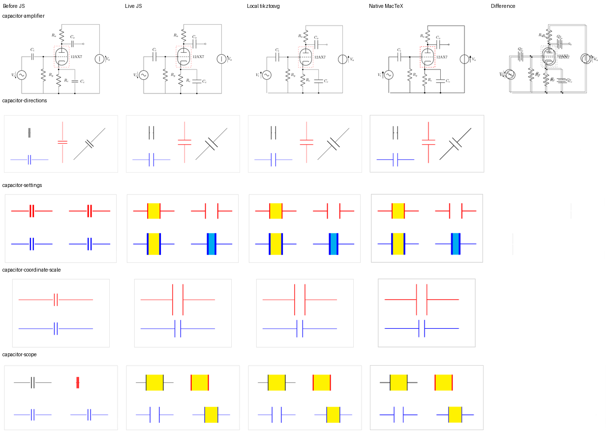

# Fixed parallel-plate capacitors

Four controls and the [manual's triode amplifier](../../test/fixtures/circuitikz-tubes/amplifier.tex) exercise the same fixed capacitor implementation. No picture-specific coordinates or reference SVGs are used by the renderer.



## Native behavior

The reference is the local MacTeX / TeX Live 2025 tree, Circuitikz 1.8.3. Source files are under `texmf-dist/tex/generic/circuitikz/`:

- `pgfcirc.defines.tex` (lines 59-65, 449-466, 511-548, 694-805, 991 and 1028-1030): Rlen is 1.4 cm. Bipole dimensions use Rlen times the class scale; a class pen of `none` uses the legacy multiplier. When the local fill is cleared, the class fill can still paint the body.
- `pgfcircbipoles.tex` (903-904, 930-977): the class width and height setters assign concrete bipole keys. The default straight capacitor is 0.2 Rlen wide and 0.6 Rlen tall. Circuitikz fills the rectangle without outlining it, then strokes the two plates as separate subpaths.
- `pgfcircpath.tex` (128-177): the component sits between the terminals; its left and right anchors also terminate the two wire portions. A short connection does not shrink the physical component.
- `doc/latex/circuitikz/circuitikzmanual.tex` (2511-2531, 5582-5594): class settings and the triode amplifier example.

Exercised: `to[C]`, `to[capacitor]`, `\ctikzset`, `bipoles/length`, `bipoles/capacitor/width` and `height`, `capacitors/width`, `height`, `scale`, `fill`, `thickness`, `bipoles/thickness`, local `fill`, conductor color and `line width`, scoped settings, uniform `scale` with and without `transform shape`. A local colored fill overrides the class; `fill=none` clears the local override, while `capacitors/fill=none` disables the class fill itself. Polar, curved and variable capacitors, named terminal anchors and arbitrary anisotropic transforms are not certified by this check.

## What changed on screen

Previously the ordinary symbol had a 0.14 cm plate gap instead of 0.28 cm; both wires stopped 0.07 cm short. The plates were 0.60 cm tall instead of 0.84 cm, class fills were absent, and short connections compressed the gap further. The new wire ends coincide with the plate centers. Filled bodies paint over the completed wire, including on connections shorter than the symbol.

The four controls cover reversed and diagonal paths, a short connection, scoped and per-component settings, pen ratios (3 and 1.25), fill overrides and a 1.8x transform. At original physical scale all four clear the 0.95 whole-image ink check in **both** the live workbench and SVG-text, with scores from 0.9996 to 1.0000. None cleared it before. All five sources render in MacTeX, tikztosvg and TikZKit with zero TikZKit diagnostics and no browser errors.

Measurements in Chrome use its actual SVG transformation matrices at intrinsic size. Across 17 capacitors, including all three amplifier capacitors, the largest plate-gap error is under 0.004 CSS px; the largest plate-span error is under 0.005 CSS px. No image fitting or rescaling is used. The check also compares pen width, orientation, stroke color and relative centers. Whole-page position is reported separately.

**The amplifier is not a whole-image pass.** Its component/voltage annotations and preview bounds still differ. Its three capacitors match in size and relative position, but the unequal page origin still shifts them by about 6.5 CSS px on the full page. A size mismatch is a failed whole-image comparison, not a zero-error result.

## Reproduce

With local MacTeX, `tikztosvg` (here `/Library/TeX/texbin/tikztosvg`), `rsvg-convert`, Chrome and Playwright available:

```sh
SUITE=test/fixtures/circuitikz-capacitor-plates
OUT=outputs/qa/capacitor-plates
PW=$(node --input-type=module -e "import {fileURLToPath} from 'node:url'; console.log(fileURLToPath(import.meta.resolve('playwright')))")
node --test test/circuitikz-capacitor-plates.test.js
node scripts/render-example-fixtures.js --fixtures "$SUITE" --output "$OUT" --native-reference --strict-tikztosvg --math-renderer svg-text --no-comparison-grid
node scripts/audit-module-regressions.js --fixtures "$SUITE" --output "$OUT" --workbench --browser-module "$PW"
node scripts/audit-capacitor-plates.mjs "$OUT" "$PW"
node scripts/measure-vector-ink.mjs "$OUT"
```

Set `PW` to the path to the local Playwright module if it is installed outside the project. Native PNGs are in `mactex-png/`; independent SVG/PNG references in `tikztosvg-svg/` and `tikztosvg-png/`; browser panels in `browser/` and `browser-audit.html`. The last command intentionally reports the two amplifier panels below threshold.
