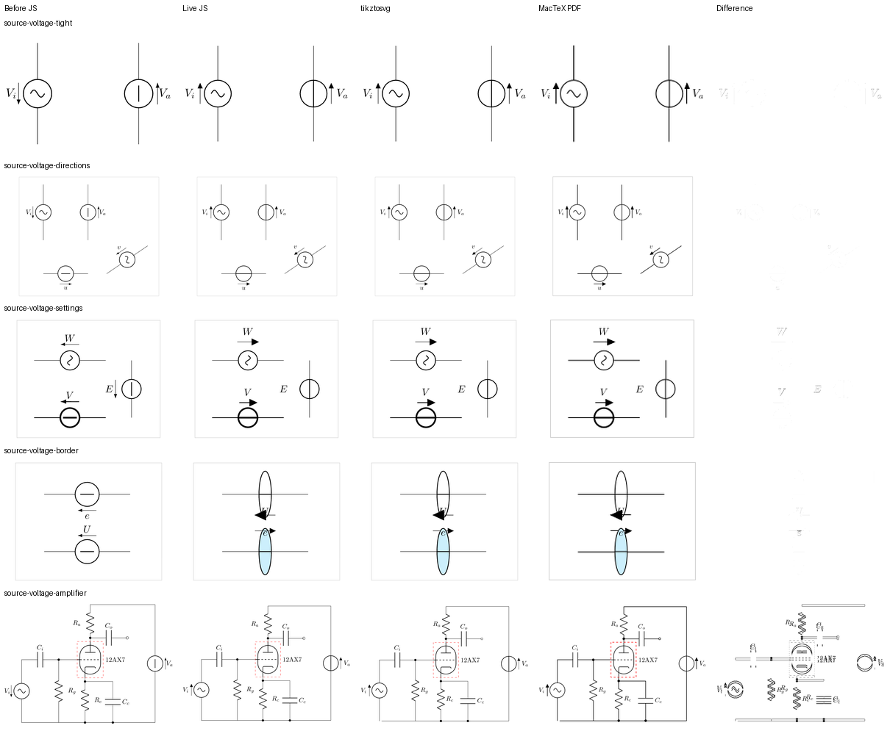

# European generator voltage annotations

Four [controls](../../test/fixtures/circuitikz-source-voltage/manifest.json) and the [manual's triode amplifier](../../test/fixtures/circuitikz-tubes/amplifier.tex) exercise the same generator implementation. The inputs are rendered by browser JavaScript, not by embedding the reference SVG.



## Source and scope

Reference: the local MacTeX / TeX Live 2025 tree, Circuitikz 1.8.3. Source paths below are relative to `texmf-dist/tex/generic/circuitikz/`.

- `pgfcircvoltage.tex` (25-104, 371-420, 469-526, 553-650) selects the direction, side, border anchors and label. Independent generators default to a forward, above-path arrow. The 60/120 degree rays hit a **rectangular** border, even for a round source. The bump scales the border position; an additional shift translates it normally by a fraction of the arrow span. Label clearance is separate from the 2 pt node padding. Near a cardinal path angle TikZ uses a side anchor; otherwise it uses a corner.
- `pgfcirc.defines.tex` (694-787, 990, 1058, 1147, 1169-1199, 1224-1245) supplies the bipole length, border margin, arrow scale, bump and label distances. The generator symbol and its arrowhead are not scaled by the same keys.
- `pgfcircshapes.tex` (413-458) defines the filled and stroked `currarrow`: the tip sits at the shaft endpoint; the base lies 1.7 steps behind, with a half-width of 0.8 steps. Each step is Rlen divided by the current arrow scale. There is no SVG end marker or marker shortening here.
- `pgfcircbipoles.tex` (1932-1933, 2280-2299) draws a European voltage source's interior line across its full diameter. `doc/latex/circuitikz/circuitikzmanual.tex` (5582-5594, 9585-9599, 9829) provides the amplifier and voltage customization examples.

Exercised commands and options: `\draw ... to[V]`, `sV`, `V<`, `v_>`, `v^<`, `v_<`; voltage text including subscripts; `\ctikzset`, `\begin{scope}`, `bipoles/length`, `sources/scale`, `bipoles/vsource/width` and `height`, `bipoles/border margin`, `voltage/bump a`, `voltage shift`, `current arrow scale`, `no v symbols` (label stays visible), `voltage=straight`, European/straight label distances, local `bipoles/vsource/voltage/{bump a,additional shift}/.initial`, `fill` and conductor thickness. The narrow 0.24 by 0.9 Rlen source checks the short side of the rectangle; a scoped arrow scale of 8 checks that only the intended head grows.

Not certified by this suite: passive curved voltage arrows, controlled or American source conventions, every waveform alias and source variant, exported `Vfrom`/`Vlab` anchors, and nonuniform canvas transforms. No example-specific coordinates or font substitutions are used to place arrows or labels.

## Measured results

In Chrome, the amplifier input `sV=$V_i$` used to point down. It now points up. The output `V<=$V_a$` points up on its downward wire, the plain source now has a full interior diameter, and the two labels sit outside the shafts with the native spacing.

At fixed physical scale the four controls score 0.9937-0.9971 in both live workbench and SVG-text, up from zero full-image passes. All five sources rendered in all three engines, with zero TikZKit diagnostics and no browser errors. An independent browser geometry check found all 12 painted arrowheads in each JS mode. The largest error in direction vector, width, pen or relative tip position was below 0.005 CSS px. In the amplifier the four glyph origins relative to their corresponding tips were within 0.003 CSS px.

**The full amplifier is not a whole-image pass.** At 3x browser capture it went from 1057 x 748 to 1090 x 748; local tikztosvg is 1090 x 766. The generator tips are still about 4.16 CSS px higher on the page as a whole; the resistor labels also differ. The arrow-specific check does not excuse the failing full-image check or resize the reference.

## Reproduce

With local MacTeX, tikztosvg (here `/Library/TeX/texbin/tikztosvg`), rsvg-convert, Chrome and Playwright installed:

```sh
SUITE=test/fixtures/circuitikz-source-voltage
OUT=outputs/qa/generator-voltage
PW=$(node --input-type=module -e "import {fileURLToPath} from 'node:url'; console.log(fileURLToPath(import.meta.resolve('playwright')))")
node --test test/circuitikz-source-voltage.test.js
node scripts/render-example-fixtures.js --fixtures "$SUITE" --output "$OUT" --native-reference --strict-tikztosvg --math-renderer svg-text --no-comparison-grid
node scripts/audit-module-regressions.js --fixtures "$SUITE" --output "$OUT" --workbench --browser-module "$PW"
node scripts/audit-generator-voltage.mjs "$OUT" "$PW"
node scripts/measure-vector-ink.mjs "$OUT"
```

Set `PW` to the local Playwright module if it is installed outside the project. Open `browser-audit.html` to inspect the live/exported captures and the reference. Native PNGs are in `mactex-png/`; reference SVGs and PNGs in `tikztosvg-svg/` and `tikztosvg-png/`. See `generator-voltage-metrics.json` for per-head comparisons. The final whole-image command intentionally exits nonzero for the two amplifier panels.
