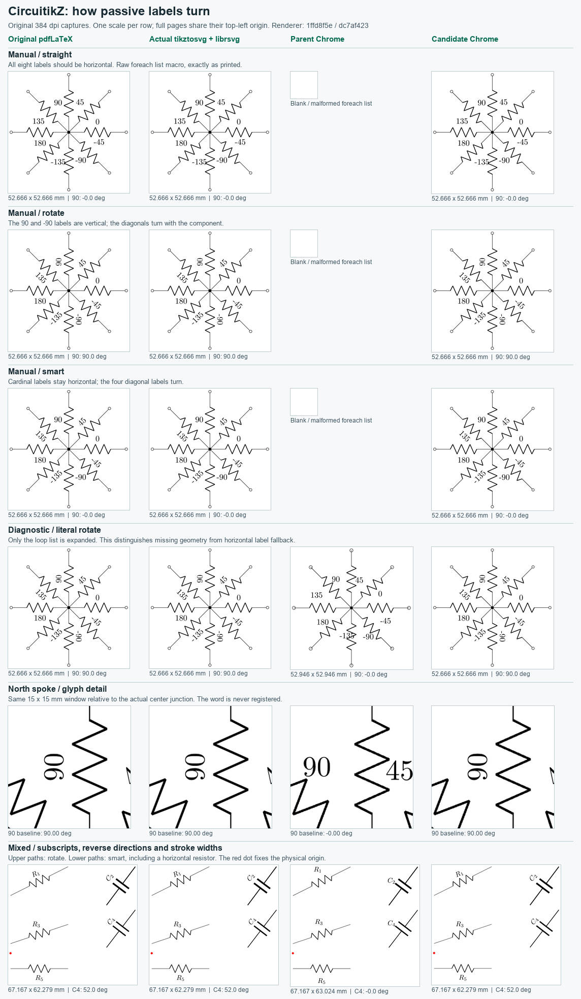

# CircuitikZ: eight directions, three label modes

The [three manual examples and two controls](../../test/fixtures/native-circuitikz-label-orientation/catalog/manifest.json) distinguish a missing picture from a label in the wrong place. The eight-resistor examples use the bodies of the local CircuitikZ manual verbatim. Each declares a list of signed angles and uses `\foreach \i in \DIR`, not a rewritten list of coordinates.

## Native rules

- **Iteration.** In TeX Live 2025, `pgffor.code.tex` distinguishes a brace list from a list macro. The latter supplies the values; the following group is the loop body. Negative angles and the source ordering must survive expansion.
- **Mode selection.** `circuitikz.sty` declares `straightlabels`, `rotatelabels`, and `smartlabels` and executes `smartlabels` by default. The picture or scope can override it with `\ctikzset{label/align=...}`. The printed examples are in `circuitikzmanual.tex:8868-8896`.
- **Direction and anchor.** `pgfcircpath.tex` computes the direction from the two saved endpoints. `pgfcirclabel.tex` starts at the body border on the selected side (`l^` or `l_`). Straight labels stay horizontal. Near a cardinal direction they use named anchors; in between, the label's padded rectangle meets the border on a ray. This rectangle includes a TeX strut.
- **Rotation.** The rotated branch places the text by its `mid` anchor, not its geometric center, and flips labels facing back along the path so they remain readable. It does not insert the straight-label strut. Smart mode rotates only when the integer remainder of the direction modulo 90 is strictly between 20 and 70 degrees.
- **Endpoints.** In `pgfcircshapes.tex`, both `circ` and `ocirc` draw the same circle: radius is `nodes width` times the bipole length. The default is `.04` of `1.4cm`. The open pole is filled before the picture is finished, so the lead stops visibly at its rim.

## Scope

The manual cases exercise `\def`, macro-list `\foreach`, polar coordinates, `\draw ... to[R=..., *-o]`, and all three alignment modes. A separate literal-list control isolates label layout from iteration. The mixed case adds fixed capacitors, explicit `l^` / `l_`, math subscripts, non-cardinal and reversed paths, and varying wire widths. This does not certify other component families, arbitrary TeX label content, annotations, or non-uniform transformations.

## Measurements

The [native anchor probe](../../test/fixtures/circuitikz-passive-label-anchors.tex) measures five named label anchors. With `TIKZKIT_TEST_PDFLATEX=1 CIRCUITIKZ_LABEL_SWEEP=1 node --test test/circuitikz-passive-label-geometry.test.js`, it exercises 41 controls plus every whole degree in each of the three modes. Across all 11,210 coordinates, the maximum difference from installed pdfLaTeX was 5 scaled points (0.000077 TeX pt). These probes include fractional smart-mode thresholds, readable rotation past vertical, both label sides, and changes of pen and coordinate transform. They test label geometry, not full transformed circuit drawings.

The [macro-list regressions](../../test/foreach-macro-list.test.js) also cover scoped definitions, loop-variable shadowing, grouped comma values, runtime lists and bounded failures. Interior empty items such as `1,,3` are still skipped by the shared list splitter, unlike native pgffor. Unsupported or undefined list macros report a diagnostic and leave the following drawing statement intact.

Before the fix, Chrome showed a blank 11.406 mm square for each of the three manual inputs; the same TeX produced a 52.666 mm drawing in both native routes. Even the literal-list control kept all its labels horizontal. The original rotated picture turns six of them: four diagonals and both verticals. For sizes, glyph locations, screenshots and independent reference generation, see the [replay instructions](../../test/fixtures/native-circuitikz-label-orientation/README.md).

After the fix, all 24 spokes and their labels render in the actual editor without diagnostics. The three pages measure 52.66623 mm square in Chrome versus 52.66619 mm in both references. The east open terminal measures 1.25960 mm across its ink in both browser SVG and tikztosvg; the line no longer crosses its white interior.

The comparison covers the live workbench, its downloaded SVG and the CLI export against unchanged pdfLaTeX and local `/Library/TeX/texbin/tikztosvg` references. All 370 label comparisons and 50 page/terminal comparisons pass, including reference controls. The largest absolute first-glyph coordinate difference for the browser against either reference was under 0.001 mm. The 384 dpi raster overlay shows minor edge antialiasing differences, not identical pixels.

