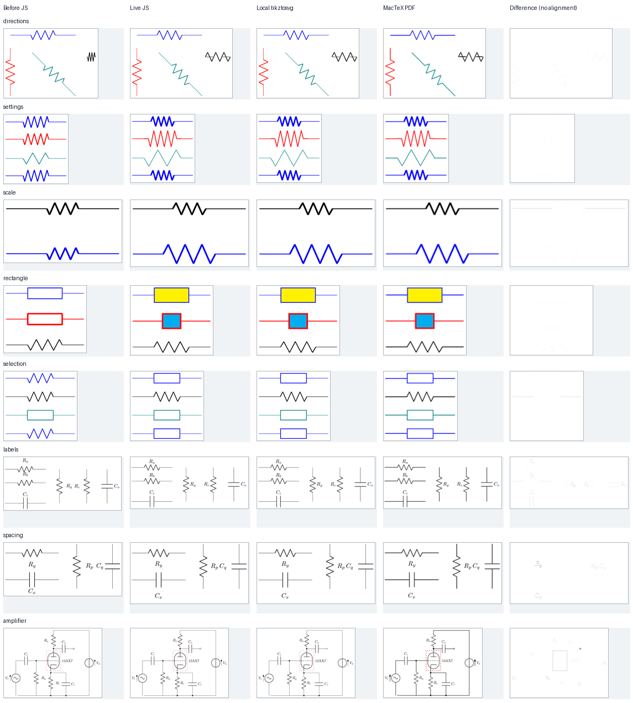
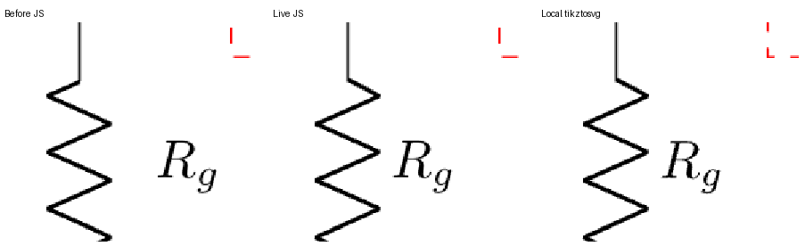

# Fixed resistor bodies and passive labels

The triode amplifier in the Circuitikz manual used to have a reversed first crest on all three resistors. Its component labels also sat too far from vertical wires and used the wrong baselines. This change covers fixed American and European resistors and straight cardinal labels on fixed resistors and capacitors. It does not make the whole package native-compatible.

## Native rules

The reference is Circuitikz 1.8.3 from TeX Live 2025, not a fit to the screenshots. TeX source paths below are relative to the installed Circuitikz package:

- `pgfcircbipoles.tex:35-62,92-114,635-689,854-858`: the default zigzag is 0.8 times the 1.4 cm component length. Reserve the two straight stubs, divide the rest into four steps per zig, and start toward the positive local normal. Each end extends half the **body's** line width to meet the wire. The native horizontal SVG stroke starts at 26.246 bp and reaches its first crest at 29.293 bp, 5.953 bp to the side. The open zigzag is stroked, never filled.
- `pgfcirc.defines.tex:533-550,694-801` and `pgfcircpath.tex:125-186`: the body is centered on the original endpoints. Leads use its nominal anchors even if they double back on a short wire. The generic resistor is a closed rectangle with independent dimensions, class fill and pen. Coordinate scaling does not by itself resize a symbol; uniform `transform shape` does. Pen overlap stays physical.
- `circuitikz.sty:61-70,126-139`: distinguish package defaults, scoped region selectors and explicitly named symbols. Choosing a European default does not change an explicitly American resistor.
- `pgfcirclabel.tex:33,111-158,222-300`: start at the saved numeric body border (default margin 1.1). Gap is 0.75 ex plus label distance; the inner separation is half the gap. Above uses the baseline, below uses the strutted north edge, and left/right use mid anchors half an ex above the baseline. The glyph box and the strut are distinct. These are not four offsets from the wire center.

## Coverage

The [fixture manifest](../../test/fixtures/circuitikz-resistor-bodies/manifest.json) has seven controls and reuses the [manual amplifier](../../test/fixtures/circuitikz-tubes/amplifier.tex) without changing its source (`circuitikzmanual.tex:5582-5594`).

| Family | Commands and options exercised |
| --- | --- |
| Body selection | `\usepackage[europeanresistors]{circuitikz}`, `\begin{circuitikz}`, `\begin{tikzpicture}`, `\draw ... to[R]`, `american resistors` in a scope, explicit `european resistor` and the default zigzag |
| Geometry and paint | `\ctikzset`, `bipoles/length`, `resistors/width`, per-symbol widths/heights under `bipoles/resistor` and `bipoles/generic`, `resistors/scale`, `resistors/zigs`, `resistors/zigzag stub`, `bipoles/thickness`, `resistors/thickness`, `resistors/fill`, local `fill`, `line width`, `mirror`, `invert`, `scale`, `transform shape` |
| Labels | `R=...`, `C=...`, `l^`, `l_`, `label distance`, `bipoles/border margin`, native math subscripts, all four cardinal wire directions; unit tests also probe a 9 pt sans font with 15 pt baseline skip and a tall fraction |

Variable resistors, rotated/smart labels, diagonal label placement, non-uniform transformations, custom shape hooks, and arbitrary TeX text are **not** certified here. Zig counts are bounded at 4096. Existing source arrows, triode anchors and return wiring are exercised in the full amplifier, not newly implemented by this change.

## Browser evidence

The editor actually interpreted each source in Chrome; it did not display the exported SVG in place of the live result. References were produced independently by local `/Library/TeX/texbin/tikztosvg` and pdfLaTeX. SVG references were also rasterized with `rsvg-convert`.

| Full amplifier | Before | After |
| --- | ---: | ---: |
| Same-size browser ink score vs tikztosvg | 0.78563 | 0.98141 |
| Maximum zigzag centerline error (CSS px) | 15.7714 | 0.0079 |
| Maximum glyph origin error, all 21 glyphs (CSS px) | 8.1317 | 0.0719 |

The 1090 x 766 capture was compared without stretching or translation. All eight live cases and all eight exports clear the 0.95 ink threshold. The seven controls score at least 0.9933. A separate check samples 65 points per open zigzag, pen width and color, and absolute glyph origins. All 16 comparisons pass the 0.15 CSS px limit. Rectangle fills and outlines are covered by the whole-image comparisons and scene tests. No browser errors or source diagnostics. Faint differences remain in text rasterization and in the amplifier's tube outline; the images are not bit-identical.

## Reproduce

From the checkout, with MacTeX, Chrome, Playwright and librsvg installed:

~~~sh
SUITE=test/fixtures/circuitikz-resistor-bodies
OUT=outputs/qa/circuitikz-passive-bipoles
PW=$(node --input-type=module -e "import {fileURLToPath} from 'node:url'; console.log(fileURLToPath(import.meta.resolve('playwright')))")
node --test test/circuitikz-resistor-bodies.test.js test/circuitikz-passive-label-layout.test.js
node scripts/render-example-fixtures.js --fixtures "$SUITE" --output "$OUT" --native-reference --strict-tikztosvg --math-renderer svg-text --no-comparison-grid
node scripts/audit-module-regressions.js --fixtures "$SUITE" --output "$OUT" --workbench --browser-module "$PW"
node scripts/measure-vector-ink.mjs "$OUT"
node scripts/audit-resistor-geometry.mjs "$OUT" "$PW"
~~~

Set `PW` to the local Playwright entry point if it is installed outside the project. Open `browser-audit.html` in the output directory to inspect individual cases. Native PNGs, independent SVGs and reference PNGs are under `mactex-png/`, `tikztosvg-svg/` and `tikztosvg-png/`.
