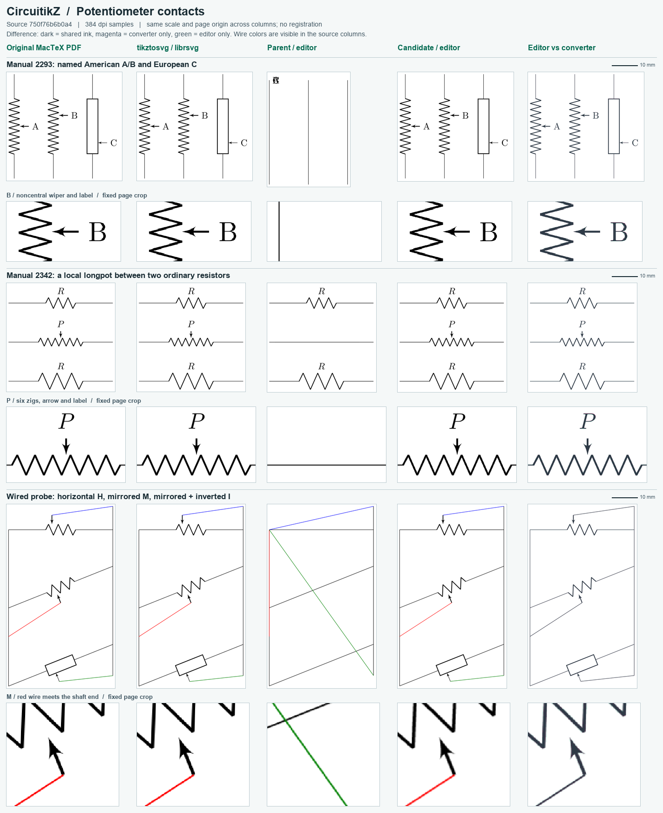

# CircuitikZ: three-terminal potentiometers

The [four diagrams](../../test/fixtures/native-circuitikz-potentiometers/catalog/manifest.json) cover two TeX Live 2025 manual examples, a circuit whose slider connections carry different colors, and a paint control. Before this change, the browser drew bare wires. The three `name.wiper` labels in the first example were all at the origin.

## Native rules

- In `pgfcircbipoles.tex:39-66,94-97,878-882`, `pR` is an alias for `potentiometer`. The active resistor convention selects the shape, unless `american potentiometer` or `european potentiometer` names it explicitly. The width and slider-position keys set both regional registers; a subsequent region-specific key changes only its own register.
- In the two shape definitions (`pgfcircbipoles.tex:550-587,724-758`), the sliding position along the body is `(wiper pos - 0.5) * body width`, relative to its center. Extending the external leads does not extend this range. The terminal and tip have the same coordinate along the resistor, but different coordinates normal to it. The American and European stems do not use the same pen: the European shape restores the incoming pen before drawing the arrow.
- `pgfcirc.defines.tex:694-798` saves the asymmetric shape anchors. Uppercase `.W` is the slider; lowercase `.w` is the west end. `pgfcircpath.tex:125-169` places the shape at the midpoint, rotates it along the connection, then applies its mirror/invert axes. These operations also transform the saved anchors used by later wires.
- `pgfcirclabel.tex:114-152` chooses the border on the requested label side. Mirroring swaps which side has the slider, but does not turn an above label into a below label. The [integration tests](../../test/circuitikz-potentiometers.test.js) compare the text baseline in all eight combinations of label side, mirror and invert to the local MacTeX measurement.

## Coverage

The original examples use `\begin{circuitikz}[american]`, `\ctikzset`, `european resistors`, `\draw ... to[...] ++(...)`, a picture-local `/.style`, `pR`, `R`, `name`, `l`, `wiper pos`, `resistors/scale`, `resistors/width`, `resistors/zigs`, and `\foreach` with `\node[right]`. The controls add `n`, `l_`, explicit regional names, `mirror`, `invert`, `.tip`, `.W`, and connections to inclined components. The two-terminal `vR`, sensors and arbitrary shape transforms are separate features, not certified by this comparison.

The paint control distinguishes a bare `\path` (visible component, invisible leads), `\draw[red]` (red shaft and head), and `\draw[draw=red]` (red shaft, black head). The default three-cubic `latexslim`, its reverse and empty start/end tips have dedicated tests; other arrow families use the existing marker renderer and have not been calibrated here.

## Results

Each source was loaded in the real Chrome workbench and rendered again with its Render button. We compared the new DOM drawing and the actual downloaded SVG with a CLI export, a locally compiled pdfLaTeX PDF, and the output of `/Library/TeX/texbin/tikztosvg`. Raster comparisons use the same physical scale and origin, without fitting one picture to the other.

The two long zigzags and the European rectangle now have separate, labeled contacts at the middle, 30% and 80% positions. In the long-pot example, the middle component has six zigs and its own label; neither adjacent ordinary resistor inherits its width. In the wiring control the three colored wires end at the sliders, including the mirrored and inverted one. In the paint control the leads disappear only on the bare path, and only the last head stays black.

All four editor renders and CLI exports reported no diagnostics. There were no browser errors or failed requests. All 90 component, 40 page and 30 paint comparisons passed, including reference-to-reference controls. The independent [native geometry test](../../test/circuitikz-potentiometer-geometry.test.js) measured 836 anchor and path coordinates over 12 components; the maximum difference was one TeX scaled point. Edges can still differ in raster antialiasing. These checks do not assert pixel identity.

See the [stroke and fill comparison](assets/native-circuitikz-potentiometers-paint.png) and [replay instructions](../../test/fixtures/native-circuitikz-potentiometers/README.md) for the measurements, tolerances and browser captures.
