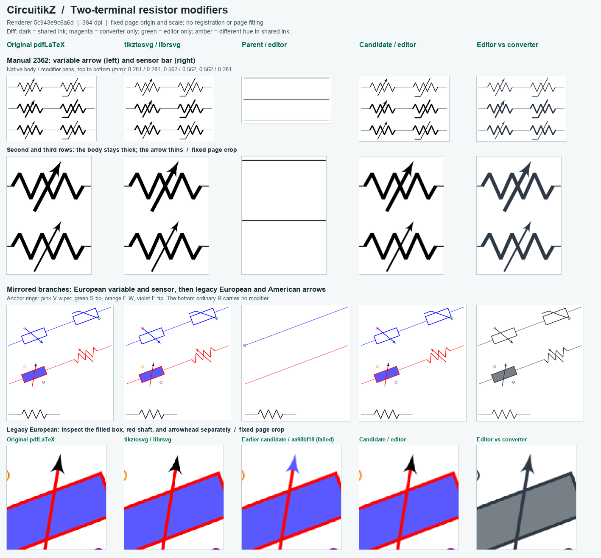

# CircuitikZ: variable resistors and resistive sensors

The [original manual diagram](../../test/fixtures/native-circuitikz-resistor-modifiers/manual-thickness.tex)
has three rows, each with an adjustable resistor and a resistive sensor. Before this fix
all six symbols were missing: the browser painted uninterrupted wires. The manually
placed named contacts in the [inclined control](../../test/fixtures/native-circuitikz-resistor-modifiers/angled-anchors.tex)
could not be resolved either.

## Native rules

- TeX Live 2025 `pgfcircbipoles.tex:35-114,857-870,884-885`: `vR` and `sR` select the current resistor convention. Forced American and European names override the convention for just that connection. `tgeneric` is the European tunable rectangle; `thermistor` and `thR` are the plain European sensor.
- `pgfcircbipoles.tex:305-332,691-722`: the American zigzag has half the saved vertical radius; the European rectangle uses 40%. With `bipoles/fix tunable direction=false`, the American arrow reverses on the same diagonal. The European arrow instead uses the opposite diagonal. Neither switch moves `.wiper`, `.W` or `.tip`.
- `pgfcircbipoles.tex:414-443,759-791`: the sensor's bent bar has no arrowhead. Its `.label` is the elbow, not the center of the body. On the European shape this elbow sits 20% below the saved southern radius; the lower label border extends with it. `mirror` and `invert` transform the saved points as well as the ink.
- `pgfcirc.defines.tex:473-489,530-561,694-829` and `pgfcorearrows.code.tex:903-936`: shape dimensions are independent of lead length. The diagonal uses the body's line width multiplied by `resistors/modifier thickness`. After the European rectangle is filled, PGF sets up the tip color separately: the control with `draw=red` and a blue box has a red shaft but a **black** head. With `red` instead of `draw=red`, the head is red.

## Commands covered

| Role | Commands or parameters |
| --- | --- |
| Selection | `vR`, `variable resistor`, `variable american resistor`, `variable european resistor`, `tgeneric`; `sR`, `resistive sensor`, `american resistive sensor`, `european resistive sensor`, `thermistor`, `thR` |
| Settings | `\ctikzset`, `american/european resistors`, `bipoles/length`, `resistors/scale`, `resistors/width`, `resistors/zigs`, `resistors/zigzag stub`, per-family `width` and `height`, `bipoles/thermistor/main` |
| Painting | `\path` or `\draw ... to[...]`, `fill`, `draw`, `resistors/fill`, `resistors/thickness`, `resistors/modifier thickness`, `bipoles/fix tunable direction`, `tunable start arrow`, `tunable end arrow` |
| Placement | `name` / `n`, `.wiper` / `.W` vs `.w` (west), `.tip`, sensor `.label`, `mirror`, `invert`, ordinary component labels |

The calibrated arrow is the native `latexslim` tip. Other tip families use the existing marker renderer. Light-dependent resistors, NTC/PTC-specific bars, and arbitrary nonuniform shape transforms are not certified by this audit.

## Browser comparison

Both sources were rendered with the workbench's Render button, then downloaded. At the
same physical scale, the browser, downloaded SVG and CLI show all six symbols in the
manual. The middle row doubles both body and modifier pen widths; the bottom row
keeps the thicker body but restores the thin arrow and sensor bar. In the inclined
control, all four anchor rings land on the same points as the native drawing.
The two rings on the legacy European resistor deliberately **do not** move to its
newly painted diagonal.

The original PDF and local `/Library/TeX/texbin/tikztosvg` were generated independently.
The converter's manual SVG has a `117.769 × 85.286` viewBox, bevel joins on the zigzags
and butt caps. The wires use a 0.3985 stroke; the two different body pens are 0.797
and 1.59401. Its default arrowhead is a separate filled, nonzero-rule path with three
cubics, not an SVG marker. Inspecting that path's fill, separately from the neighboring
rectangle, exposed a blue head in the first JS candidate; the final head is black
in the browser, the PDF and the converter.

All 102 comparisons of JS output against the two native references and all 68
reference cross-checks passed. Both browser renders and exports had zero diagnostics;
no failed browser requests were recorded. A separate [anchor regression](../../test/circuitikz-resistor-modifiers-native.test.js)
checks exact recorded TeX coordinates for nine component configurations. These checks
cover the listed features, not every antialiasing pixel or the whole CircuitikZ package.

[Sources, measurements and replay instructions](../../test/fixtures/native-circuitikz-resistor-modifiers/README.md)
