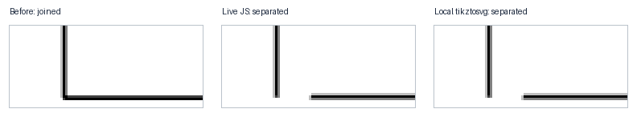
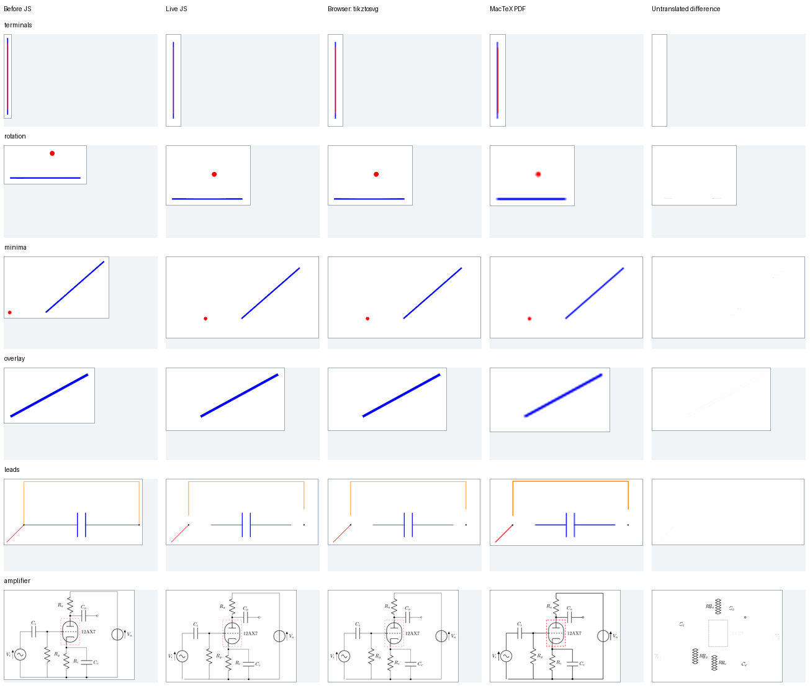

# Empty node bounds and Circuitikz terminals

An empty rectangular node can enlarge the page without painting anything. Its background defines the page bounds, while its border anchors (including outer separation) determine where an implicit connection stops. A coordinate has neither that background nor a rectangular border. The regression is visible in the [Circuitikz manual's triode amplifier](../../test/fixtures/circuitikz-tubes/amplifier.tex): ignoring the rectangle cropped the page; wiring directly to its center joined two lines that should be separated.

## Native behavior

References are from local MacTeX / TeX Live 2025, under /usr/local/texlive/2025/texmf-dist/tex/generic/:

- pgf/modules/pgfmoduleshapes.code.tex (84-104, 847-897, 936-1011, 1098-1102): construct a shape's background even when it is not stroked or filled. A coordinate has no background. Rectangles default to .3333em inner separation and 1pt minimum width and height. The background omits outer separation; the border uses it.
- pgf/basiclayer/pgfcorepathconstruct.code.tex (125-141) and pgfcorepathusage.code.tex (112-130): recording the geometric bounds and growing them by half a pen for a stroke are separate operations. The standalone document border is separate again.
- pgf/frontendlayer/tikz/tikz.code.tex (2691-2709, 2816-2838) and pgfmoduleshapes.code.tex (597 onward): a bare node name resolves to the border in the direction of travel; an explicit anchor is used literally.
- circuitikz/pgfcircpath.tex (125-186), pgfcircbipoles.tex (135-174, 842): place a straight component on the original center line, then connect its leads using TikZ paths. A short has no component body. Clipping the two terminals before computing the midpoint would move the capacitor when the two rectangles have different sizes.

The independent [pdfTeX box probe](../../test/fixtures/empty-node-boundary-metrics.tex) measures a default rectangle at 6.66595 x 6.66595 TeX pt, two terminal nodes on a 2cm wire at 6.66595 x 63.57144 pt, and the padded rectangle rotated 30 degrees at 24.78467 x 18.92822 pt. With zero inner separation, the default minimum is 1 x 1 pt; an explicit zero minimum gives 0 x 0 pt. Setting minimum width to 3pt after minimum size of 14pt yields 3 x 14 pt; reversing the two keys yields 14 x 14 pt.

## Browser comparison

The [six sources](../../test/fixtures/empty-node-boundaries/manifest.json) were rendered by the live Chrome editor, the SVG exporter, local tikztosvg and pdfLaTeX. Reference SVG and PNG files came from /Library/TeX/texbin/tikztosvg and rsvg-convert, not from TikZKit. In the asymmetric capacitor control the native SVG uses straight, butt-ended leads; the blue conductor runs from 21.837 to 101.052 bp and its break runs from 52.724 to 60.661 bp. The red conductor still starts at the center. There are no reference images substituted into the JS result.

At 3x browser capture, with no translation or scaling to fit, all five controls scored 0.99935 or better for both live JS and export. Before the repair none passed the 0.95 threshold. The separate zero-ink, zero-minimum control with a 2pt standalone border was an entirely white 16 x 16 capture in all three SVG panels; a blank image is not counted as an ink pass. No browser errors or TikZKit diagnostics were reported.

**The amplifier is still not a whole-image pass.** The native screenshot is 1090 x 766; JS went from 1090 x 748 to exactly those dimensions. On the bottom wire the old horizontal segment started at x=133 and touched the vertical. JS and tikztosvg now both end the vertical at x=134 and start the horizontal at x=148 on row 744. The four outer voltage-label glyph origins agree to within 0.005 CSS px at natural scale. Whole-picture ink agreement is 0.78563: resistor bodies and passive component labels still differ, as the last difference panel shows.

**Exercised:** standalone and on-path empty nodes, ordinary rectangles, coordinate and overlay controls, minimum size/width/height in both orders, inner and outer separations, rotation, implicit named borders, explicit center anchors, relative endpoints, and straight short/capacitor leads. No fixture-specific dimensions are used in the implementation. Arbitrary shape backgrounds, affine transforms, phantom content, and other bipoles are not certified by these controls.

## Reproduce

~~~sh
SUITE=test/fixtures/empty-node-boundaries
OUT=outputs/qa/empty-node-boundaries
mkdir -p "$OUT"
pdflatex -interaction=nonstopmode -halt-on-error -output-directory="$OUT" test/fixtures/empty-node-boundary-metrics.tex
node --test test/empty-node-boundaries.test.js
node scripts/render-example-fixtures.js --fixtures "$SUITE" --output "$OUT" --native-reference --strict-tikztosvg --math-renderer svg-text --no-comparison-grid
PW=$(node --input-type=module -e "import {fileURLToPath} from 'node:url'; console.log(fileURLToPath(import.meta.resolve('playwright')))")
node scripts/audit-module-regressions.js --fixtures "$SUITE" --output "$OUT" --workbench --browser-module "$PW"
node scripts/measure-vector-ink.mjs "$OUT"
~~~

Set PW to the installed Playwright entry point if it is outside the project. Open browser-audit.html in the output directory for the browser captures; independent references are in mactex-png/, tikztosvg-svg/ and tikztosvg-png/. The final command reports 10/12 and exits nonzero for the two amplifier panels.
