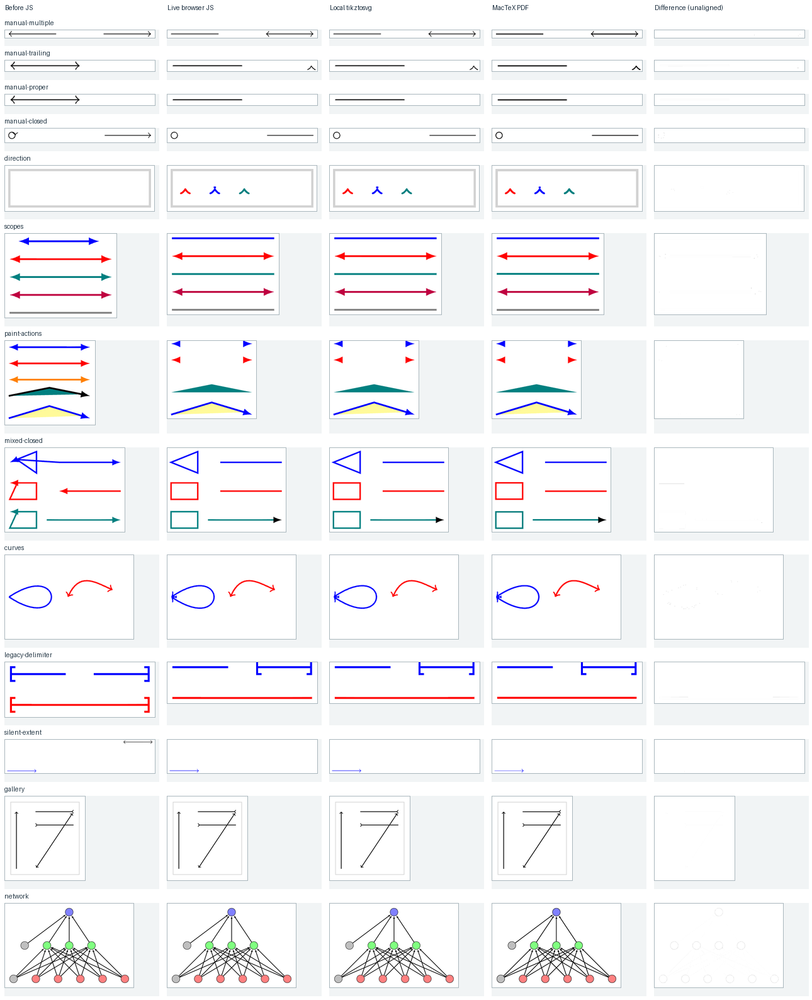

# When a TikZ path gets arrow tips

An arrow specification such as `<->` sets the available tips. It does not mean
that every visible stroke gets an arrow. The [test sources](../../test/fixtures/native-arrow-actions/manifest.json)
cover the path-action rules in chapter 16 of the PGF manual, a legacy bracket
interval, and an unmodified feed-forward network with 22 independent edges.
These checks apply to the ordinary TikZ path interpreter, not PGFPlots axes.

## Native behavior

| Source and controls | What the local reference shows |
| --- | --- |
| `\draw[<->] (0,0)--(1,0) (2,0)--(3,0);` | The first line has two plain ends; both tips and the corresponding shortening belong to the second line. |
| Empty path, last move only, repeated identical coordinates | An empty path paints nothing. A move alone can carry tips; both ends point upward and coincide. A zero-length line and a move-only path do not always produce the same shaft. |
| `tips`, `true`, `proper`, `on draw`, `on proper draw`, `never`, `false`; `/pgf/tips` | The initial mode is `on draw`; writing the bare key selects `true`. Proper modes suppress a point, but a returning cubic with distinct controls is not a point. |
| `\path`, `\fill`, `\filldraw`, `\draw[clip]` | A no-paint path with `tips=true` or `proper` can draw colored heads without a shaft. Fill-only paints its area without tips, even with `tips=true`. A clipped stroke has no tips or arrow shortening. |
| `circle`, `rectangle`, `-- cycle`, a following coordinate, `edge` | A closed contour anywhere suppresses arrows on the complete parent path. The next bare coordinate starts a new subpath. A separately painted edge can still carry an arrow. |
| Scoped `tips=never`, `shorten <=5pt`, `shorten >=7pt` | The line has its full length when tip processing is disabled. A local override re-enables the tips; scope exit restores the previous mode. |
| Unpainted geometry, `overlay`, `use as bounding box` | An ordinary silent path still contributes its coordinates, without pen padding. With a 2pt standalone border, a silent 2cm horizontal line measures 60.678 by 3.985 PDF points; a single point measures 3.985 by 3.985. An overlay does not enlarge the picture. |

Source paths below are relative to the local MacTeX (TeX Live 2025)
`texmf-dist` tree:

- `doc/generic/pgf/pgfmanual-en-tikz-arrows.tex:145-226`: the manual's
  two-subpath, last-point, proper, and circle-plus-line examples are used
  directly. `pgfmanual-en-library-arrows.tex:10-18` distinguishes the legacy
  compatibility library from the modern tip catalog.
- `tex/generic/pgf/basiclayer/pgfcorepathusage.code.tex:49-249,316-655`:
  the stroke, fill, no-paint and clip branches are distinct. The proper-path
  test resets at each move and examines cubic supports as well as endpoints.
  Start/end preparation treats a move-only terminal differently from a line.
- `tex/generic/pgf/basiclayer/pgfcorepathprocessing.code.tex:140-240`:
  moving to a new subpath resets the endpoints; rectangle and close tokens
  suppress all path tips. The soft path itself still paints.
- `tex/generic/pgf/libraries/pgflibraryarrows.code.tex:14-40` and
  `tex/generic/pgf/basiclayer/pgfcorearrows.code.tex:1096-1102`: the legacy
  square bracket declares back and tip extents; these are not a picture hull.
  The native SVG still contains the sides of the bracket extending past the
  frame. No output is fitted to those sides for comparison.

The local `tikztosvg` SVG for the last-point example has one plain shaft and
two tips with **identical upright transforms**, not two opposed markers on the
shaft. For the circle-plus-line it contains one stroked path and no arrow
paths. In the paint-action example there are separate blue and red filled
arrowheads with no stroke between them. Independent pdfLaTeX output confirms
these distinctions.

The edge's own paint action also matters for color. For the legacy filled
`latex` tip, a teal `draw=teal` on the parent leaves the independent edge's
shaft teal but its tip black. The bare color switch `teal,draw` makes both
teal. This is consistent with PGF's separate stroke and fill inks; it is not
a special case for the example's color.

## Browser results



All 13 examples ran in Chrome through the workbench, as exported SVG, and in
both local reference tools with no diagnostics. Measurements are at 3x CSS
zoom with the original physical page dimensions; nothing is shifted or fitted
to make the images match. Browser zoom happens before layout rounding. Scaling
an already rounded 4.38pt-high viewport introduced an artificial 0.3px error.

| Check on the live and exported panels | Before | After |
| --- | ---: | ---: |
| Same page size and at least 0.95 full-size ink agreement | 6/26 | 26/26 |
| Fixed-pixel checks for colored paint and intentionally white gaps | 28/80 | 80/80 |
| Arrow and shaft geometry, stroke style and page dimensions (0.12 CSS px tolerance) | 2/10 | 10/10 |

On the first manual example the old start arrow landed on the first line
instead of the second, about 227px away at audit scale. The largest remaining
centerline error across the five geometry-gated examples is 0.035px. The
legacy bracket page shrank from 111px to the reference's 83px; the glyphs
still extend outside their page bounds just as they do in the PDF. The
perceptron retained its 22 edges and 11 nodes. Faint edge-antialiasing
differences remain; the lowest image agreement in this suite is 0.9981.

This is evidence for the listed core path actions and examples, not complete
support for every arrow declaration, bending mode, decoration or PGFPlots axis.

## Reproduce

Set `PW` to an installed Playwright module; run from the repository root:

```sh
SUITE=test/fixtures/native-arrow-actions
OUT=outputs/qa/native-arrow-actions
node scripts/render-example-fixtures.js --fixtures "$SUITE" --output "$OUT" --native-reference --strict-tikztosvg --math-renderer svg-text --no-comparison-grid
node scripts/audit-module-regressions.js --fixtures "$SUITE" --output "$OUT" --workbench --browser-module "$PW"
node scripts/measure-vector-ink.mjs "$OUT"
node scripts/compare-native-paint-probes.mjs "$OUT" "$SUITE/paint-probes.json"
node --test test/native-arrow-action-policy.test.js test/native-arrow-subpaths.test.js
```

Open `$OUT/browser-audit.html` to inspect the live workbench, exported SVG, and
reference captures. The corresponding native SVG/PNG, PDF/PNG, and TikZKit
SVG/PNG are retained in the same run directory. Local tools:
`/Library/TeX/texbin/tikztosvg`, `/opt/homebrew/bin/rsvg-convert`, and pdfLaTeX.
