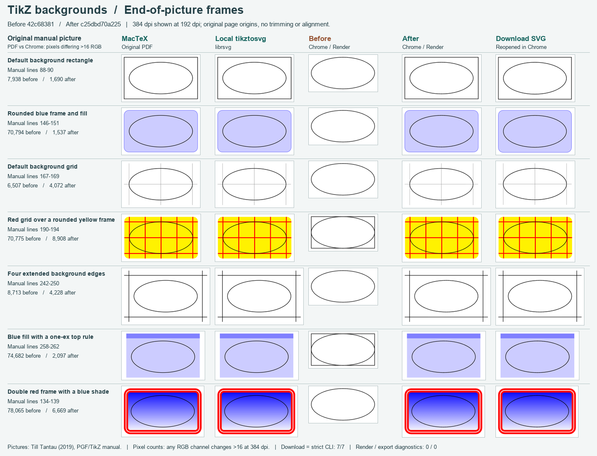

# Picture frames and grids from the TikZ backgrounds library

The [seven original manual drawings](../../test/fixtures/native-backgrounds/README.md)
exercise outline, fill, grid, side rules, rounded corners and double strokes.
The test boundary is the library's end-of-picture paths, not a general
implementation of user-defined PGF layers.

## What the local source does

| TeX Live 2025 file | Behavior followed in JavaScript |
| --- | --- |
| `tikzlibrarybackgrounds.code.tex` | `framed` and `gridded` register ordinary paths at the end of a picture. The first one resets the transform and saves the physical picture bounds once. All six kinds of path read that same saved box. |
| `pgfmanual-en-library-backgrounds.tex` | The default inner separation is `1ex`. `tight background` sets it to zero; `loose background` sets it to `2ex`. X and Y can be set separately. Outer separation lengthens each individual side along its tangent; it does not enlarge the rectangle or grid. |
| `tikz.code.tex` and `pgfcorelayers.code.tex` | End hooks append in source order. The background box ships before the main box. Switching layers sets the pen to `0.4pt`; a background style can select a different pen. Foreground clipping does not transfer to the background layer. |

The supported picture keys are `show background rectangle`, `show background
grid`, `show background top/bottom/left/right`, their `framed` and `gridded`
aliases, `tight/loose background`, and `inner/outer frame sep/xsep/ysep`.
Each `background rectangle/grid/top/bottom/left/right` style can be
replaced or extended. A rectangle can therefore fill without stroking, and
a grid can use a different step and line width. A later opaque frame can
cover an earlier grid; neither covers the foreground.

At `42c68381` the red-grid example showed a plain outline touching the
ellipse. The original PDF and converter SVG both showed a rounded yellow
field, a red grid on top of that field, and the black ellipse in front.
The local `tikztosvg` reference contains three ordered SVG paths: the
nonzero yellow fill, the eight red grid segments with a butt cap and miter
join, and the black cubic ellipse. The SVG's Y-inverting transform is a
backend detail; both JavaScript and TeX must ultimately paint in this order.

## Visual results

The red grid now shows through only where the foreground permits. In the
four-side example each rule projects past the crossing without enlarging the
ellipse; in the blue example the thick top rule stays on top of the pale
fill. The fancy frame preserves both red outlines, the white gap, and the
blue-to-white gradient. The rounded corners and black outline still have
slightly different antialiasing in Chrome and in the PDF rasterizer.
Across these seven inputs the browser and native PDF page widths and heights
differed by less than 0.001 mm. All seven browser downloads were identical
to the final CLI SVG bytes, with no diagnostics in either path.

## Verification

The [live native tests](../../test/backgrounds-native.test.js) compare the
JavaScript geometry, pen widths, paint colors and ordering against PGF path
traces and the actual PDF. They include rotated bounds, a thick foreground
pen, repeated styles, `use as bounding box`, and adjacent pictures.
All 30 focused checks passed; the full suite with local TeX enabled reported
4,192 passed, zero failed and 14 skipped.
The [replay instructions](../../test/fixtures/native-backgrounds/README.md)
cover browser rendering, download, MacTeX, and local
`/Library/TeX/texbin/tikztosvg`. No TeX installation is required at runtime.

Arbitrary named layers, deeply nested background scopes and unrestricted
TeX hook code are outside this comparison. Shapes with other libraries'
custom bounds are not certified by the seven manual drawings.
