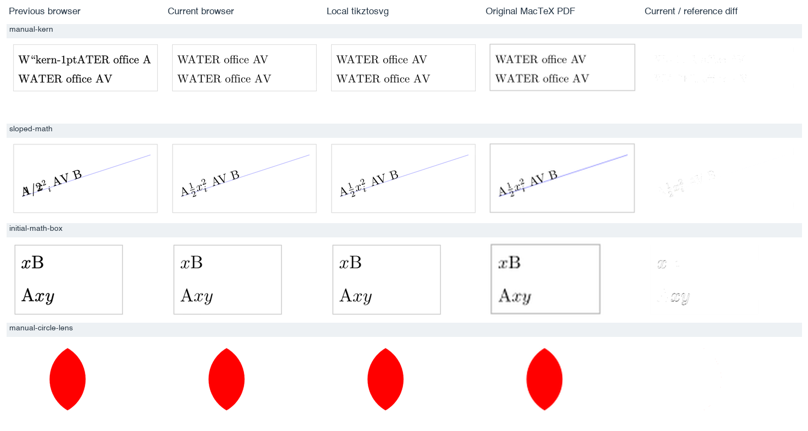

# Native boxes for text along a path

PGF does not bend a typeset paragraph. Ordinary `text along path` scans
one token or balanced group, advances by half its TeX width, places the
baseline midpoint on the path tangent, then consumes the other half.
This is different from `text effects along path`, which builds TikZ nodes.



## What changed

| Input or key | Observed behavior |
| --- | --- |
| `W{\kern-1ptA}TER`, `{office}`, `{AV}` | The kern moves the A and subsequent letters; it is not printed. Explicit groups use the font's kerning and ligatures and have one tangent. Ungrouped letters keep separate boxes. |
| `$a+b$` and `{$a+b$}` | The former scans math atoms separately; the latter is a single math box. Adjacent groups follow PGF's actual saved-token behavior rather than blindly preserving every pair of braces. |
| `{$\frac{1}{2}$}`, `{$x_i^2$}` | On a slope, the numerator, denominator, fraction rule and scripts rotate with their own measured box. The previous image overprinted the first characters and used a slash in place of the rule. |
| `\ `, `\space`, `fit to path stretching spaces` | Only a typed scanner space receives extra width. The control space in `A\ B C` keeps B beside A while C reaches the far end. |
| `|\bfseries|`, `|\boldmath|`, `|+...|`, `||` | Bold text does not imply bold math; a math-version switch changes the math face. Replacement, cumulative formatting and reset are exercised on the manual's curved red-apple example. |
| `execute at begin picture`, `use as bounding box`, `\clip` | The opening picture hook runs in its transformed scope, before the body. A fixed bounding box stops later size tracking without clipping paint. A clip does clip paint. Native document borders are added in page coordinates. |

The browser and standalone SVG use reusable original CMR10 contours for
the ordinary decoration's default Roman letters. Text remains selectable;
other optical faces still use the packaged MacTeX fonts. The outline table
comes from the existing CMR10 WOFF, not from any reference image. It is
regenerated with `python3 scripts/build-cm-roman10-outlines.py`; pass
`--check` to verify it without rewriting it.

## Native evidence

- In local TeX Live 2025, `pgflibrarydecorations.text.code.tex` defines
  `scanchar`, grouped remainder collection, `dobox` and the half-width
  states. `tikzlibrarydecorations.text.code.tex` delegates ordinary text
  to that PGF library. `pgfmanual-en-library-decorations.tex` gives the
  WATER kerning and cumulative formatting cases. An [independent TeX
  probe](../../test/fixtures/native-decoration-scanner.tex) measures 89
  boxes in 18 examples, including explicit spaces, ligatures, radicals
  and mixed text/math.
- The local `tikz.code.tex` clears the picture hooks, applies
  `every picture` and the picture options, then executes the opening
  hook. `standalone.cls` and preview's `prtightpage.def` pad the
  completed TeX box. The comparison adapter previously lost that padding
  after a top-level clip: its lens was 56.693 bp wide while the untouched
  PDF and JS were 60.678 bp. The reference now measures 60.678 bp too.
- The local tikztosvg SVG contains glyph outlines and positioned `<use>`
  elements. On the sloped fraction the bar is separate ink, not a slash
  glyph; the measured script origin is not a browser-relative baseline
  shift. In `$a_k$` at 10 pt, pdfLaTeX selects CMMI7 for k and lowers
  its baseline by 1.49998 pt.

## Browser acceptance

The [11 source documents](../../test/fixtures/decoration-box-qa/manifest.json)
ran in the interactive Chrome workbench, as exported SVG, through local
tikztosvg, and through unmodified-document pdfLaTeX. No diagnostics or
browser errors. The image gate uses native physical size at 3x CSS zoom,
with no alignment, rescaling or reward for matching whitespace. The
separate glyph gate measures actual painted origins relative to the
frame, not the selectable text behind an outlined glyph.

| Live browser vs. tikztosvg | Before | After |
| --- | ---: | ---: |
| Manual kerning and ligatures | 0.5930 | 0.9982 |
| Sloped fraction and scripts | 0.4812 | 0.9931 |
| Roman capitals on a short path | 0.9088 | 0.9975 |
| Leading and consecutive math groups | 0.9089 | 0.9755 |
| Standalone lens | Different page size | 0.99998 |

Before: 6/16 full-size comparisons passed across the eight original
fixtures. After: 22/22 passed across eleven (live and exported for each).
Six glyph-gated cases have 74 visible glyphs per renderer; the largest
origin difference is 0.0082 CSS px at audit zoom (limit 0.09 px).
The enlarged preview controls also verify asymmetric standalone margins
and a transformed clip with paint drawn before it. The contact sheet is
for inspection; its resized thumbnails are not used in any measurement.

Limits: standard ASCII input and supported native text/math inside each
resolved run, not a general TeX expansion engine. Display math, custom
catcodes, arbitrary macro expansion and unsupported groups take the
existing fallback. Math mode does not carry across format-run boundaries.
Exact curve-distance arithmetic, all optical-size contours and complete
text-effects compatibility are not claimed.

## Reproduce

Set `PW` to an installed Playwright module and run from the project root:

```sh
SUITE=test/fixtures/decoration-box-qa
OUT=outputs/qa/native-decoration-boxes
node scripts/render-example-fixtures.js --fixtures "$SUITE" --output "$OUT" --native-reference --strict-tikztosvg --tikztosvg-engine pdflatex --math-renderer svg-text --no-comparison-grid
node scripts/audit-module-regressions.js --fixtures "$SUITE" --output "$OUT" --workbench --browser-module "$PW"
node scripts/measure-vector-ink.mjs "$OUT"
```

Open `$OUT/browser-audit.html`. The per-case reference SVG/PNG is under
`$OUT/tikztosvg-svg` and `$OUT/tikztosvg-png`; the independent PDF
raster is under `$OUT/mactex-png`. Local commands: `/Library/TeX/texbin/tikztosvg`,
`/Library/TeX/texbin/pdflatex` and `/opt/homebrew/bin/rsvg-convert`.
