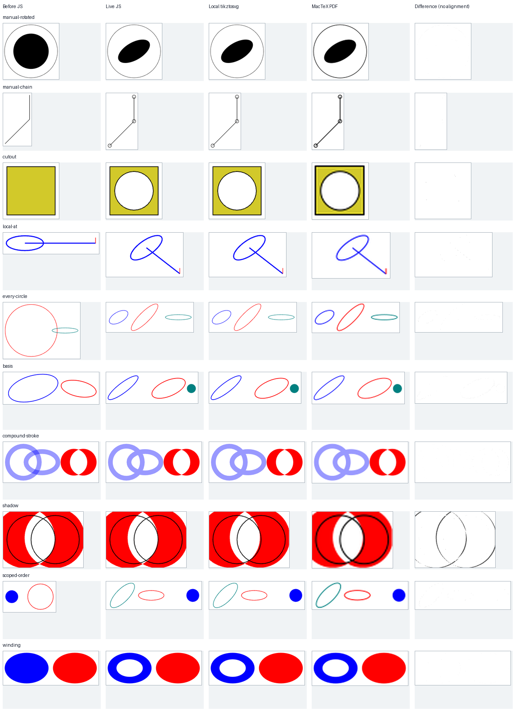

# Core TikZ path circles and ellipses

This audit covers the `circle` and `ellipse` **path operations**, not node shapes
or PGFPlots. The [ten sources](../../test/fixtures/native-path-ellipses/manifest.json)
include two chapter 14 examples, the chapter 15 even-odd hole, and a previously
working gallery shadow. Each was rendered independently with the live JavaScript
workbench, SVG export, local `tikztosvg`, and a MacTeX PDF.



| Source commands and keys | What to look for |
| --- | --- |
| `\draw`, `\fill`, `circle`, `ellipse`, `radius`, `x radius`, `y radius`, `rotate` | The black disk becomes a tilted ellipse. The outer circle is unchanged. |
| Picture-level `radius=2pt`, bare `circle`, `--`, `++` | All three small rings are visible at the corners of one connected path. |
| `\filldraw`, `rectangle`, `even odd rule`; positive and negative radii with the default nonzero rule | The yellow rectangle has a white hole. Reversing an inner contour cuts a hole in the blue oval; the red positive-winding control remains solid. |
| `\coordinate`, `at`, `xshift`, `-- ++`, `+` | The blue line leaves the moved ellipse center but reaches the original relative target, right at the red segment. |
| `\tikzset`, `every circle/.style`, parameterized styles, repeated `rotate`, overlapping radius keys | Both modern spellings use the style and respect local overrides in order. The legacy `ellipse (5mm and 1mm)` remains horizontal. |
| Coordinate basis `x`, `y`, unitless radii, radii in mm, named colors, `thick` | Numeric radii follow the skew basis; lengths use the canvas instead. All three shapes appear. |
| `opacity`, compound strokes, the existing general-shadow preaction | The crossing is the same blue as its arms. The red gallery rings keep their overlap; their thin black strokes still show raster differences. |

## Native implementation

Sources below are relative to the local TeX Live 2025 `texmf-dist` tree.

- `tex/generic/pgf/frontendlayer/tikz/tikz.code.tex:286-297,3542-3623`:
  modern operations apply `every circle` and local options, shift to the center,
  then apply their transforms. Parenthesized scalar and paired forms take a
  separate branch. Mixed dimensional and unitless radii are invalid.
- `tex/generic/pgf/basiclayer/pgfcorepathconstruct.code.tex:86-105,127-144,907-1011`:
  four cubic segments use 0.55228475 times the transformed axes, close, and
  move the physical pen to the center without updating the TikZ relative origin.
  The native SVG shows those four cubics, including controls outside the page
  extent. TeX scans a temporary first-control ordinate while expanding the
  bounding-box macro. For a 7mm by 2mm ellipse at +45 and -45 degrees,
  pdfLaTeX reported half-heights of 14.28339pt and 16.5057pt (including
  half the 0.4pt pen). Explicitly terminating the assignment in a control
  [control experiment](../../test/fixtures/native-path-ellipses/probes/rotated-page-bounds.tex)
  made both 16.5057pt. The JS keeps the real controls for painting.
- `doc/generic/pgf/pgfmanual-en-tikz-paths.tex:438-536` and
  `doc/generic/pgf/pgfmanual-en-tikz-actions.tex:804-824`: original examples
  for shared radii, a rotated ellipse, and applying the fill rule to a whole path.

## Verification

- At the original capture dimensions with no shifting or resizing, **4/20**
  full-frame ink comparisons passed before and **20/20** after (same 0.95
  threshold; final scores 0.98277 to 0.99998). Two initial render
  diagnostics fell to zero. Identical page dimensions do not imply identical
  antialiasing.
- The [absolute color probes](../../test/fixtures/native-path-ellipses/paint-probes.json)
  deliberately catch defects a whole-image score misses. **20/32** matched
  before and **32/32** after across browser and export: off-axis points
  are white, the cutout is white, its exterior is `#d2c92a`, and both
  blue crossings are `#9999ff`, not double-painted `#5c5cff`.

Reproduce from the repository root (set `PW` to the installed Playwright module):

```sh
SUITE=test/fixtures/native-path-ellipses
OUT=outputs/qa/native-path-ellipses
node scripts/render-example-fixtures.js --fixtures "$SUITE" --output "$OUT" --native-reference --strict-tikztosvg --math-renderer svg-text --no-comparison-grid
node scripts/audit-module-regressions.js --fixtures "$SUITE" --output "$OUT" --workbench --browser-module "$PW"
node scripts/measure-vector-ink.mjs "$OUT"
node scripts/compare-native-paint-probes.mjs "$OUT"
node --test test/native-ellipse-parser.test.js test/native-path-ellipses.test.js test/paint-probes.test.js
```

Open `$OUT/browser-audit.html` for the full captures. The same directory contains
`tikztosvg-svg/`, `tikztosvg-png/`, `mactex-png/`, and `tikzkit-svg/`. Native
tools here were `/Library/TeX/texbin/tikztosvg`, `/opt/homebrew/bin/rsvg-convert`
and pdfLaTeX. Arbitrary TeX option callbacks, nonlinear transforms, and
bit-exact TeX arithmetic for all placements are not certified by these cases.
