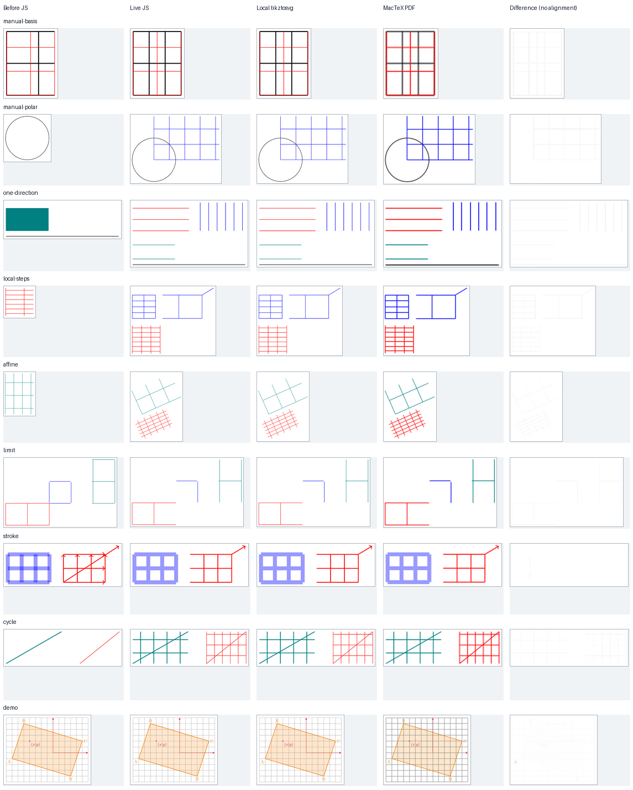

# Core TikZ path grids

This audit covers the TikZ `grid` path operation, not PGFPlots axis grids or
the comparison page's background. The [nine sources](../../test/fixtures/native-path-grids/manifest.json)
include both grid examples from chapter 14 of the PGF manual and the gallery's
Cartesian polygon. Each was compiled independently with local MacTeX and
`tikztosvg`, and rendered in the actual JavaScript workbench and SVG export.



## What changed

| Source and controls | Browser result |
| --- | --- |
| Manual: `x=.5cm`, `step=1` versus `step=.75cm` | The black grid has four columns of lines at half-centimetre intervals; the red grid has three at physical 0.75cm intervals. |
| Manual: `step=(45:1)` | The eight blue strokes are present beside the circle; both step components are about 0.7071cm. |
| `xstep`, `ystep`, zero, negative and very small steps | Three red rows, six blue columns and two teal rows. The old render omitted directions or painted a solid band. |
| `grid[...]`, coordinate pairs and a following `-- ++` | Local step overrides end at the grid. The following segment starts at the requested corner, not at the last grid intersection. |
| Skew basis, rotated/shifted scope, named and relative corners | Both grids rotate with the scope. The paper includes the unpainted off-lattice corners; live and reference captures are both 346 by 459 pixels. |
| Narrow, reversed and negative bounds; `grid cycle` | The first lattice stroke can lie outside a narrow rectangle. Closing a grid uses the preceding subpath's start; both diagonals and their grids remain. |
| `opacity=.4`, a thick stroke, and a following arrow | The blue crossing stays RGB(153,153,255), not darker than its rails. The red grid starts its vertical strokes at 2.5cm and has one arrow on the continuation. |

## Native implementation

Paths below are relative to the local TeX Live 2025 `texmf-dist` tree.

- `tex/generic/pgf/frontendlayer/tikz/tikz.code.tex:469-478,2799-2801,3294-3330`:
  a scalar step sets both directions; a coordinate step saves two physical
  dimensions. A bare number uses the active basis; a dimension uses the canvas
  axis. Optional grid keys are scoped to one operation, and `grid cycle`
  substitutes the current subpath start before closing.
- `tex/generic/pgf/basiclayer/pgfcorepoints.code.tex:800-809`:
  `pgfpointxy` multiplies each already-scanned basis dimension before adding.
  For example, TeX reports 1cm as 1864679sp and 0.5cm as 932339sp;
  four half-centimetres fall **two scaled points** short of the coordinate
  `(2,0)`. Including a vertical there changes the actual picture.
- `tex/generic/pgf/basiclayer/pgfcorepathconstruct.code.tex:1127-1240`:
  PGF sorts both bounds, walks rows then columns independently, draws the first
  multiple at or above the lower bound, and subtracts 0.01pt from the final
  candidate. The threshold is 655sp, not a percentage of the step. PGF transforms
  each endpoint into canvas space and finishes with a move to the supplied corner.
- `doc/generic/pgf/pgfmanual-en-tikz-paths.tex`, “The Grid Operation”:
  the two manual examples are reproduced without retuning any parameters.

## Verification

Local tools: `/Library/TeX/texbin/tikztosvg`, `/opt/homebrew/bin/rsvg-convert`,
MacTeX PDF output, and Chrome. The native SVG paints the blue grid as one path
with seven move/line pairs and 0.4 stroke opacity. Its red path has six rails
and the outgoing segment; the arrow tip is a separate curve.

- Full-size ink check, with no fitting or translation and the same 0.95 threshold:
  **2/18 before, 18/18 after**; final scores range from 0.9923 to 0.9999.
  Browser and export both render all nine sources without diagnostics.
- Eight fixtures have line-by-line checks: all **111 reference segments**
  match in each output (16/16 comparisons). The worst endpoint error is under
  0.015 CSS px. The polygon intentionally has a whole-image check only.
  Neither these measurements nor the PDF thumbnail imply pixel-identical rasterization.

From the repository root, set `PW` to the local Playwright module entry:

```sh
SUITE=test/fixtures/native-path-grids
OUT=outputs/qa/native-path-grids
node scripts/render-example-fixtures.js --fixtures "$SUITE" --output "$OUT" --native-reference --strict-tikztosvg --math-renderer svg-text --no-comparison-grid
node scripts/audit-module-regressions.js --fixtures "$SUITE" --output "$OUT" --workbench --browser-module "$PW"
node scripts/audit-path-grid-geometry.mjs "$OUT" "$PW"
node scripts/measure-vector-ink.mjs "$OUT"
node --test test/native-path-grids.test.js
```

Open `$OUT/browser-audit.html` for the live captures. The same directory also
contains `tikztosvg-svg/`, `tikztosvg-png/`, `mactex-png/`, `tikzkit-svg/`,
and the geometry and raster reports. Arbitrary grid-local transformations,
singular transforms, nonlinear coordinates, and general TeX expression
rounding are not certified. Grids above 32768 lines produce an explicit
diagnostic instead of a misleading partial diagram.
