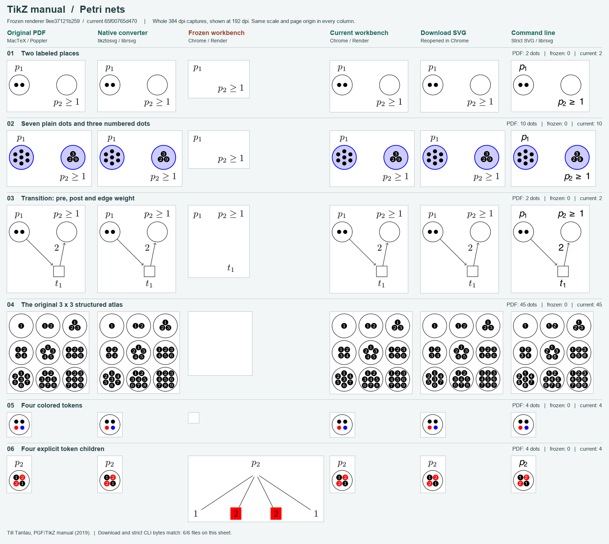
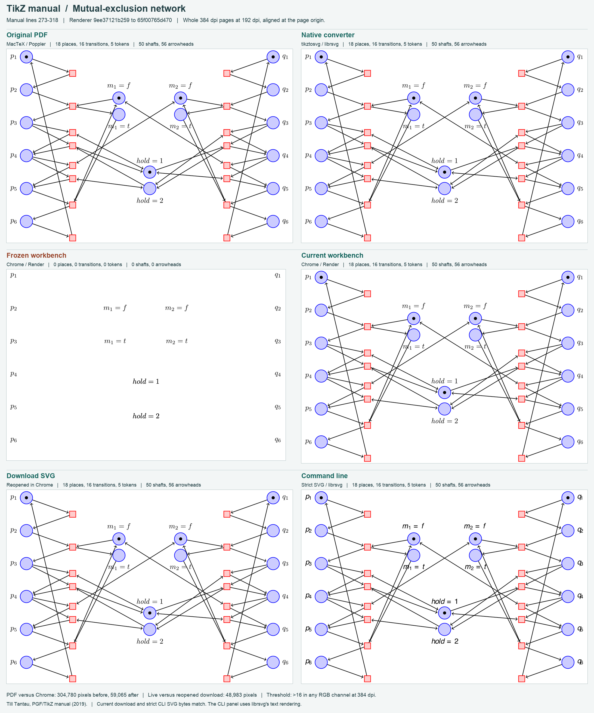

# TikZ Petri nets: places, transitions and token layout

The test corpus is the installed PGF/TikZ manual, not a reconstruction from
screenshots. [Six original small drawings](../../test/fixtures/native-petri/README.md)
isolate the keys; the [original mutual-exclusion network](../../test/fixtures/native-petri/mutual-exclusion.tex)
combines styles, transformed coordinates, repeated nodes, labels and 50 arcs.
The editable [gallery examples](../examples.md#petri-nets) share those inputs.

## Why the old rendering differed

At `096af885`, loading `petri` was accepted without an error but did not
install its styles or child layout. A place with a label painted the label
alone. A complete nine-place token atlas painted nothing, and four explicit
token children became a branching tree extending outside the place.

## Source and behavior

| Local TeX Live 2025 source | What the JavaScript implementation follows |
| --- | --- |
| `tex/generic/pgf/frontendlayer/tikz/libraries/tikzlibrarypetri.code.tex` | Places are circles with a `5ex` minimum; transitions are rectangles with a `4mm` minimum. Tokens are ordinary nodes with a `1ex` minimum, `.5pt` of inner separation, and tiny white text on black. Larger text can enlarge the circle. `every place`, `every transition`, and `every token` are overridable styles. |
| Same file, token growth and placer definitions | `tokens`, `colored tokens` and `structured tokens` add children, not marks on a path. The layout uses the native **ordered** offsets for one through nine children, with `1.5ex` default spacing and no parent-child edge. There is no extra placer for ten: default growth puts the children at the same center, rather than on a new ring. |
| `tex/generic/pgf/frontendlayer/tikz/tikz.code.tex`, node continuation and `do@edge` | Multiple trailing `edge` operations keep the source shape even when it has no name; an edge label belongs to its edge. `pre`, `post` and `pre and post` shorten the corresponding arrow ends by `1pt`. |
| `tex/generic/pgf/utilities/pgfkeys.code.tex`, lines 826, 836-837 | `/.style` replaces a key; `/.prefix style` and `/.append style` add code on the corresponding side. Adding paint to a library style before a picture must not discard its geometry. A picture-local style does not carry into the next picture. |
| `tex/latex/base/fontmath.ltx` and `ot1cmr.fd` | At 10 and 10.95 pt, normal-version `\mathit{hold}` uses the CM text italic face (CMTI10), not the math italic variable face. The correction applies to the last glyph; it must not shift the following equals sign. This change covers words and digits at these sizes, not all math alphabets. |

The numbered atlas tests all nine arrangements and numbering order. The
styled pair checks scoped overrides and larger numbered tokens. The short
colored example and explicit children distinguish a bare color from `fill=`;
the full net exercises nonuniform, reflected coordinates, border anchors,
both arrow directions and bidirectional arrows.

## Visual results

The atlas went from an empty page to nine places with all 45 numbered tokens.
Against the native PDF, the largest difference along either axis for a token
center was 0.00092 mm. At 384 dpi, the bounding edges of the white numerals
could still differ by up to three pixels.
The colored example now paints black, black, red and blue tokens in their
native positions. Explicit children stay inside their place rather than
growing branches. On the transition, the incoming and outgoing arrowheads
are visible and the weight sits beside the outgoing line.

In the mutual-exclusion drawing, the browser now shows 18 places, 16
transitions, five initial tokens and 50 connections. Both `hold` labels use
the native italic face in the preview and the downloaded SVG. The tests compare
the endpoints and directions of all 50 connections with MacTeX.

All seven workbench renders and downloads reported no diagnostics; the SVG
bytes from the current CLI matched the seven files downloaded by Chrome.
This is not a pixel-equality claim: rasterizers differ at stroke edges and
in font handling, especially when librsvg renders embedded web fonts.

All 52 Petri regression checks passed with MacTeX enabled. The full project
run recorded 4,162 passed, zero failed and 14 skipped.

## Reproduce

The [fixture notes](../../test/fixtures/native-petri/README.md) contain the
manual line numbers and replay commands. The native references use local
`pdflatex` and `/Library/TeX/texbin/tikztosvg`; separate captures use the
workbench's live SVG, an actual downloaded SVG reopened in Chrome, and the
CLI output. Runtime rendering itself does not call TeX.
