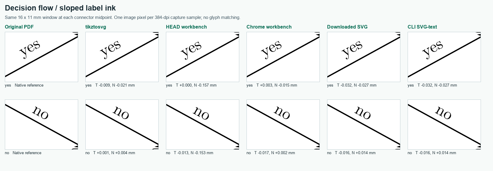

# Node positioning: borders, fixed targets and distances

In TikZ, `right=of A` and `right=of A.center` need not mean the same thing.
With `on grid`, the former measures center to center; the latter places the
new node's **west side** at a distance from a fixed coordinate. TikZKit used
to center both. It also treated every diagonal default as a single length
and lost the order of some local options.

[Before comparison](assets/native-positioning-before.png) |
[After comparison, all seven cases](assets/native-positioning-after.png)

## Rules checked against MacTeX

The implementation follows the locally installed TeX Live 2025 sources:

| Input | How native TikZ places it |
| --- | --- |
| `\usetikzlibrary{positioning}`, also loaded by `chains`; `node distance`, `above right` and the other directions | `tikzlibrarypositioning.code.tex` installs a **pair** of defaults, `1cm and 1cm`. An explicit single diagonal length is multiplied by 1/sqrt(2); a pair is vertical **and** horizontal, with no such multiplier. Core TikZ without the library retains its separate behavior. |
| `right/left/above/below=... of`, diagonal, base and mid variants; `on grid` | The positioning macro looks at the coordinate scanner's border flag. Bare shapes can supply a border or center; `A.center`, `A.north east`, a named `\coordinate`, explicit `node cs` anchors, literal coordinates, projections and `calc` results supply fixed points. The new node still has its own anchor. |
| Unitless values, explicit `cm/mm/pt`, `x` and `y` basis vectors | TikZ adds the components: a dimensional horizontal or vertical length is physical; a bare number is a multiple of its basis vector. On skew axes, one basis vector can contribute to **both** canvas coordinates. Only then are direction signs applied. |
| `\node`, `\coordinate`, `at`, `anchor`, styles and scopes | Placement reads local settings **at the direction key**. A subsequent `anchor` changes the self anchor, not the chosen target. A later `at` replaces the target, not the active gap. A zero-sized coordinate does not acquire a text box. |
| `scale`, `rotate`, `transform shape`, `midway,sloped` | In `tikz.code.tex` the node transform normally resets non-translation components before applying the delayed shift. A sloped edge label needs that shift exactly once in the tangent frame. |

The coordinate scanner, node transform and coordinate shorthand are in
`tex/generic/pgf/frontendlayer/tikz/tikz.code.tex`; the direction table and
distance reader are in its `libraries/tikzlibrarypositioning.code.tex`.
The positioning section of `doc/generic/pgf/pgfmanual-en-tikz-shapes.tex`
illustrates the default gap and on-grid behavior.

## What changed in the pictures

Five focused drawings and two unchanged [gallery drivers](../../test/fixtures/native-positioning-targets/manifest.json)
ran in the live Chrome workbench, its downloaded SVG and the exported SVG.
The references were the original source compiled by pdfLaTeX and the SVG
from `/Library/TeX/texbin/tikztosvg`; no reference replaced a JS output.
The reference SVG stores the painted boxes as closed, nonzero-fill paths in
page coordinates. Measuring those paths and the original PDF outlines gives
an independent check on the node positions, rather than on the interpreter's own numbers.

| Case | Visible change | Largest component of center error vs. original PDF, before / after |
| --- | --- | ---: |
| On-grid targets | Explicit centers, corners and bare shapes no longer collapse onto the same columns. | 9.0004 / 0.0009 mm |
| Diagonals | The default red rectangle moves back to the native upper-right corner; the explicit scalar keeps its shorter displacement. | 2.9295 / 0.0006 mm |
| Option order | The blue rectangle follows the earlier local gap, not a later setting. | 6.9998 / 0.0007 mm |
| Skew axes | The colored markers now follow their physical and basis-vector components, including the sideways offsets. | 4.0008 / 0.0008 mm |
| Standalone directions and `at` | The missing paired-distance box is visible, and the two orders of `at` land in distinct intended rows. | 27.0005 / 0.0007 mm for measurable boxes; none missing after |

All **39** measured centers across the seven drawings are within 0.0014 mm
of both references in vector coordinates after registration by translation
only. At 384 dpi the largest measured *painted* center difference was
0.166 mm. The on-grid target sheet's page is 36.9058 x 72.9058 mm in both
Chrome and the PDF. No renderer diagnostics in the final seven cases.



In the unmodified decision flow the perpendicular offset of the browser's
`yes` and `no` labels fell from about 0.15 mm to 0.0152 and 0.0022 mm
respectively. The other on-grid flowchart's Chrome image was unchanged.
This is **not** a pixel-identity claim: the two gallery drivers still have
outline-size differences up to 0.141 mm. Without registration their centers
differ by up to 0.072 mm. The decision-flow connector strokes did not change:
shaft endpoints differ from PDF by at most 0.0064 mm, tips by 0.0973 mm.
The PDF uses CMR10 and Chrome loaded the corresponding TikZKitCMR10 face;
glyph rasterization still differs.
Arbitrary rotated asymmetric custom shapes and arbitrary PGF key code are
outside this audit. The registry's 192 uses are not 192 visually audited cases.

The [follow-up rectangle audit](2026-11-25-native-rectangle-outlines.md) revisits
both gallery drivers and measures their borders separately from their anchors.

## Reproduce

`PW` below is the absolute entry point of an installed Playwright module.
The visual audit needs local Chrome, MacTeX, tikztosvg, librsvg, Poppler,
PyMuPDF, Pillow, NumPy, SciPy and OpenCV.

```sh
SUITE=test/fixtures/native-positioning-targets
OUT=outputs/qa/native-positioning
POSITIONING_PDFLATEX=/Library/TeX/texbin/pdflatex node --test test/native-positioning-targets.test.js
node scripts/render-example-fixtures.js --fixtures "$SUITE" --output "$OUT" --native-reference --native-latex-engine pdflatex --strict-tikztosvg --tikztosvg-engine pdflatex --math-renderer svg-text --no-comparison-grid
node "$SUITE/capture.mjs" . "$OUT" "$PW" working-tree
python3 "$SUITE/audit.py" "$OUT" --require-match
```

Open `$OUT/visual-sheet.png` and `$OUT/decision-flow-labels.png`. The original
workbench screenshots and PDF are in `capture/ui/` and `capture/pdf/`, and
the reference SVG/PNG are in `tikztosvg-svg/` and `tikztosvg-png/`. The
audit also writes signed measurements and a list of missing landmarks.
