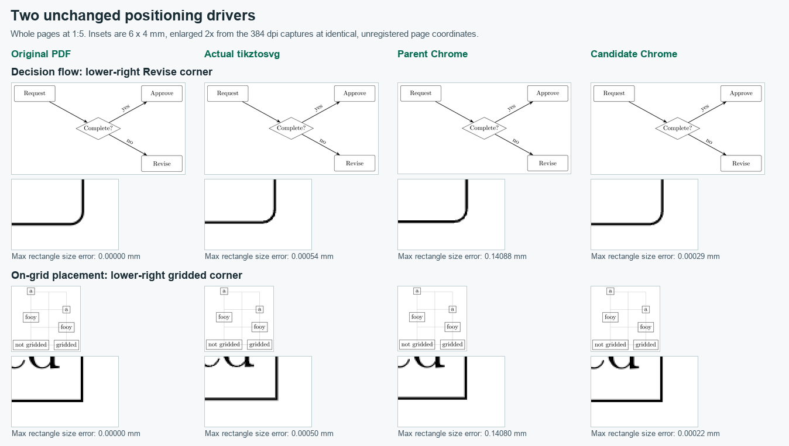

# Rectangle nodes: the path, the pen and the page

TikZKit used to push the background path of a text rectangle inward by
half a pen width, even when its named anchors were already correct. A
heavy frame visibly shrank towards its label. A double frame could render
as two nested outlines instead of one centered band with a colored stripe.
The fix is in the shared interpreter and SVG renderer, not in the examples.



## Native rules

The local TeX Live 2025 package entry point, `tikz.sty`, loads PGF and
inputs `tikz.code.tex`. These are the implementation details used here:

| Source | Rule |
| --- | --- |
| `pgfmoduleshapes.code.tex:881-1102` | The rectangular node uses the text box, inner separation and minimum size to construct its background. The named outer anchors include outer separation; the background path removes it. |
| `pgfcorepathusage.code.tex:107-167,254-265` | PGF tracks the constructed path in canvas coordinates, adds half of the active outer pen when stroking, and replays the same processed path for a positive inner pen. That replay does not fill the region again. |
| `tikz.code.tex:192-233` | With nominal line width W and gap G, the two pens are 2W+G and G (default 0.6pt). With line-center distance D they are W+D and D-W. The distance keys enable double mode. A bare `double` retains the selected ink; `double=none` turns the second stroke off. |
| `tikz.code.tex:103,1055-1062,4156-4171` | `transform shape` retains the coordinate transform for node geometry and text. Unlike a backend `transform canvas`, it does not multiply the current stroke width. |
| `pgfcorepathconstruct.code.tex:1039-1104` and `pgfcorepathprocessing.code.tex:371-427` | A rounded rectangle walks from northeast towards northwest. PGF trims each incident segment by the signed inset and computes cubic controls. It does not clamp to half a side as SVG `rx` does. The unrounded construction corners still determine the native page. |

## What was tested

- **Size and placement:** ordinary `\node` rectangles with and without text,
  `minimum width/height`, `inner sep`, `outer sep`, `outer xsep/ysep`,
  `draw`, `fill`, `line width`, named `west/east/north east` anchors,
  `rotate`, and uniform `scale` with `transform shape`.
- **Paint:** `rounded corners` (default, explicit, unitless, negative and
  oversized), `double`, `double=<color>`, `double=none`, `double distance`
  and `double distance between line centers`. Zero and overlapping gaps
  paint only the outer pass. The same pen setup applies to an ordinary
  `\draw` path; pdfLaTeX measurements distinguish painted and fill-only boxes.
- **Controls:** an unchanged decision flowchart with rounded process boxes,
  a diamond and sloped edge labels, and an unchanged on-grid positioning
  example with six text boxes. Neither fixture was rewritten to match the output.

For a 60 x 30 TeX pt node with a 4 pt stroke, the old page measured
60 x 30 pt instead of **64 x 34 pt**. Outer separation changes its anchors
without changing that page; a fill-only rectangle really is 60 x 30 pt.
After a 30-degree rotation the drawn page is 70.96165 x 59.98082 pt. A
2 pt line with a 3 pt double gap has a 7 pt outer pen and is 67 x 37 pt.
The [independent TeX measurements](../../test/fixtures/rectangle-outline-metrics.tex)
cover 23 such configurations. Scaling the shape by 1.5 produces a
90 x 45 pt centerline but retains the 4 pt pen, giving a 94 x 49 pt page.
The same distinction is tested for inline nodes and for a separate backend scale.

| Original gallery source | Previous outline size error | Current maximum width or height error vs. original PDF | Current page width / height error |
| --- | ---: | ---: | ---: |
| Decision flow | 0.14088 mm | 0.00029 mm | +0.00015 / +0.00019 mm |
| On-grid center placement | 0.14080 mm | 0.00022 mm | +0.00014 / +0.00023 mm |

The original PDF was compiled directly from the fixture. The independent
SVG was produced by the local `/Library/TeX/texbin/tikztosvg` and rasterized
with `rsvg-convert`. Its rounded process boxes have four cubic corners and
a centered 0.3985 bp pen; they are not inset rectangles. The browser
measurements came from the live workbench, its downloaded SVG and the CLI
SVG at the same physical scale, not from the renderer's scene data.

In the [stroke and rotation comparison](assets/native-rectangle-pens.png),
the missing red inner stripe is back on the centerline, and scaling the
box no longer thickens the blue 8 pt pen from 2.8117 to 4.2175 mm.
In the [before/after ink differences](assets/native-rectangle-difference.png),
the previously pill-shaped and square corners now show the same crossing
segments and outward arcs as the original. The crops use the same native
page coordinates; there is no alignment or rescaling before differencing.
All ten probes and both drivers rendered without diagnostics. None of
the 120 panel/row reference comparisons exceeded the predefined 0.005 mm
geometric or 0.20 mm raster tolerance on the probes.

This is not pixel equality: the decision-flow arrow tips still differ by
up to 0.0973 mm and its node-word ink centroids by up to 0.1065 mm.
Other shapes, arbitrary double-style hooks, dashed stroke phase on sharp
boxes, and general text/arrow painting are outside this rectangle audit.

## Reproduce

Run the [regression tests](../../test/rectangle-outline.test.js) with and
without the local TeX measurement check:

```sh
node --test test/rectangle-outline.test.js
RECTANGLE_PDFLATEX=/Library/TeX/texbin/pdflatex node --test test/rectangle-outline.test.js
```

The [Chrome and TeX replay instructions](../../test/fixtures/native-rectangle-outlines/README.md)
work from a fresh checkout. The [visual probes](../../test/fixtures/native-rectangle-outlines/manifest.json)
and [original gallery drivers](../../test/fixtures/native-rectangle-outlines/drivers/manifest.json)
are separate so the calibration marks cannot change the real diagrams' bounds.
