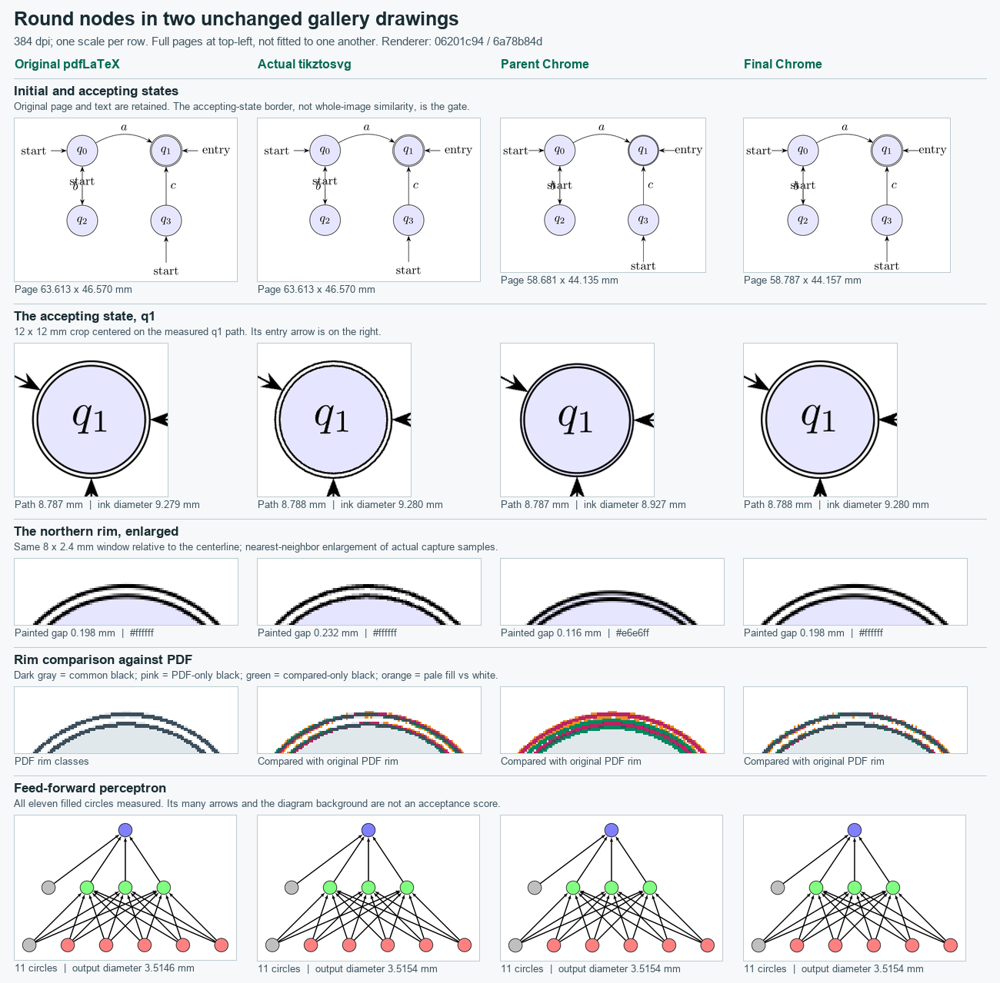
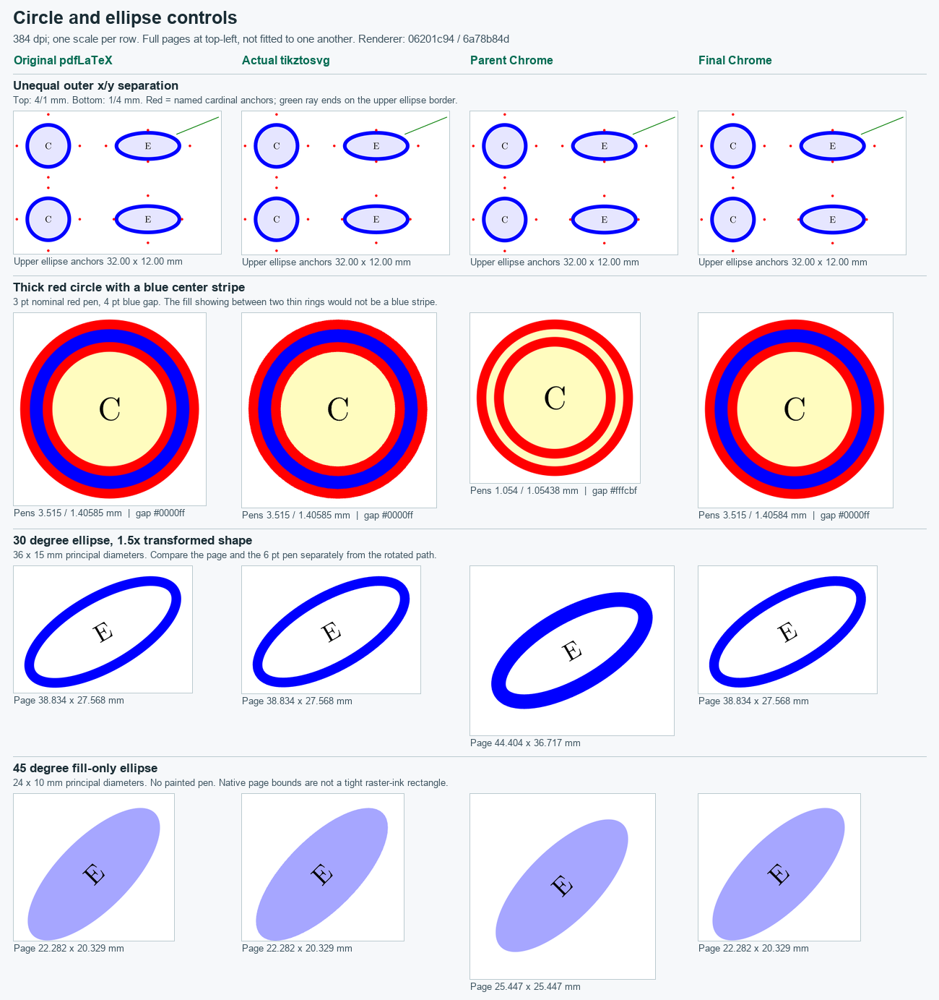

# Circular and elliptical node outlines

An accepting automaton state is a good way to spot a wrong double stroke:
the fill is pale blue, but the ring separating its two black edges is white.
TikZKit previously drew two nested black ellipses, so the fill showed through.
The centerline was already the correct size; enlarging the whole node would
have moved its arrows as well.

## Native rules

The sources below are from the installed MacTeX (TeX Live 2025), not from
the SVG under test.

| Source | Rule used |
| --- | --- |
| `pgfmoduleshapes.code.tex`, circle; `pgfcorepoints.code.tex`, `\pgfpointnormalised` | Half-width and half-height plus inner separation form a radius vector. PGF normalizes its direction and divides integer registers to recover the radius, then applies the minimum size. This is not exactly a floating-point hypotenuse. The larger outer separation applies to both circle anchors, but not to the painted path. |
| `pgflibraryshapes.geometric.code.tex`, ellipse; `pgfmanual-en-library-shapes.tex`, ellipse example | Each half-axis is scaled by 1.4142136 and clamped by its own minimum. Outer separation is per axis. A named diagonal uses 0.707107 of each saved radius; a numeric angle intersects a ray with the border instead. |
| `tikzlibraryautomata.code.tex`, `pgfmanual-en-library-automata.tex` | An ordinary state is a drawn circle with a 2.5 em minimum. `accepting by double` sets both `double` and `outer sep=.5\pgflinewidth+.3pt`. The latter reads the nominal line width, not the widened outer stroke. |
| `tikz.code.tex`, double keys; `pgfcorepathusage.code.tex`, stroke action | With pen width W and gap G the two passes have widths 2W+G and G, on the same path. Only the first pass fills. A uniform shape transform changes the radii, not the physical pen or gap. |
| `pgfcorepathconstruct.code.tex`, `\pgfpathellipse` and `\pgf@protocolsizes` | The page tracks transformed cubic supports in construction order, not the rotated rectangle enclosing the original ellipse. Even an unpainted background affects the page. |

## What changed visibly

| Measurement | Previous Chrome | Fixed Chrome | Original PDF |
| --- | ---: | ---: | ---: |
| Automaton accepting state's outer ink diameter | 8.927 mm | 9.280 mm | 9.279 mm |
| Color in that state's gap | pale blue | white | white |
| 30-degree stroked ellipse, 1.5x shape transform: page | 44.40 x 36.72 mm | 38.83 x 27.57 mm | 38.83 x 27.57 mm |
| 45-degree fill-only ellipse: page | 25.45 x 25.45 mm | 22.28 x 20.33 mm | 22.28 x 20.33 mm |

The original PDF was compiled directly from the TeX input. The separate
`/Library/TeX/texbin/tikztosvg` output was rasterized with `rsvg-convert`.
Its accepting state uses two strokes on the same four-cubic path. The browser
uses two SVG ellipse elements with identical centers and radii. The checks
measure physical dimensions and sample actual pixels in loaded Chrome,
the downloaded SVG and the CLI export. The original gallery sources for the
automaton and the eleven-node perceptron are unchanged.

Across six drawings, all 132 comparisons of JS output against the native
references passed, as did 44 comparisons between the references themselves.
Each comparison checks the applicable dimensions, anchors, ink or colors of a
specific shape; this is not a whole-page similarity score.

**Covered:** ordinary `circle` and `ellipse`; text boxes, inner and outer
separation, per-axis minimums, named compass and numeric angle anchors,
stroke, fill, colored double lines, rotation, uniform shape scale, and
`state` / `accepting` for states without output.

**Not a whole-diagram pass:** the automaton page is still about 4.83 mm
narrower and 2.41 mm shorter than the reference. Entry-arrow tips and their
label spacing are separate from the circular border. This audit does not
certify split nodes, arbitrary canvas transformations or all math text.

[Replay the browser and converter comparisons](../../test/fixtures/native-round-nodes/README.md).
The independent TeX fixtures record [node radii](../../test/fixtures/round-node-radii.tex)
and [page sizes and anchors](../../test/fixtures/round-node-outlines.tex).
