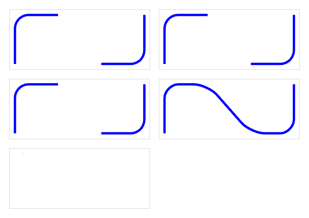

# Rounded corners on TikZ paths

Previously, TikZKit joined disconnected strokes, abandoned all rounding when a
path contained a cubic, and applied the last corner setting to the whole path.
These were construction errors: changing the SVG stroke join cannot fix them.



## Source and behavior

The local MacTeX 2025 front ends (`tikz.sty` and `tikz.tex`) both load
`tikz.code.tex`. Its `rounded corners` and `sharp corners` keys write the
same PGF register. The default inset is 4 TeX points. The section on path
construction in `pgfmanual-en-tikz-paths.tex` supplies the open, inline,
braced and 1ex rectangle examples in the [14-case manifest](../../test/fixtures/native-rounded-corners/manifest.json).

| Command or option | What the implementation follows |
| --- | --- |
| `\draw`, `--`, `.. controls ..`, `-- cycle` | In `pgfcorepathconstruct.code.tex`, the incoming segment records a marker at its endpoint. A later move ends the subpath. A close has its own marker and can change the first painted point. |
| `rounded corners`, `rounded corners=<inset>`, `sharp corners` | The last key takes effect **at that point**. Explicit scopes, named styles and braced groups restore the previous value without resetting the pen. The nested example measures 0, 7, 0 and 1pt on its four elbows. |
| Line/cubic and cubic/cubic joins | `pgfcorepathprocessing.code.tex` uses the adjacent control points to find directions, keeping the original cubic supports. Each new support lies 0.5522847 of the way from a cut point towards the vertex. `pgfcorepoints.code.tex` supplies PGF's normalized directions. |
| `rectangle`, `circle`, `arc` | A rectangle interrupts an incoming line, closes, then resumes at the opposite corner. An ellipse's internal quarters are not marked corners; a multi-piece arc marks its end, not its internal joins. |
| `scale`, `xscale`, `yscale`, `rotate`; signed or oversized insets | Ordinary coordinate scaling changes the legs but not the physical inset. There is no half-leg clamp. With two 2pt legs and a 20pt inset, the curve extends well past the 2.391bp square page; the page still tracks construction, not that protruding ink. |

The native SVG confirms distinct moves for the two disjoint strokes and for
the line, rectangle and continuation. Rounding adds cubic commands; the stroke
still has butt caps and miter joins. The tests check the path commands and
original PDF page as well as the visible result.

## Results

The live Chrome workbench and exported SVG each ran against local
`/Library/TeX/texbin/tikztosvg`. All source files also ran independently
through pdfLaTeX. No substituted reference, diagnostics or browser errors.
See the [before comparison](assets/native-rounded-corners-before.png) and
[after comparison](assets/native-rounded-corners-after.png) for all 14 pictures.

| Live case | Before: ink agreement | After |
| --- | ---: | ---: |
| Disconnected strokes (spurious joining line) | 0.7736 | 1.0000 |
| Mixed cubic joins (sharp kinks) | 0.3790 | 0.9998 |
| Rectangle inside a longer path | 0.6079 | 0.9989 |
| Manual: switch off rounding, then round the closing corner | 0.7929 | 0.9999 |
| 20pt inset on a tiny page | 0.0454 | 0.9773 |

Only 14/28 old panels passed the 0.95 ink gate, and only 2/28 also passed
the independent PDF centerline gate. After the fix, all 28 pass both. The
largest sampled centerline deviation from the original PDF is 0.0017bp,
without translating or scaling the pictures to fit. Antialiasing remains
visible on a 10-by-10-pixel page. The unmodified corpus triangle and the
intentionally sharp open-path control also pass.

A separate Chrome check expands the actual SVG commands at intrinsic size.
It verifies open/closed subpaths, paint order, endpoints, cubic controls and
page bounds without aligning paths. Before: 2/28 panels passed. After: 28/28;
the largest cubic-coordinate difference is 0.00432 CSS px (limit 0.05px),
and page bounds match. Each renderer paints 16 open and 7 closed subpaths,
counting fill and stroke separately.

These results cover ordinary TikZ paths, not rounded *node shapes*,
anisotropic backend canvas transforms, arbitrary custom path constructors,
or the low-level PGF interface for unequal incoming and outgoing insets.

## Reproduce

Set `PW` to the entry point of an installed Playwright module:

```sh
SUITE=test/fixtures/native-rounded-corners
OUT=outputs/qa/native-rounded-corners
node scripts/render-example-fixtures.js --fixtures "$SUITE" --output "$OUT" --native-reference --strict-tikztosvg --tikztosvg-engine pdflatex --math-renderer svg-text --no-comparison-grid
node scripts/audit-module-regressions.js --fixtures "$SUITE" --output "$OUT" --workbench --browser-module "$PW"
node scripts/measure-vector-ink.mjs "$OUT"
python3 "$SUITE/verify.py" "$OUT"
node scripts/audit-rounded-corner-geometry.mjs "$OUT" "$PW"
node --test test/native-rounded-corner-paths.test.js test/native-rounded-corner-geometry.test.js
```

The PDF check uses PyMuPDF, Pillow, NumPy and SciPy. Open
`$OUT/browser-audit.html` for the workbench comparisons, or
`$OUT/corner-contact-sheet.png` for the independent PDF and difference
panels. Reference SVGs and rasters are in `tikztosvg-svg/`, `tikztosvg-png/`
and `mactex-png/` under the same output directory.
