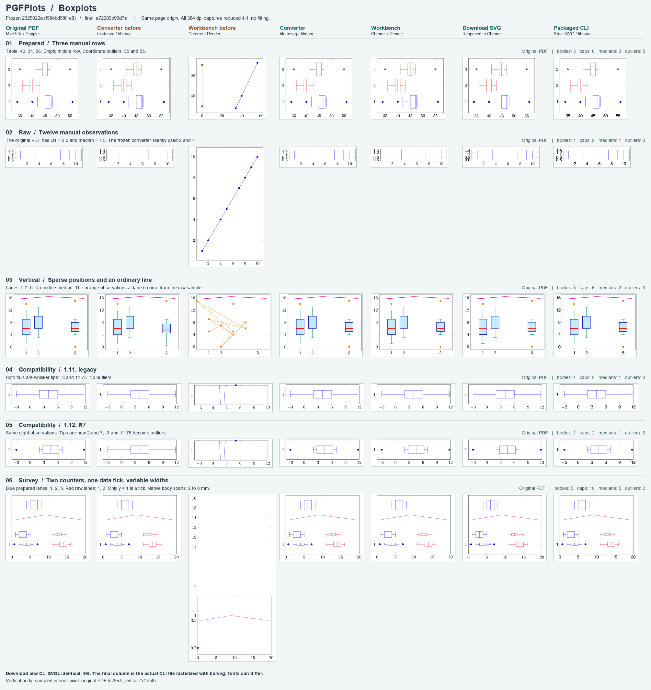

# PGFPlots statistics: 2D boxplots

Previously the ordinary line handler connected the input rows, ignored the
five-number summary and reported no error. In the three-group manual example
the entire middle group disappeared. The statistics handler now separates
the scalar sample survey, box geometry and outlier marker stream.

## Sources and reproduction

- MacTeX 2025: `tikzlibrarypgfplots.statistics.code.tex` defines the prepared
  and raw handlers, part styles, quartile estimators, whisker fences, per-type
  plot counters, category anchor and variable-width survey. The
  `pgfplots/statistics.lua` backend differs from TeX at some rounding ties.
- `pgfplots.code.tex` changes the default estimator and marker at compatibility
  1.12. `pgfplotscoordprocessing.code.tex` collects data ticks from the first
  plot's coordinate stream, not every survey corner or subsequent series.
  `pgfplots.scaling.code.tex` sets a supplied 2D unit vector directly.
- Two original examples are in the installed manual source
  `pgfplots.doc.src.tar.bz2:pgfplots.libs.statistics.tex`:
  [three prepared summaries](../../test/fixtures/examples/pgfplots/boxplot-manual-prepared.tex)
  and [one column of samples](../../test/fixtures/examples/pgfplots/boxplot-manual-samples.tex).
- The [visual fixtures](../../test/fixtures/native-pgfplots-boxplots/) use the
  original PDF, local `tikztosvg`, Chrome's live Render button, the downloaded
  SVG reopened in Chrome, and CLI output. The local artifact directory is
  `outputs/qa/2026-11-25-pgfplots-boxplots/`. The
  [native geometry tests](../../test/pgfplots-boxplot-native.test.js) compare
  actual painted strokes and mark centers in TeX points; the
  [statistics tests](../../test/pgfplots-boxplot-statistics.test.js) check
  the numerical results independently.

All 17 geometry cases passed against the installed pdfLaTeX. For each of the
six visual examples the SVG downloaded from the live workbench was identical
to the CLI SVG, byte for byte. The full project suite passed 3,955 tests,
with 14 skipped and no failures.

## What to inspect

1. Three horizontal rows now show three boxes, six whisker caps and three
   medians. The five isolated marks are outliers; the red middle row has none.
2. For the twelve unsorted observations at compatibility 1.18 the box runs
   from 3.5 to 9 and the median is 7.5. The old reference wrapper loaded the
   library twice, producing 2 and 7 instead of 3.5 and 7.5. It now preserves
   the preamble order. The source's `y=1cm` remains a physical data unit.
3. The vertical series occupy lanes 1, 2 and 5. The second has no median:
   no extra red stroke should appear. In the compatibility pair the same
   observations at -3 and 11.75 are whisker tips in 1.11 and outliers in 1.12.
4. Prepared and calculated plots have separate default lane counters.
   Ordinary lines do not advance either counter. Variable widths change the
   painted boxes after surveying, not the axis limits.

## Coverage

| Supported in this slice | What determines the result |
| --- | --- |
| `\usepgfplotslibrary{statistics}`, `\addplot`, `\addplot+`, `boxplot`, `boxplot prepared` | Prepared summaries accept empty coordinates or explicit outliers. Raw coordinates, inline/external tables, or sampled 2D functions supply observations. |
| `lower whisker`, `lower quartile`, `median`, `upper quartile`, `upper whisker`, `average`, `sample size` | A missing prepared statistic is not zero. A computed average is painted only when requested. |
| `estimator`, `lower quartile off`, `upper quartile off`, `whisker range`, `data`, `data value` | Compatibility chooses the default. The selected estimator, fences and data expression determine the whiskers and outliers. |
| `draw direction`, `draw position`, `draw relative anchor`, `box extend`, `whisker extend` | Sizes are in category-axis units. A prepared outlier may use its own table row for placement; the summary uses the final row. |
| `variable width`, `variable width min target`, `sample size min/max` | The stock square-root rule scales the painted width; a constant whisker extent stays constant. |
| `every box/whisker/median/average`, `mark`, `mark size`, `ensure mark`, `clip marker paths` | Part styles, outlier markers and clipping follow distinct native paint stages. |

This is not a whole-library certification. Arbitrary TeX draw/filter programs,
custom size transforms, boxplot coordinate systems in user overlays, custom
scatter phases and mark sampling are outside this slice. Native and browser
rasters are compared at physical scale, not claimed to be pixel-identical.
