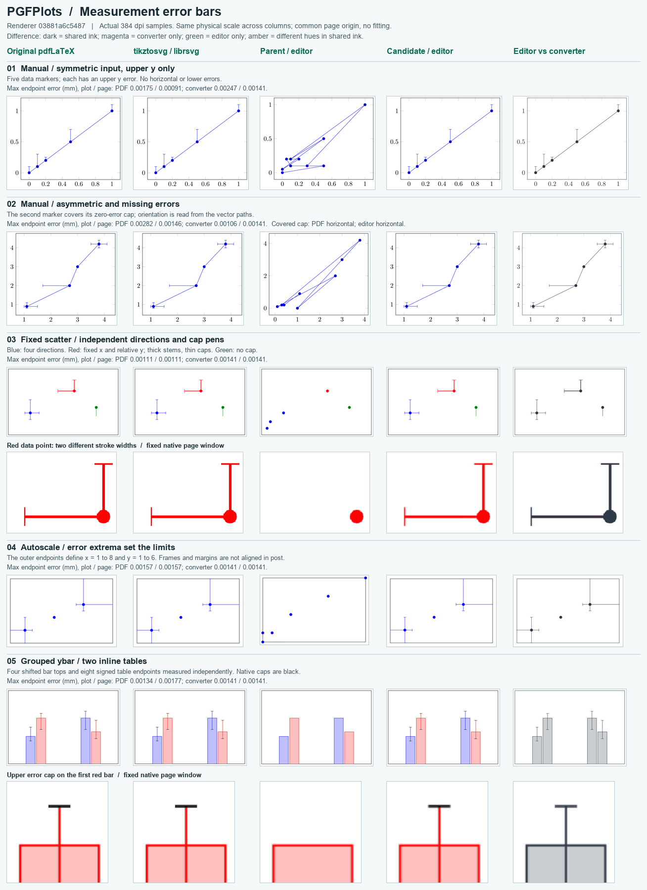

# PGFPlots: measurement errors on linear Cartesian axes

The old renderer read the uncertainty in `(1,2) +- (0,.5)` as a second
measurement at `(0,.5)`. It joined this point to the line, painted another
marker and used it to size the axis, all without a diagnostic. Fixed errors
had the opposite failure: only the original point appeared.

## Native behavior

- TeX Live 2025 `pgfplots.sty` loads `pgfplots.code.tex`. Lines 3088–3166
  of the latter define separate direction and value modes for each axis.
  `error bar style` appends to the thin stem style; `error mark options`
  replaces the nested mark options (initially `rotate=90`).
- In `pgfplots.errorbars.code.tex`, the survey updates limits with the
  enabled data-space endpoint, not the physical width of its end mark.
  A relative endpoint is `v * (1 ± e)`, including when `v` is negative.
  An omitted side does not mean that a symmetric partner should be invented.
- `pgfplotscoordprocessing.code.tex:3976–4018` puts error bars after the
  ordinary plot handler, independently of the marker phase. The default
  mark in `pgflibraryplotmarks.code.tex:148–154` runs from +size to −size.
  The directed stem and nested picture orient that mark; independent x/y
  data scales do not stretch its physical width. The standard `ybar` and
  `xbar` styles shift both endpoints along with the grouped rectangle.
- The tip is drawn inside a node, not as an SVG arrowhead. The nested mark
  starts with a fresh 0.4 pt pen and the current color, not a stroke-only
  `draw=...` override on the shaft. With `clip=false`, the enclosing node's
  inner separation extends the page box without changing the axis limits.

## Coverage

| Input | Supported in this slice |
| --- | --- |
| Per-measurement coordinates | `+-` (symmetric); `+=` and `-=` separately or together. The central line, ordinary plot marks and metadata still refer only to the measured points. |
| Tabular input | Named or indexed `x error` / `y error` columns and separate `... error plus` / `... error minus` columns. |
| Error options | `error bars/.cd`, qualified keys, `x dir` / `y dir` = `none`, `plus`, `minus`, `both`; `fixed`, `fixed relative`, `explicit`, `explicit relative`. |
| Painting | Line or points only, sampled functions, ordinary grouped bars, independently styled stems and caps, and viewport clipping. Errors are not legend marks or named data paths. |
| Not certified | Logarithmic, stacked/interval, ternary or 3D errors; table error expressions; custom TeX `draw error bar/.code 2 args` programs; custom minimum sizes or anisotropic padding on rotated tip nodes. |

## Reproduce

The original [one-sided](../../test/fixtures/native-pgfplots-error-bars/manual-symmetric.tex)
and [asymmetric](../../test/fixtures/native-pgfplots-error-bars/manual-asymmetric.tex)
pictures come from `pgfplots.reference.errorbars.tex` in the installed manual.
The [fixed-dimension scatter plot](../../test/fixtures/native-pgfplots-error-bars/fixed-scatter.tex)
distinguishes the two axes, pen widths and a deliberately capless negative arm.
The [automatic-axis control](../../test/fixtures/native-pgfplots-error-bars/auto-extents.tex)
places its outermost errors on the plot boundary without fixing any data limits.
The [grouped bar control](../../test/fixtures/native-pgfplots-error-bars/grouped-table.tex)
uses two tables and a separate column for each error direction: the colored
shafts are centered on their own bars, and all eight caps stay black.
The [replay instructions](../../test/fixtures/native-pgfplots-error-bars/README.md)
cover the live editor, Download SVG, CLI export, original PDF and converter.

## What changed on screen

In the two manual examples, the old line doubled back through the error tuples.
The repaired line visits only the measurements; its missing side stays absent
and its one-sided errors stop at the same tick positions as the original PDF.
Across the five examples the old renderer drew none of the 37 nonzero stems.
The new rendering also distinguishes a capless green stem from a missing
stem, and a thin black cap from its thicker or colored shaft.

At 384 dpi, the editor, downloaded SVG and CLI export each passed all 101
feature checks against **each** of the original PDF and `tikztosvg`
(606 comparisons at a 0.02 mm geometry tolerance; no diagnostics).
The largest editor endpoint deviation relative to the plot was 0.00282 mm
against the PDF and 0.00247 mm against the converter. On the unclipped
autoscale example, the maximum *absolute page* endpoint deviation fell from
1.10193 mm in the intermediate fix to 0.00157 mm against the PDF. No page
was shifted or resized to obtain those numbers.

These are geometry and paint checks, not a claim of pixel identity. The PDF
page streams, converter SVGs and librsvg reference images were unchanged;
two repeat Chrome screenshots of the same converter SVGs had different
pixel hashes. The fixture records those separately from renderer differences.
