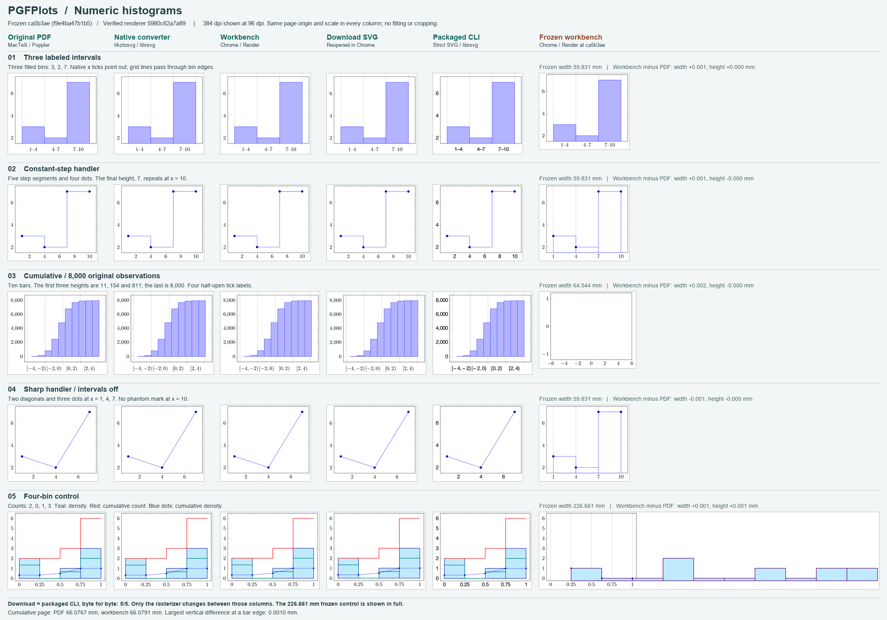

# PGFPlots: numeric histograms

The cumulative example in the installed statistics manual used to produce
an empty frame. It reads 8,000 observations from the first column of a plot
file, not from a table with a header. The other manual examples distinguish
a histogram drawn as adjacent bars, as steps, and as a line through bin
starts. Binning must happen before any of those drawing rules run.



## Native references

The installed MacTeX 2025 sources under `tex/generic/pgfplots/` define the
following behavior:

- `pgfplotsplothandlers.code.tex:1638-1960`: the histogram is a core plot
  handler. Select a scalar before ordinary coordinate filtering, inherit
  unspecified bin limits from the x-axis, clamp the outer tails, count,
  then replay the bin starts into the selected painter. The default final
  point repeats the last height at the exact upper bound.
- `pgfplotscoordprocessing.code.tex:6401-6540`: a plot file has positional
  whitespace-delimited fields; a line with one number supplies x and a
  default y of zero. It does not consume the first number as a column name.
- `pgfplots.code.tex:3495-3521` and `pgfplotsticks.code.tex:294-350`: the
  PGFPlots interval bar style configures the category grid, tick alignment
  and interval labels. The low-level TikZ handler just paints the bars.
  Interval text belongs halfway between consecutive physical tick positions;
  the final boundary has a tick but no interval label.
- The [visual fixtures](../../test/fixtures/native-pgfplots-histograms/manifest.json)
  include four examples from `pgfplots.doc.src.tar.bz2:pgfplots.libs.statistics.tex`.
  The [cumulative example](../../test/fixtures/examples/pgfplots/hist-manual-cumulative-x.tex)
  uses the [original observations](../../test/fixtures/examples/pgfplots/plotdata/pgfplots.randn.dat).

## Commands and options

| Commands or options | Result tested |
| --- | --- |
| `\usepackage{pgfplots}`, `\begin{axis}`, `\addplot`, `\addplot+`, `hist` | Only an activated histogram replaces the input with a bin stream. The statistics library is not required for the core handler. |
| `coordinates`, `table`, `file`, sampled 2D functions, `domain`, `samples`, `variable` | Select one scalar per input row; a nonfinite unused coordinate does not discard the observation. External plot files must be supplied to the renderer. |
| `data`, `data value`, `data filter/.expression`, `\thisrow`, `\coordindex` | Expressions can use the selected row; a literal value is not reinterpreted as a PGF math program. |
| `bins`, `data min`, `data max`, `xmin`, `xmax` | Unspecified limits inherit from the x-axis or the sample extrema. Both outer bins include observations beyond the configured range. |
| `density`, `cumulative` | Counts, count divided by sample count and bin width, running counts, or running counts divided by sample count. Tiny densities retain their scale through projection. |
| `\pgfmathsetseed`, bare `{rnd}` and `{rand}` | A literal seed drives consecutive 2D histogram samples in source order. The [random-stream tests](../../test/pgfplots-histogram-random.test.js) compare every sample and the following generator state to pdfLaTeX. This is not a general-purpose random expression evaluator. |
| `intervals`, `handler/.style`, `ybar interval`, `const plot`, `sharp plot`, `mark` | The painter consumes the same surveyed values. With `intervals=false` the duplicate terminal coordinate is absent, so it gets no marker. |
| `xtick=`, `x tick label as interval`, `xticklabel`, `\tick`, `\nexttick`, `\pgfmathprintnumber` | Half-open brackets, punctuation and authored number formatting survive parsing. A later explicit tick setting overrides the axis style. |

## Reproduction

The [native path tests](../../test/pgfplots-histogram-native.test.js)
compare actual TeX rectangle corners, line vertices and independent axis
coordinates in physical TeX points (tolerance 0.025 pt).

```sh
QA_LATEX_ENGINE="$(command -v pdflatex)" TIKZKIT_TEST_PDFLATEX=1 \
  node --test test/pgfplots-histogram*.test.js
```

The local visual outputs are under
`outputs/qa/2026-11-25-pgfplots-histograms/`. The reference converter is
`/Library/TeX/texbin/tikztosvg`; an original-document PDF raster is retained
separately from the SVG converted with `rsvg-convert`.

## What changed on screen

- The original 8,000-row chart now has ten filled bars, rising to 8,000,
  instead of empty axes. The second cumulative total is **154** in MacTeX;
  dividing ideal binary64 endpoints would yield **155**. The data were not
  resampled to force a match.
- The constant-line example shows the three bin heights as steps and four
  markers. The sharp-line example with `intervals=false` shows three markers
  joined by two diagonals, not three outlined rectangles.
- A grouped comma in `\pgfmathprintnumber{8000}` is an ordinary math atom;
  it must not receive the thin space of a punctuation comma. MacTeX measures
  the printed label at 22.77785 pt (24.44447 pt for ungrouped `$8,000$`).
- On the cumulative chart the final live page is 66.07907 mm wide versus
  66.07669 mm for the original PDF. The largest vertical difference at a
  bar edge is 0.00104 mm. All five cases rendered without diagnostics,
  and each SVG downloaded from Chrome was byte-identical to the final CLI
  output. The [replay instructions](../../test/fixtures/native-pgfplots-histograms/README.md)
  cover the originals, browser screenshots, hashes and per-panel measurements.

Symbolic histograms, arbitrary TeX transforms, filters and drawing callbacks
and 3D histogram input are outside this slice. The supported bin limit is
10,000. These tests do not certify every PGFPlots axis or byte-identical
antialiasing between PDF, SVG and the browser.
