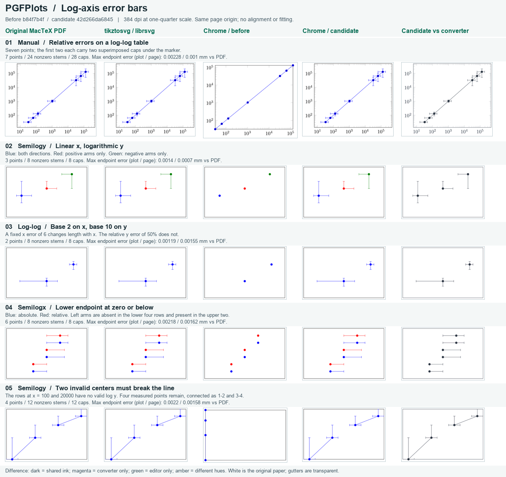

# PGFPlots: measurement errors on log axes

The starting revision (`b84f7b4f`) drew the measured curve on log axes but
silently omitted every uncertainty. The following examples use the standard
PGFPlots 2D Cartesian handlers, not a per-picture drawing or a precomputed SVG.

## Native semantics

The [double-log table](../../test/fixtures/native-pgfplots-log-errors/manual-log-relative.tex)
is the original picture in `pgfplots.reference.errorbars.tex`, lines 198–215
of the installed PGFPlots manual sources. Its seven rows combine a fixed
relative x error of 0.5 with independent y errors from a table.

`pgfplots.errorbars.code.tex:261–415` starts from the unfiltered coordinate:
an absolute endpoint is `v ± e`, and a relative endpoint is `v × (1 ± e)`.
Only then does PGF project the endpoint onto the logarithmic axis. TikZKit
keeps it in data units through the survey so the existing axis transform is
applied exactly once. A perpendicular cap still has a physical width in TeX
points; zooming the data or changing the log basis must not stretch it.

An endpoint at 1 is valid, including where its mapped log is zero. A supplied
zero uncertainty is also valid. An absent or nonpositive per-point log
endpoint does not extend the axis or get a replacement cap at the frame.
For a fixed relative error PGF prepares **both** scale factors before looking
at the selected direction; an invalid factor is a setup error even for a
one-sided plot. The browser reports `PGFPLOTS_LOG_ERROR_FACTOR` for this
configuration, once per affected series dimension.

An invalid **measurement** is different from an invalid **endpoint**.
`pgfplotsaxisdatapointsurveyed` in `pgfplotscoordprocessing.code.tex` admits
only a complete valid row. On a semilog-y axis, `(20000,-1)` therefore
contributes neither a mark nor an x limit of 20000. With `unbounded coords=jump`
it breaks the connecting line; with `discard` the next valid point continues it.

The boxed manual axis enlarges its automatic limits by 10% of the **log**
span, not the span of the raw numbers. Frame layout must not apply the
margin a second time. PGFPlots then paints 43 minor x ticks on each of the
bottom and top edges, and 39 minor y ticks on each of the left and right
edges. Major ticks and their labels remain distinct.

## What to try

| Source | Commands and options exercised |
| --- | --- |
| [Manual](../../test/fixtures/native-pgfplots-log-errors/manual-log-relative.tex) | `loglogaxis`, `\addplot+`, `table[x=...,y=...,y error=...]`, `error bars/.cd`, `x/y dir=both`, `x fixed relative`, `y explicit relative`. |
| [Semilog scatter](../../test/fixtures/native-pgfplots-log-errors/semilogy-asymmetric.tex) | `semilogyaxis`, mixed linear/log dimensions, `only marks`, `mark=*`, `+=`/`-=`, `+-`, plus-only/minus-only and two-sided errors. |
| [Different bases](../../test/fixtures/native-pgfplots-log-errors/loglog-mixed-bases.tex) | `log basis x=2`, `log basis y=10`, `x fixed=6`, `y fixed relative=.5`, explicit limits and a fixed plot box. |
| [Invalid lower endpoints](../../test/fixtures/native-pgfplots-log-errors/nonpositive-lower.tex) | `semilogxaxis`, absolute and relative errors at or beyond zero, and a positive lower-arm control. |
| [Invalid measurement centers](../../test/fixtures/native-pgfplots-log-errors/semilogy-invalid-centers.tex) | `semilogyaxis`, `unbounded coords=jump`, automatic limits, two connected pairs with a real gap and twelve signed errors. |

## Visual result

The manual example recovers 24 nonzero stems and all 28 caps (four coincide
at zero-error centers). Its outer markers now clear the frame and the first
x decade label is back. In the last example the four markers used to collapse
onto the left edge; both the editor and the downloaded SVG now show two
separate pairs with the same extents as the original PDF.

All five cases were rendered by clicking **Render** in Chromium, downloading
the SVG, and running the CLI independently. Compared at the same page origin
with unmodified MacTeX PDF and local `tikztosvg` output, no physical checks
failed. The largest frame-relative endpoint difference was **0.00282 mm**
against either reference. An independent TeX callback also checked 75 stem
origins and tips within 0.03 TeX pt. This is not a pixel-identity claim:
at 384 dpi the thin blue cap on the last chart's right border rasterizes
slightly differently in Chrome's standalone SVG than in native PDF; the
converted reference SVG shows the same effect.

The strict repeat-capture check was **24/25**, separate from the geometric
checks. On two Chrome captures of the exact same mixed-base reference SVG,
60 pixels differed by one channel level out of 255. The reference file did
not change. The byte-for-byte check remains enabled and reports this failure.

[Sources, tools and reproduction steps](../../test/fixtures/native-pgfplots-log-errors/README.md)
describe the complete capture. Local artifacts are under
`outputs/qa/2026-11-25-pgfplots-log-errors/final/`: `capture/live`,
`capture/download`, `mactex-png`, `tikztosvg-svg`, `tikztosvg-png` and
`all-routes.png`. The reference executable was `/Library/TeX/texbin/tikztosvg`.

This audit is not certification of arbitrary error callbacks, pre-logarithmized
input, stacked/interval error handlers, polar or 3D projection.
