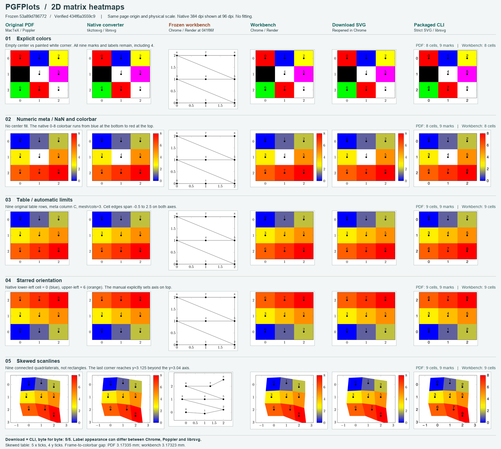

# PGFPlots 2D matrix heatmaps

The baseline rendered the manual's five heatmaps as ordinary polylines. Its
browser reported no diagnostic, even for the example missing the entire
right-hand color scale. The comparison uses the original pictures rather
than simplified charts or screenshots scaled to fit each other.

## Scope

| Command or option | Behavior under test |
| --- | --- |
| `\usepackage{pgfplots}`, `\pgfplotsset{width=7cm,compat=1.18}`, `axis`, `\addplot` | Real manual inputs, with the same size and compatibility setting for all renderers. |
| `matrix plot`, `imagesc` | Center-defined cells; the late y reversal and foreground axes also apply to other plots and overlays on the axis. |
| `matrix plot*`, `imagesc*` | Same cells; keep the original axis direction and layer order. |
| `coordinates`, `table[meta=C]`, `mesh/cols`, `mesh/rows`, `mesh/ordering` | Read complete scanlines, including rows delimited by blank lines. Adjacent cells share corners even for unevenly spaced or skewed points. |
| `point meta=explicit`, `point meta=\coordindex`, `mesh/color input=explicit` | Numeric colors use the surveyed scale; explicit colors bypass it. Missing metadata suppresses only the colored face, never moves the next center. |
| `mark=*`, `nodes near coords=\coordindex` | Paint the marks and numbers at the original centers, including number 4 inside an unpainted cell. |
| `enlargelimits=false`, `enlargelimits=0.2`, `colorbar` | Survey the extended outer half-cells before enlargement and clipping. The colorbar is a separate axis, independent of image y reversal. |

## Native source

Reviewed in the installed MacTeX 2025 tree, under `tex/generic/pgfplots/`:

- `pgfplots.code.tex:3754-3769` defines the unstarred late axis options, the starred flat image style and both aliases.
- `pgfplotsmeshplotimage.code.tex:35-395` measures scanline ends during survey, then paints a rolling pair of rows. The axis limits need not equal the bounding box of all drawn corners. Metadata belongs to the original cell, not an average of neighboring colors.
- `pgfplotscoordprocessing.code.tex:3463-3558` separates per-plot metadata bounds from the shared axis color scale. `pgfplotsmeshplothandler.code.tex` supplies the flat-corner fill and stroke.
- `pgfplotsticks.code.tex:997-1028` checks candidate ticks against the final axis limits; a tick need not lie between the outermost observations. Separate directed-frame probes check physical axis sides when either coordinate is reversed.
- The installed manual's `pgfplots.reference.3dplots.tex` supplies all five original pictures. [Sources and replay commands](../../test/fixtures/native-pgfplots-matrix-plots/README.md) include the precise lines, tools and measurement procedure.

## Visual results

Compared on the same physical scale: original pdfLaTeX/PDF, local
`/Library/TeX/texbin/tikztosvg` rasterized with `rsvg-convert`, actual
Chrome workbench Render, reopened Download SVG and the strict CLI export.
The leading uncolored page margins were not cropped away for comparison.

- The two incomplete grids now paint **eight faces and nine markers** each.
  In the explicit-color example the white corner is an actual filled
  polygon, unlike the transparent center. In the numeric example the main
  y axis descends while the adjacent 0-to-8 color scale rises.
- The table and starred examples paint all nine faces. Blue zero is
  upper-left in the unstarred table, lower-left in the starred example.
- The skewed table paints nine joined quadrilaterals, clips the lower-right
  corner and retains ticks in the enlarged margins (x: -1 to 3, y: 0 to 3).
  No polyline connects the observation centers in any of the five examples.
- The actual browser produced **43 of 43 native faces and 45 of 45 marks**.
  Its largest cell-corner difference from the PDF was **0.00264 mm**;
  corresponding tick strokes were within **0.0024 mm**. All five downloads
  matched the strict CLI SVG byte for byte, with no JS diagnostics.
  This is not a pixel-identity claim: rasterized label ink differed by up to
  0.0662 mm between Chrome and the PDF rendering.
- A separate native probe paints another drawing far to the right before
  the heatmap. It verifies that the colorbar still measures its own parent
  axis, not the entire picture's bounding box.

Local raw SVGs, PNGs, coordinates and replay results are under
`outputs/qa/2026-11-25-pgfplots-matrix-plots/`; the sheet and original
inputs are tracked so the evidence also works on GitHub.

Verification: `npm run test:summary` with native probes enabled returned
4,110 passed, zero failed and 14 skipped. `npm run check:architecture`
and `npm run docs:links` also passed.

This covers linear two-dimensional coordinate and table heatmaps. It does
not certify logarithmic cell projection, 3D images, interpolated shaders,
patch refinement, direct color indexing on built-in maps, arbitrary TeX
metadata/paint callbacks or full PGFPlots. The continuous colorbar needs
a finite, increasing numeric range.
