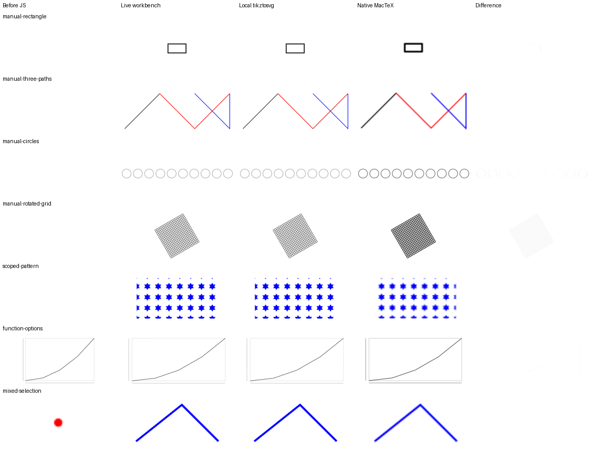

# Standalone TikZ picture commands

TikZKit now accepts the two top-level forms `\tikz[options] \command ...;`
and `\tikz[options]{...}` in addition to `tikzpicture`. They use the same
coordinate system, scoped styles and renderer. For example:

```tex
\tikz[rotate=30] \draw[step=1mm] (0,0) grid (2,2);
```



## What changed

| Fixture | Before | What was checked in the live browser |
| --- | --- | --- |
| Manual rectangle | Blank | Rectangle, including its 2ex by 1ex dimensions. |
| Manual three paths | Blank | Three independent paths retain their black, red and blue strokes. |
| Manual foreach | Blank | Ten separate circles at the specified centers and radius. |
| Manual grid | Blank | All 42 lines, 1mm spacing and the whole-picture 30-degree rotation. |
| Pattern | Blank | Blue six-pointed stars and the locally styled, scaled fill area. |
| Function plot | Lost the picture's x scale | The two semicolons inside the data group no longer interfere; the 1.35 x scale gives an 819px browser capture rather than 613px. |
| Mixed selection | Selected the middle red dot | Both JS and the independent reference select the third, blue line. It starts at a coordinate defined in the first, scaled picture. |

Four inputs come from the TeX Live manual: `pgfmanual-en-tikz-scopes.tex`
(rectangle), `pgfmanual-en-tikz-paths.tex` (three paths and rotated grid) and
`pgfmanual-en-tutorial.tex` (foreach). See the [seven original inputs](../../test/fixtures/picture-command).

## Local reference

In TeX Live 2025, `tex/latex/pgf/frontendlayer/tikz.sty` loads
`tex/generic/pgf/frontendlayer/tikz/tikz.code.tex`. Lines 1722-1813 open an
ordinary picture for the short command. An unbraced path terminates at its
semicolon; a braced picture allows the final path to terminate at the closing
brace. Lines 1869-1872 provide the corresponding braced `\scoped` behavior.
The frontend recognizes these boundaries after supported macro expansion and
before library interpretation. The reference runner preserves the original TeX
and replays only earlier selected-document pictures invisibly for their names.

The local `/Library/TeX/texbin/tikztosvg` grid has a multi-subpath stroke with
a 0.3985bp pen, butt caps and miter joins. JS issues separate strokes at the
same projected locations. Their whole-page size is 336 by 336 pixels in the
3x capture. A small edge-antialias difference remains on circles and the grid.
Native PDF PNGs provide an independent visual check, not a pixel-identity claim.

## Reproduce

```sh
F=test/fixtures/picture-command
Q=outputs/qa/picture-command
node --test test/picture-command.test.js test/example-diff-script.test.js
node scripts/render-example-fixtures.js --fixtures "$F" --output "$Q" --native-reference --strict-tikztosvg --math-renderer svg-text --no-comparison-grid
node scripts/audit-module-regressions.js --fixtures "$F" --output "$Q" --workbench --browser-module "$PLAYWRIGHT_MODULE"
node scripts/measure-vector-ink.mjs "$Q"
```

Set `PLAYWRIGHT_MODULE` to the local Playwright entry point. The output includes
`browser-audit.html`, full-size live and export captures, `tikztosvg-svg/`,
`tikztosvg-png/`, `mactex-png/` and `vector-ink.json`. All seven page sizes
match; all 14 ink comparisons pass the 0.95 threshold (minimum 0.9877),
without alignment, resizing or credit for empty page area. A blank page does
not pass, even against another blank page.

This covers executable, top-level picture commands using supported TikZ
operations. It does not implement TeX paragraph baselines, arbitrary nested
inline graphics, catcode changes, or the entirety of any contained library.
