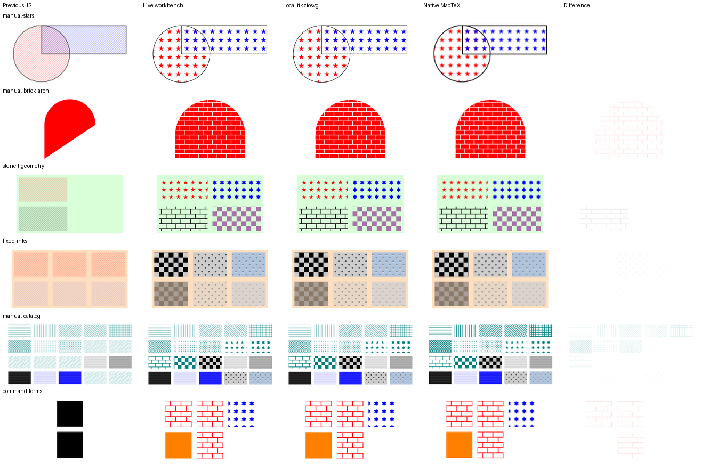

# The 20 classic PGF patterns

The classic `patterns` library in the installed PGF manual lists twenty names.
The [catalog fixture](../../test/fixtures/stock-pattern-catalog/manual-catalog.tex)
now paints all twenty without generic hatch fallback. This is not a claim about
`patterns.meta` or the complete PGF pattern declaration language.



Left to right: JS before this change, actual Chrome workbench, local `tikztosvg`
SVG in the same browser, independent pdfLaTeX PNG, and difference (white = equal).
The native PNG is magnified in the overview; fine antialiasing still differs.

| Source feature | What changed on screen |
| --- | --- |
| [Five-pointed stars](../../test/fixtures/stock-pattern-catalog/manual-stars.tex) | The red circle and blue rectangle now show aligned star fields across the overlap, not diagonal strokes. Both stars use a 1 mm radius on a 3 mm repeat. The six-point star fills both triangles once, regardless of the host path's fill rule. |
| [Brick arch](../../test/fixtures/stock-pattern-catalog/manual-brick-arch.tex) | A solid red wedge is now an arch with a level base and white staggered mortar. Both the ground and the pattern use the endpoint of the semicircle as the base for the following relative line. |
| [Stencils](../../test/fixtures/stock-pattern-catalog/stencil-geometry.tex) | Bare patterned paths now paint without an outline. The checker leaves the ground visible between tinted squares. Brick courses repeat every 4 mm with a 0.8 TeX pt pen. |
| [Fixed inks](../../test/fixtures/stock-pattern-catalog/fixed-inks.tex) | The fixed checker uses black and gray; gray and steel-blue dots have separate highlight and shadow disks offset by 0.5 TeX pt. A requested stencil color does not recolor these patterns. Translucent samples preserve the layering. |
| [Command and scope](../../test/fixtures/stock-pattern-catalog/command-forms.tex) | The pattern command and a bare pattern option reuse the selected tile or solid ink. A local named override stays local. Disabling, then re-enabling fill restores the tile; disabling it alone leaves the cell blank. |

## Local reference

- `tikz.code.tex:1951,3732-3743` defines the pattern command as a path with a bare pattern action and updates the saved coordinate at the end of an arc.
- `tikzlibrarypatterns.code.tex:13-30` separates choosing a tile from enabling fill. Empty does not replace the ink; `none` disables filling.
- `pgflibrarypatterns.code.tex:88-164,225-266` supplies the vertices, repeat lengths, stroke width and palettes of the seven additional tiles. In the fixed gray checker, the background color command is commented out; the native PDF tile starts in black.
- `pgfcorepatterns.code.tex:130-182` separates tile paint bounds from the repeat and resets the drawing transform. The reference SVG confirms a brick repeat of 11.33858 PDF points, a stroke of 0.79701 PDF points, and clipped ink at the arch boundary.
- `pgfmanual-en-library-patterns.tex:17-85` lists the classic stock names; `pgfmanual-en-tikz-actions.tex:739-752` provides the two manual figures above.

## Verify

All six documents compiled independently with local `/Library/TeX/texbin/tikztosvg`
(xelatex) and pdfLaTeX, with no TikZKit diagnostics or browser errors. The same
43 paper-space regions were checked in both the actual workbench and the opened
JS export at four pixels per PDF point. All **86 checks passed**, with no
rescaling or image registration; the minimum patterned-region correlation was
0.961 and the largest channel-mean error was 6.80/255. These are checks on
specific regions, not pixel-perfect whole-figure equivalence. The five
[plot and legend controls](2026-11-25-stock-patterns.md) were also regenerated
with this build; all 44 existing paint checks passed without threshold changes.

```sh
F=test/fixtures/stock-pattern-catalog
Q=outputs/qa/2026-11-25-pattern-catalog/final
node --test test/stock-pattern-catalog.test.js test/pgfplots-pattern-paint.test.js
node scripts/render-example-fixtures.js --fixtures "$F" --output "$Q" --native-reference --strict-tikztosvg --math-renderer svg-text --no-comparison-grid
node scripts/audit-module-regressions.js --fixtures "$F" --output "$Q" --browser-module "$PLAYWRIGHT_MODULE" --workbench
node scripts/measure-pattern-paint.mjs "$Q" "$F/paint-probes.json"
```

Set `PLAYWRIGHT_MODULE` to the local Playwright entry point. Open
`browser-audit.html` in the output directory for per-case images;
`tikztosvg-svg/`, `mactex-png/` and `pattern-metrics.json` hold the references
and individual results. These cases use a `tikzpicture` environment. For the
standalone `\tikz` command, see [the separate picture-command comparison](2026-11-25-picture-command.md).
