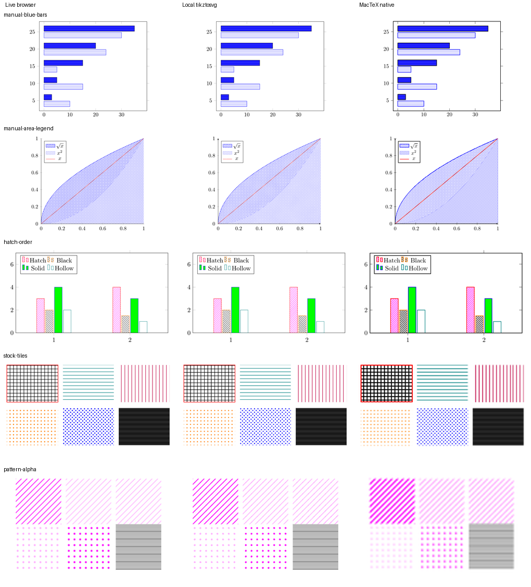

# PGF pattern paint in plots and legends

The manual's [horizontal bars](../../test/fixtures/pgfplots-pattern-paint/manual-blue-bars.tex)
were hollow. Its [closed-cycle functions](../../test/fixtures/pgfplots-pattern-paint/manual-area-legend.tex)
and area-legend samples had solid fills. Both now use the same page-anchored
patterns as ordinary TikZ paths. Browser previews use the document's declared
border by default; choosing a different output margin crops the image without
moving the ink relative to the drawing.



Left to right: live Chrome workbench, local `tikztosvg` SVG in Chrome, and
independently compiled MacTeX PNG. The low-resolution native PNGs are enlarged
in this overview; they are not used as the high-resolution pixel oracle.

## Acceptance

| Case | Checked result |
| --- | --- |
| Manual horizontal bars | All ten bars use their own light/dark blue bands, with a 4 TeX pt repeat. |
| Manual function areas | The upper field has staggered blue dots; the lower field adds pale crosshatching. Both miniature rectangles use the same patterns; the red line legend stays a line. |
| Grouped bars | Magenta and black hatches keep separate outlines. Later solid green replaces a pattern; `pattern=none` leaves an empty rectangle. |
| Offset paths | Grid, horizontal, vertical, dots and staggered dots follow the page origin. The dark gray bands ignore the requested red stencil ink. |
| Opacity controls | With only `fill opacity=.3`, magenta hatch strokes stay opaque but dot fills become pale. With only `draw opacity=.3`, the reverse holds. Translucent colored bands retain their half-point overlap. |

All five fixtures compiled independently with pdfLaTeX and local
`/Library/TeX/texbin/tikztosvg`; none produced TikZKit diagnostics or browser
errors. Twenty-two paper-space regions were compared against the reference SVG
at four pixels per PDF point, for both the live browser and the browser-opened
export. All **44 checks passed**. The lowest patterned-region correlation was
0.955; the largest region-mean RGB channel difference was 7.45/255 or less.
There is no fitted scale or per-tile translation. The prior magenta rendering,
although well aligned, failed both comparisons with only 42% of the native
contrast. The solid and hollow control interiors match exactly.

This verifies paint placement, not whole-image equality. Rasterization of fine
strokes, text and some axis endpoints still differ. The stock set covers
horizontal, vertical and both diagonal lines, grid, crosshatch, dots, crosshatch
dots, and five gray/blue horizontal bands. The [subsequent catalog audit](2026-11-25-stock-pattern-catalog.md)
covers the remaining seven stock names. Arbitrary inherently colored
declarations and `patterns.meta` transforms are outside both audits.

## MacTeX sources

- `tikzlibrarypatterns.code.tex:13-30`: selecting a pattern enables fill;
  `none` disables it. Stencil ink is black unless `pattern color` sets it.
- `pgflibrarypatterns.code.tex:13-95,159-224`: 3pt line/dot lattices,
  0.4pt strokes, 0.5pt dot radius and overlapping 2.5pt bands on a 4pt step.
- `pgfcorepatterns.code.tex:130-182,260-277`: independent paint bounds and
  repeat steps; stencil colors are converted to RGB before reaching the driver.
- `pgfsys-pdftex.def:186-230` and `pgfcoretransparency.code.tex:20-40`:
  PDF pattern matrices and separate stroking/nonstroking alpha. The reference
  SVG uses a reflected page-space matrix for colored tiles and clipped paths
  for the uncolored strokes and dots.
- PGFPlots manual sources `pgfplots.reference.2dplots.tex:241-255` and
  `pgfplots.reference.axisdescription.tex:1585-1605` supply the first two cases.

## Reproduce

Set `PLAYWRIGHT_MODULE` to the local Playwright entry point; use local TeX tools.

```sh
F=test/fixtures/pgfplots-pattern-paint
Q=outputs/qa/2026-11-25-pattern-paint/verified
node --test test/pgfplots-pattern-paint.test.js test/web-workbench.test.js
node scripts/render-example-fixtures.js --fixtures "$F" --output "$Q" --native-reference --tikztosvg-engine pdflatex --math-renderer svg-text --no-comparison-grid
node scripts/audit-module-regressions.js --fixtures "$F" --output "$Q" --browser-module "$PLAYWRIGHT_MODULE" --workbench
node scripts/measure-pattern-paint.mjs "$Q"
```

Open `browser-audit.html` for the full-size screenshots and difference sheets.
The output directory also contains both SVGs, native and rendered PNGs, and
`pattern-metrics.json`. Pass `--before <previous-output-directory>` to the
browser audit to add the older export to each comparison.
