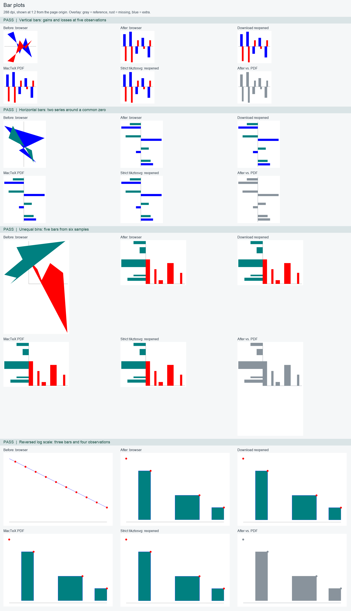

# Fixed-width and interval bars

The old renderer connected ordinary TikZ bar samples with a polyline.
With a fill, that produced one large polygon instead of separate bars.
In PGFPlots, sampled interval and parametric inputs could similarly reach
the line renderer even though the same data as coordinates produced bars.

## Native behavior

- In the installed TeX Live 2025, `tikz.code.tex:1243-1246` selects one of
  four PGF plot handlers. `pgflibraryplothandlers.code.tex:292-607` defines
  the baselines and builds signed rectangles. `xbar` and `ybar` use a
  physical `bar width` (10pt by default) and `bar shift` (0pt). Bare numbers
  here mean TeX points, not the plot's x/y coordinate units.
- `xbar interval` and `ybar interval` use the signed distance to the next
  observation. `bar interval width` scales that distance (default 1);
  `bar interval shift` locates the center as a fraction of it (default .5).
  Neither fraction is clamped. The last observation closes the previous
  interval but still counts for markers and the next relative coordinate.
- A scope can set either zero level with `\pgfplotxzerolevelstreamconstant`
  or `\pgfplotyzerolevelstreamconstant`. The corresponding comb plots
  read the same register. Fixed bars, mixed units, reversals, rotated and
  rounded rectangles, file gaps and a following `++` are checked against
  the original [MacTeX path traces](../../test/fixtures/native-bar-plot-tests/texlive-2025.trace).
- `pgfcorepathconstruct.code.tex:1039-1079` has two rectangle constructors:
  ordinary paths start at the supplied corner; a coordinate transform or
  rounded corners starts at the opposite corner and restores the pen.
  This is visible with dashes, and the pen matters to a subsequent line.
- PGFPlots surveys and projects observations before the handler replays
  them (`pgfplotscoordprocessing.code.tex:7544-7590`). The final marker
  and axis limits use the surveyed observations, not the generated bar
  corners. The [sampled-axis tests](../../test/pgfplots-sampled-bar-handlers.test.js)
  replay both orientations, reversed logarithmic scales, clipping and
  `unbounded coords=jump` versus `discard` against the installed package.

## What to look for



| Example | Expected ink |
| --- | --- |
| [Gains and losses](../../test/fixtures/examples/bar-plots/manual-signed-ybar.tex) | Five blue and five red bars extend above or below the common zero. Red is shifted 3pt. |
| [Grouped horizontal bars](../../test/fixtures/examples/bar-plots/manual-grouped-xbar.tex) | Four blue and four teal bars, 5pt thick, offset on opposite sides of each category center. |
| [Unequal intervals](../../test/fixtures/examples/bar-plots/manual-nonuniform-bar-intervals.tex) | Five red bars and five teal bars. The artificial final values do not paint or expand the paper. |
| [Reversed log axis](../../test/fixtures/examples/bar-plots/axis-sampled-log-ybar.tex) | Three outlined teal bars between x=1, 2, 8, 16 in descending screen order. Four red marks, including the last one at the upper left. |

The local `/Library/TeX/texbin/tikztosvg` emits a compound, nonzero-fill
path with a y-inverting transform. On the reversed axis the path contains
three closed contours with decreasing x, butt caps and miter joins. The
four red dots are separate paths. No text or external fonts are required.

An additional opacity control paints two identical sampled bars. The
half-transparent pair must paint pale red once; the same pair under the
even-odd rule must leave white paper. At an interior pixel the PDF and
reopened SVGs measured RGB (255,127,127), the live browser (255,128,128);
all four measured (255,255,255) in the canceled region. The control source
and captures are included in the archive.

These examples cover the four built-in Cartesian bar handlers, not
arbitrary TeX callbacks, user-defined zero-level streams, all stack modes
or 3D bars. Nonempty ordinary TikZ per-bar callbacks are diagnosed.

## Reproduce

The [evidence archive](../../test/fixtures/examples/bar-plots/evidence.tar.xz)
contains the actual browser renders, reopened downloads, native PDFs,
JS and strict reference SVG/PNG pairs, and the per-case measurements.
The physical comparison pads only at the right and bottom: it never
rescales or translates ink to force an alignment.

All four old browser renders failed the physical ink check. For the four
fixed renders and their reopened downloads, the color masks had no missing
or extra ink beyond a two-device-pixel neighborhood at 288 dpi. The live
viewport differed from the native PDF by at most two pixels on either
dimension. These are visual tolerances, not a claim of byte-identical SVG.

Full repository run with the MacTeX test switches enabled: 4,376 passed,
zero failed, and 14 skipped for unavailable optional external corpora.

```sh
TIKZKIT_TEST_PDFLATEX=1 node --test test/bar-plots-native.test.js test/pgf-plot-registers.test.js test/pgfplots-sampled-bar-handlers.test.js
F=test/fixtures/examples/bar-plots
OUT=outputs/qa/bar-plots
CAP=test/fixtures/examples/plot-mark-selection/capture.mjs
node scripts/render-example-fixtures.js --fixtures "$F" --output "$OUT" --native-reference --native-latex-engine pdflatex --strict-tikztosvg --tikztosvg-engine pdflatex --math-renderer svg-text --no-comparison-grid
# BEFORE_TREE: prior checkout 7edd1e16 with dependencies; PW: absolute Playwright module path
node "$CAP" "$BEFORE_TREE" "$OUT" "$PW" before
node "$CAP" . "$OUT" "$PW" after
python3 "$F/compare.py" "$OUT"
```
