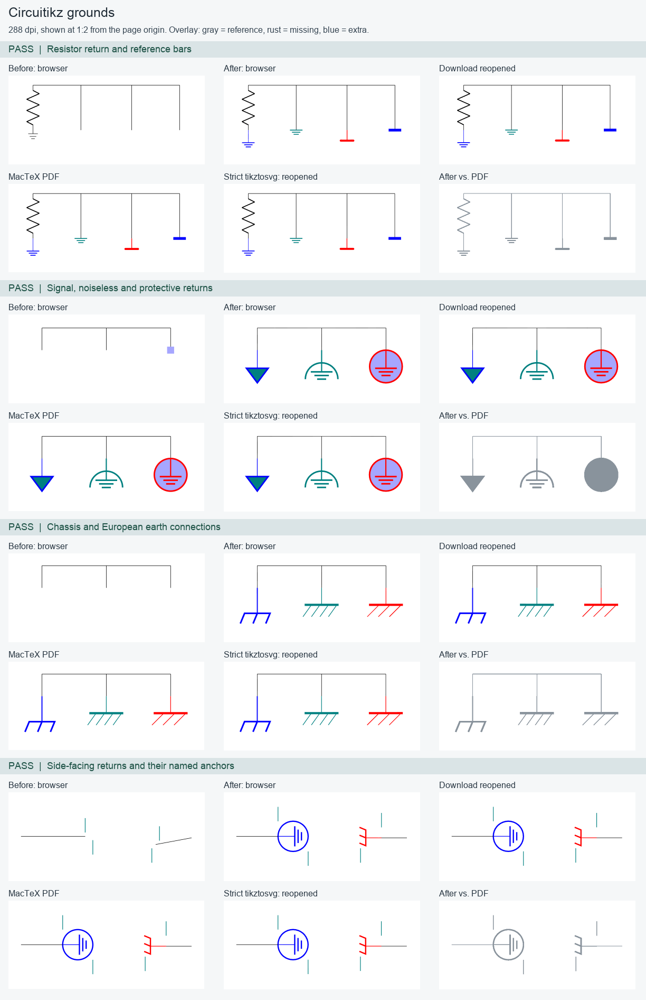

# Circuitikz ground symbols

The old renderer approximated `ground` with one pen and silently treated the
other nine ground shapes as ordinary nodes. A resistor lost its return, a
protective ground became a small filled rectangle, and wires to rotated symbols
ended at unrelated positions. These are ten shapes declared by one native
macro, not ten aliases for the same drawing.

| Editable example | What changed |
| --- | --- |
| [Resistor returns](../../test/fixtures/examples/circuitikz-grounds/tutorial-resistor-returns.tex) | `ground` has a narrow lead and three stepped bars; `tlground` starts at its top bar. `rground` forces round caps; `tground` has no lead and inherits the cap. |
| [Signal and protective returns](../../test/fixtures/examples/circuitikz-grounds/signal-and-protective-grounds.tex) | `sground` has a triangle, `nground` an open semicircle, and `pground` a closed ring painted behind the lead and bars. Only fillable parts take the component fill. |
| [Chassis and European grounds](../../test/fixtures/examples/circuitikz-grounds/chassis-and-european-grounds.tex) | `cground` has three chassis teeth; `eground` and `eground2` have four and three separate hatches and use the incoming pen for the hatches. |
| [Rotated connections](../../test/fixtures/examples/circuitikz-grounds/rotated-ground-anchors.tex) | The black wires meet the terminal, while the four teal leaders start at the saved compass anchors of the rotated symbols. |

## Native behavior

`circuitikz.sty` loads `pgfcircmonopoles.tex`. In the local TeX Live 2025
implementation, `\pgf@circ@declareground` saves the electrical terminal as
`center`, `north`, `left` and `right`. The compass rectangle depends on the
shape and is not the painted extent. For example, the chassis south anchor is
two steps below the terminal but its teeth reach 2.1 steps. With the defaults,
one step is `1.4cm * 1 * .25 = .35cm`. The text box begins at the terminal's
left baseline. The default border routine returns the terminal for an implicit
wire or an angle anchor; PGF does not clip such a wire against a rectangle.

The ten bodies and their saved anchors are in `pgfcircmonopoles.tex:62-263`.
`pgfcirc.defines.tex:185,473,533` defines the behind-background drawing hook,
explicit versus class fill, and class versus legacy pen widths. The resistor
return and ground gallery in `circuitikzmanual.tex` supplied the test patterns.
`pgfmoduleshapes.code.tex` defines the fallback text/border anchors, and
`tikz.code.tex:771-804` explains why angle labels start at the terminal.

The signal/protective strict SVG has a `185.402 x 83.355` viewBox. Its signal
triangle has nonzero fill; the lead and triangle border are separate strokes
(0.59776 and 1.43463 in PDF units). The noiseless semicircle is two cubics;
the protective ring is four. The paths use butt caps and miter joins unless
the shape or user changes them. None of these symbols uses an SVG marker,
image, or embedded copy of the native rendering.

## Verification

All four pages failed on `2ecf6063`. After the fix, the live workbench and
each downloaded SVG reopened in Chrome passed at the same physical scale as
MacTeX and `/Library/TeX/texbin/tikztosvg`. The [comparison](../../test/fixtures/examples/circuitikz-grounds/compare.py)
checks colored ink relative to the page origin, counts bars and teeth on fixed
scan lines, probes interior fills, and checks leader endpoints; it never
fits one picture to the other. At 288 dpi no tested ink lay more than two
device pixels from its reference. This is a raster tolerance, not pixel identity.

The [evidence archive](../../test/fixtures/examples/circuitikz-grounds/evidence.tar.xz)
contains the raw before/after browser captures, downloaded SVGs, PDFs, native
and strict SVG rasters, and per-case measurements. Follow the [capture instructions](2026-11-26-fill-between-boundaries.md#reproduce)
with `cases=test/fixtures/examples/circuitikz-grounds` and baseline `2ecf6063`;
run `python3 -B "$cases/compare.py" "$stage"` after the browser capture.
The [additional pen and text control](../../test/fixtures/native-circuitikz-grounds/ground-ink.tex)
also passed the physical-page comparison: `draw=red` leaves the first `GND`
black, `color=blue` makes the second blue while the symbol uses its local red
pen, and the `PE` label sits above the terminal, not above a fictitious
symmetric node box. Its before/after sheet and captures are under `ink-control/`
in the archive. A separate local pdfLaTeX regression checks 247 anchor
positions, and a PDF operator test checks 38 paint paths in 16 settings.

In scope: `\node` and path nodes, the ten names or `shape=...`, `\ctikzset`,
`bipoles/length`, `grounds/scale`, `grounds/thickness`, `grounds/fill`,
`monopoles/ground/{width,thickness,connectionthickness}`, `monopoles/rground/thickness`,
`monopoles/tground/thickness`, `bipoles/thickness` for the signal triangle,
TikZ stroke/fill, physical line width and cap, rotation, and named contacts.
Power-supply arrows, antennas and user-defined component paint hooks are
outside this comparison. Inline `coordinate[ground]`, using a ground as the
shape of an empty label, and arbitrary transformed multiline text are not
covered by this ground-only check. The [inline coordinate follow-up](2026-11-26-inline-coordinates.md)
also checks a wire ending in `coordinate[pground] (PE)`.
