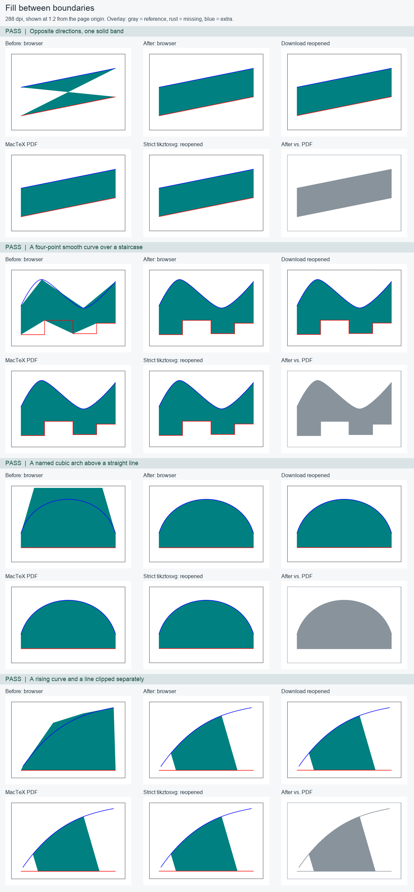

# Filling between named 2D boundaries

The previous browser renderer used the observations of each named plot
as polygon vertices and always walked the second list backwards. Two
parallel lines traced in opposite directions produced a bow tie. The
blue stroke of a cubic could be correct while its teal fill extended
through the control points, well above the stroke.

## Four examples



| Editable source | What distinguishes a correct fill |
| --- | --- |
| [Oppositely traced lines](../../test/fixtures/examples/fill-between-boundaries/opposite-traced-band.tex) | One solid sloping strip, 1.5 cm thick at every x; no crossed diagonals. |
| [Smooth curve over steps](../../test/fixtures/examples/fill-between-boundaries/smooth-over-steps.tex) | The upper edge follows all three cubics. The lower edge turns at x = 1.75, 3.25, and 4.5, without diagonal shortcuts. |
| [Cubic over a line](../../test/fixtures/examples/fill-between-boundaries/bezier-over-line.tex) | The arch peaks at y = 3.3; the area does not reach the control points at y = 3.9. |
| [Independent soft clips](../../test/fixtures/examples/fill-between-boundaries/soft-clipped-rising-cubic.tex) | The upper cubic is cut twice by the requested y-domain 1.3:3.2. Its right tip follows PGF's repeated-cut rule below. The lower line ends independently at x = 1.4 and 4.65; both original strokes remain visible. |

All four failed on the previous revision and passed after the fix. At 288 dpi
the live Chrome view and the reopened download each matched both references
with no ink farther than the two-device-pixel tolerance in either direction;
all frame, fill-span, and named-color probes passed. This allows rasterizer
antialiasing differences and is not a claim of byte-identical SVG or PNG.

## Local source

The implementations below are from the installed TeX Live 2025 tree,
under `tex/generic/pgfplots/`:

- `libs/tikzlibrarypgfplots.fillbetween.code.tex:79-111,135-186`:
  the numeric domain creates a physical clip path. This changes the
  boundaries. The subsequent axis clip masks the finished paint on the
  pre-main layer; it is not another name for soft clipping.
- `pgfcontrib/tikzlibraryfillbetween.code.tex:95-114,159-160,178-181`:
  `of=A and B` resolves two named paths. `soft clip` assigns both
  selectors; `soft clip first` and `soft clip second` assign only one.
- `pgfcontrib/pgflibraryfillbetween.code.tex:81-142,380-435,536-594`:
  normalize inner moves and compare the *first segment endpoints* before
  clipping. For equal x compare y. In auto mode only matching directions
  require reversing the second boundary, including swapping cubic controls.
- `pgfcontrib/pgflibraryfillbetween.code.tex:315-379`: with `split`, a
  piece is omitted if *both* contributing segments have a control box
  narrower or shorter than 1 TeX point. If every piece is omitted there
  is no replacement fill. `omit empty segments=false` retains those pieces.
- `pgfcontrib/tikzlibrarydecorations.softclip.code.tex:121-193` and
  `pgfcontrib/pgflibraryfillbetween.code.tex:983-1078`: cut at the
  intersection times and retain the inside portions. De Casteljau
  subdivision preserves a cubic rather than approximating it by a chord.
- `pgfcontrib/pgflibraryfillbetween.code.tex:1089-1174`: for successive
  intersections on the *same* cubic, PGF splits the previous remainder at
  the next original local time. It starts a new piece at the reported
  intersection point. In the fourth fixture the rendered endpoint is near
  (3.813, 3.279) cm, not the analytic crossing at y = 3.2. The crop is
  applied to the fill boundary only, not to either source stroke.

The independent `/Library/TeX/texbin/tikztosvg` reference uses a
`188.237pt` by `131.544pt` page for all four examples. Its teal area
uses the nonzero fill rule. The arch and clipped arch each contain a
`C` followed by two `L` instructions and a close; the source outlines
are separate painted paths with butt caps and miter joins. No font or
marker substitutions are involved in this comparison.

## Reproduce

From the repository root:

```sh
stage=outputs/qa/fill-between
cases=test/fixtures/examples/fill-between-boundaries
node scripts/render-example-fixtures.js --fixtures "$cases" --output "$stage" \
  --native-reference --native-latex-engine pdflatex --strict-tikztosvg \
  --tikztosvg-engine pdflatex --math-renderer svg-text --no-comparison-grid
capture=test/fixtures/examples/plot-mark-selection/capture.mjs
node "$capture" "$BASELINE_CHECKOUT" "$stage" "$PLAYWRIGHT_MODULE" before
node "$capture" . "$stage" "$PLAYWRIGHT_MODULE" after
python3 "$cases/compare.py" "$stage"
```

`BASELINE_CHECKOUT` is the unmodified `ec79ba05` checkout with its
dependencies; `PLAYWRIGHT_MODULE` points to a local Playwright module.
The capture uses the workbench's Render and Download buttons and reopens
both the downloaded SVG and the strict reference in Chrome. The
[evidence archive](../../test/fixtures/examples/fill-between-boundaries/evidence.tar.xz)
contains those captures, the reference PDFs, and the actual SVG/PNG pairs.

Scope: open 2D boundaries and the numeric domain forms exercised here.
This is not support for arbitrary closed TikZ paths, custom clip shapes,
coincident intersections or general parametric intersection sequences.
The numeric selectors use an orthogonally unbounded strip; an outlying
overlay beyond PGF's enlarged survey rectangle can still differ.
