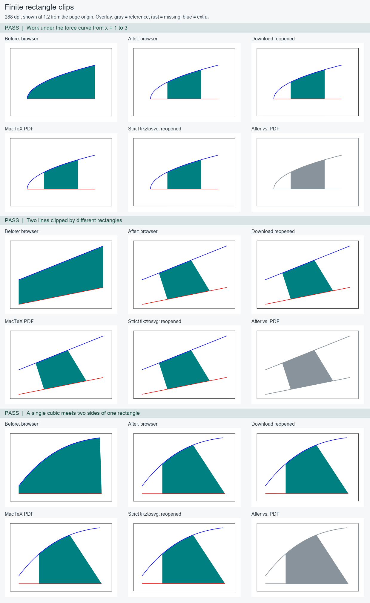

# Rectangular windows on fill-between curves

The old browser renderer recognized numeric domains but silently ignored a
rectangle supplied as a soft clip. The work integral filled the entire plot
even though its two endpoints were specified explicitly.

| Editable example | What to look for |
| --- | --- |
| [Work under a force curve](../../test/fixtures/examples/fill-between-rectangles/force-distance-rectangle.tex) | Only the interval from 1 to 3 under the square root is teal. The blue curve and red baseline continue outside it. |
| [Two independent windows](../../test/fixtures/examples/fill-between-rectangles/independent-flipped-rectangles.tex) | The upper and lower strokes meet different sides of differently oriented rectangles. The teal area is one quadrilateral, not two triangles touching at a point. |
| [One cubic, two sides](../../test/fixtures/examples/fill-between-rectangles/cubic-two-side-rectangle.tex) | At y = 2.20 the native fill still covers 40 pixels at 288 dpi. Cutting the result of an x clip a second time in y incorrectly removes this tip. |

All three failed before the fix. After it, both the Chrome workbench and
the downloaded SVG reopened in Chrome passed against the MacTeX PDF and
strict tikztosvg reference. At 288 dpi no tested ink was missing or extra
beyond two device pixels, and the physical fill-span probes passed. This is
a tolerance for rasterization, not a claim that the files are identical.
The four earlier named-boundary examples also passed when rerendered.

## What PGF actually clips

The local TeX Live 2025 implementation treats `soft clip` as an operation on
each original boundary. An SVG clip on the closed area is **not** equivalent.

- `tikzlibrarypgfplots.fillbetween.code.tex:79-111` makes a **finite**
  rectangle for `domain=a:b` or `domain y=c:d`. It expands the other
  coordinate's native limits by 10%, using data extrema in its linear branch;
  logarithmic limits have their own handling. Named overlay paths do not
  contribute plot observations.
- `tikzlibrarydecorations.softclip.code.tex:121-193,406-487` accepts a direct
  path or a saved name. It intersects the whole contour with the original
  path and uses the first point to decide which alternating pieces to keep.
  A direct rectangle, `path={...}`, and a preceding `name path` rectangle
  all go through the same browser clipping code.
- `pgflibraryintersections.code.tex` and `pgflibraryfillbetween.code.tex`
  distinguish line hits on the same segment from timed cubic hits. A line's
  tied hits can follow rectangle-edge order. In the original force example,
  reversing the two rectangle corners reversed just the two baseline
  vertices in the PDF (x = 200.039, 81.137 in one order; 81.137, 200.039 in
  the other). A single cubic is split using its original intersection times.
- The strict local `tikztosvg` SVG has a 188.237 by 131.544 viewBox. In the
  cubic example the teal area has one cubic segment followed by straight
  edges and a close with nonzero fill. The blue and red strokes are separate
  paths. No markers or text are involved.
- `pgfplots.code.tex:4403`, `pgfplots.scaling.code.tex:3031-3219` and
  `tikz.code.tex:5356` explain why a bare numeric corner on a 1.10 axis
  does not mean the same thing as `axis cs:`. From 1.11 bare numbers use data
  coordinates; a pair of lengths still offsets the local canvas origin. That
  origin is not necessarily data (0,0). Mixed length/number pairs add a
  physical offset to the corresponding numeric point.

## Reproduce

Run the same [workbench capture procedure](2026-11-26-fill-between-boundaries.md#reproduce)
with `cases=test/fixtures/examples/fill-between-rectangles` and baseline
`815ef103`. The [comparison script](../../test/fixtures/examples/fill-between-rectangles/compare.py)
checks the physical page origin, frame, colored contours, inside/outside
probes and uninterrupted fill spans at specified heights. It does not scale or
register an image to make its contents fit the reference.

The [evidence archive](../../test/fixtures/examples/fill-between-rectangles/evidence.tar.xz)
contains browser screenshots before and after, reopened SVGs, the original
PDFs, both SVG/PNG pairs, and per-case measurements. The reference command was
`/Library/TeX/texbin/tikztosvg` with pdfLaTeX; `rsvg-convert` rasterized its SVG.
Arbitrary clip contours, custom TeX survey hooks or coordinate transforms,
and 3D clip windows remain
outside this slice. An unresolved window skips the affected fill and reports
a warning; it does not hide the source strokes.
