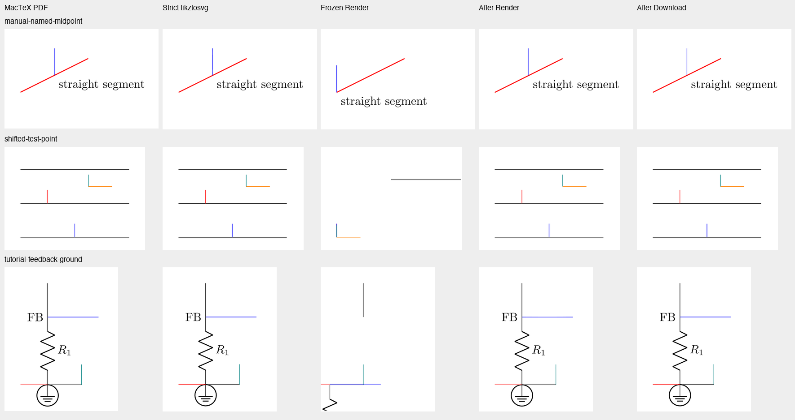

# Coordinates on a path



| Fixture | Before | Verified result |
| --- | --- | --- |
| [Named midpoint](../../test/fixtures/native-inline-coordinates/manual-named-midpoint.tex) | The takeoff and label were at the start of the segment. | Both meet the midpoint, 10 mm right and 5 mm up from the previous result. |
| [Shifted test point](../../test/fixtures/native-inline-coordinates/shifted-test-point.tex) | Missing rails, unknown coordinates, and marks at the origin. | The three rails retain their endpoints. The quarter and midpoint probes start at 8 and 16 mm. A shifted point has no border, even with explicit drawing and minimum size. |
| [Protective ground](../../test/fixtures/native-inline-coordinates/tutorial-feedback-ground.tex) | Missing FB label and ground; the resistor ran off the page. | The ring, bars, label and outgoing wires match. Fixing coordinate parsing alone had left the return wire 20 mm too high: the relative reference after `to[R] ++(...)` must advance too. |

In local MacTeX (TeX Live 2025), `tikz.code.tex` defines `\tikz@@coordinate`
as an empty node with `shape=coordinate` followed by the user's options.
`pgfmoduleshapes.code.tex` gives the coordinate shape coincident anchors
and no node parts. Thus `draw` does not create a rectangle, but an explicit
`pground` selects a real shape. The TikZ line, orthogonal, and cubic timers
use interpolation, half the time per orthogonal leg, and the cubic
parameter respectively. `\tikz@do@to` continues the current path;
`\tikz@do@edge` draws a separate path.

The [replay script](../../test/fixtures/native-inline-coordinates/replay.sh)
compiles the same files with local pdfLaTeX and strict `tikztosvg`.
It captures the live Chrome editor after Render, the downloaded SVG opened
in a separate page, and the CLI output. All three fixtures failed on
`8d1bdbda` and passed on the release code with no editor diagnostics.
The largest measured probe-coordinate difference was below 0.002 mm
against either reference. This is a coordinate check, not a claim of
pixel identity or complete compatibility with all TikZ shape libraries.

Bash replay (locally installed tools only):

```sh
sh test/fixtures/native-inline-coordinates/replay.sh before
sh test/fixtures/native-inline-coordinates/replay.sh after
```
