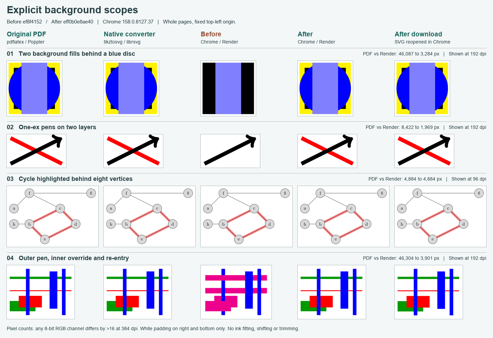

# Switching between background and foreground

The first Background Library drawing in the PGF manual used to lose the
blue disc behind a black square. In the second drawing the red line was
missing altogether. Both now render in the workbench, including after
downloading and reopening the SVG. This report covers the built-in
background and main layers, not arbitrary user-defined layer order.

| Input | What to look for |
| --- | --- |
| [Two background fills](../../test/fixtures/native-background-scopes/scopes-manual-interleaved.tex) | The converter SVG has four nonzero-filled paths in order: yellow square, black square, blue disc, light-blue strip. The exposed blue sides and yellow corners are visible again. |
| [Crossed pens](../../test/fixtures/native-background-scopes/scopes-manual-crossed-pens.tex) | The red line reappears behind the black arrow. Both use the one-ex pen. In both Chrome views the shaft endpoints were within 0.0005 mm of the native PDF, and the pen widths within 0.00002 mm. |
| [Re-entering the background](../../test/fixtures/native-background-scopes/scopes-pen-reentry.tex) | Two thick magenta lines used to overwrite the background. The first is now green at 2.5 pt, the second red at 1 pt; both stay behind the blue foreground strokes. |
| [Cyclic graph](../../test/fixtures/examples/latex-examples/cyclic-graph.tex) | Unchanged control: the heavy highlighted cycle remains behind its eight labeled vertices. |

The physical pages in these four browser renders and downloads match the
native PDF dimensions within 0.0003 mm. Antialiasing still differs between
the PDF rasterizer, inline Chrome rendering and reopening a standalone SVG;
these are not pixel-identical images. See the [captures and replay instructions](../../test/fixtures/native-background-scopes/README.md).

## Why the order matters

- In TeX Live 2025's `tikzlibrarybackgrounds.code.tex`, ordinary scope keys execute
  *before* `\pgfonlayer{background}`. The `every on background layer` style
  and the inline argument execute *after*, in that order. A raw PGF entry
  does not run the style.
- `tikz.code.tex` defines `\scoped` for a single statement or a brace group.
  Its bare color shorthand uses xcolor's stack, whereas `color=` emits PGF
  stroke and fill assignments. A node can therefore keep red text while its
  outline and fill reuse blue and green ink from the background.
- `pgfcorelayers.code.tex` appends to the existing layer box and resets the
  source pen before switching. TeX's `\pgflinewidth` on a later entry can
  be 0.4 pt even while the PDF actually paints with a saved 8 pt pen.
  Coordinate transformations and size tracking are distinct from the
  backend's canvas transformation and clip. End-picture frames use the same
  background box as explicit scopes.

The [13 native probes](../../test/background-scope-native.test.js) compare
97 paints against the actual PDF and the picture bounds recorded by PGF.
They cover path order, separate stroke and fill, `draw=.` / `fill=.`,
line widths, dash, cap, join, opacity, nested scopes, clipping and canvas
translations. The measurements are checked in; replaying with local TeX
is optional. Transparency groups, blend modes and arbitrary layer lists
are outside this audit. The full suite with native checks enabled passed
4,220 tests with zero failures and 14 skips. The documentation links and
architecture checks passed separately.
