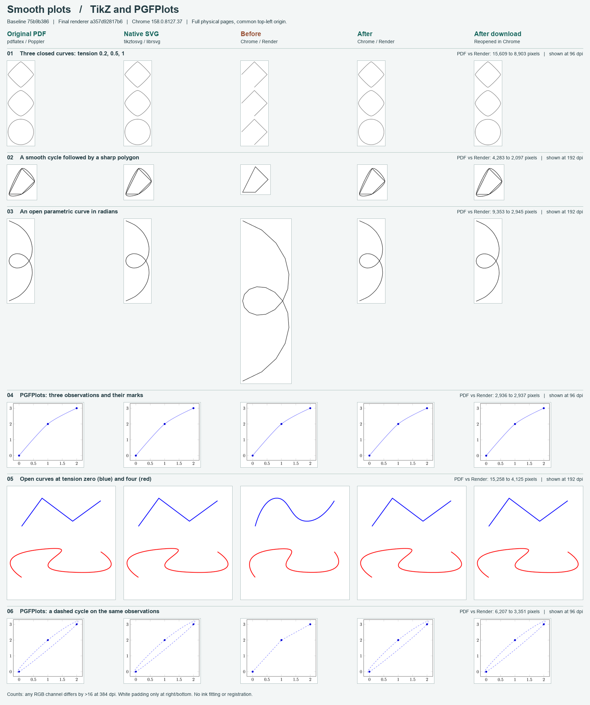

# Open and periodic smooth plots

TikZ and PGFPlots both pass an ordered stream of points to PGF; SVG does not
choose the interpolation. Four points on a compass should make a round loop
at tension one. Previously a TikZ coordinate list made three straight sides,
sampled expressions ignored smoothing, and nonpositive or large tensions were
replaced or clamped.

## Local source

- `pgflibraryplothandlers.code.tex:13-269`: the open handler fixes the two
  endpoint supports. At each interior sample the tangent is the difference of
  its neighbors, multiplied by the tension register in scaled points. The
  installed code initializes tension to 0.5 (the TikZ manual prose says 0.55).
  The periodic handler starts at the **second** sample, wraps through the first
  and closes; rotating that order would rotate the dash pattern.
- `pgfmoduleplot.code.tex:66,185-267,294-315,550-560` and
  `tikz.code.tex:1225-1316,3330-3440`: joining the first open point, replaying
  coordinate lists and sampling an expression are distinct operations. The
  last input point, not necessarily the end of the painted contour, determines
  the following relative coordinate.
- `pgfplotscoordprocessing.code.tex:7544-7590`: axis visualization restores the
  selected PGF plot handler before streaming the mapped observations.
- Manual examples: `pgfmanual-en-tikz-plots.tex:241-242,550-578` and
  `pgfplots.reference.2dplots.tex` (smooth line through three observations).

## Reproduce

The [TikZ picture inputs](../../test/fixtures/native-smooth-plot-tests/cases.tex)
and [recorded native paths and boxes](../../test/fixtures/native-smooth-plot-tests/texlive-2025.trace)
can be checked without TeX. With MacTeX on PATH, this also regenerates the
trace with shell escape disabled:

```sh
TIKZKIT_TEST_PDFLATEX=1 node --test test/smooth-plots-native.test.js test/tikz-plot-operations.test.js
```

The [visual inputs](../../test/fixtures/native-smooth-plots/manifest.json)
include the published tension series, periodic/straight overlay and parametric
curve alongside an open PGFPlots line and a dashed periodic variant.

## Browser comparison



The five columns show the original MacTeX PDF, local
`/Library/TeX/texbin/tikztosvg` rasterized by `rsvg-convert`, Chrome on
`75b9b386`, Chrome on the fix, and the downloaded SVG reopened in Chrome.
Full physical pages share an origin; no plot is fitted to the reference ink.
The [replay instructions](../../test/fixtures/native-smooth-plots/README.md)
and [archived paths, images and measurements](../../test/fixtures/native-smooth-plots/evidence.tar.xz)
make the comparison reproducible without relying on local output folders.

| Case | Visible result |
| --- | --- |
| Three tensions | Previously three identical open polylines; now all close and become progressively rounder. |
| Smooth and sharp overlay | Both the bowed outline and the inscribed straight polygon are visible. |
| Parametric loop | The original half-scale is respected; the loop no longer has polygonal shoulders. |
| Three PGFPlots observations | Existing open-line control: visually unchanged; all three marks remain. |
| Tension 0 and 4 | Zero no longer bulges; the high-tension curve retains its full overshoot. |
| Dashed PGFPlots cycle | The dashed return from the upper observation to the lower one is restored. |

Across these six figures both Chrome outputs have the native sequence of plot
operators. The largest measured control-coordinate error against the original
PDF is **0.00087 mm**. In the dashed PGFPlots reference, the SVG has one blue
`M C C C Z` outline with a y-inverting transform, butt caps, miter joins and a
`2.98883 2.98883` dash pattern. Returning to the wrong starting point would
shift that pattern even if the solid contour looked identical. All six renders
and downloads have zero diagnostics; browser and native pixels are not identical.

## Scope

Checked: `plot` and `-- plot`, `coordinates`, sampled expressions, `domain`,
`samples`, `samples at`, `variable`, `every plot`, `smooth`, `smooth cycle`,
`sharp plot`, `tension`, relative coordinates, and scoped basis changes.
PGFPlots regression cases distinguish a periodic handler, a trailing
`-- cycle` and the zero-level `\closedcycle`. They cover clipping after
interpolation, disconnected runs, reversed/log axes and plot-local transforms.
External programs, arbitrary PGF plot handlers, unbounded sampling and
pixel-identical rasterization are not certified by this comparison.

Full suite with the native tests enabled: **4,272 passed, 0 failed, 14 skipped**.
