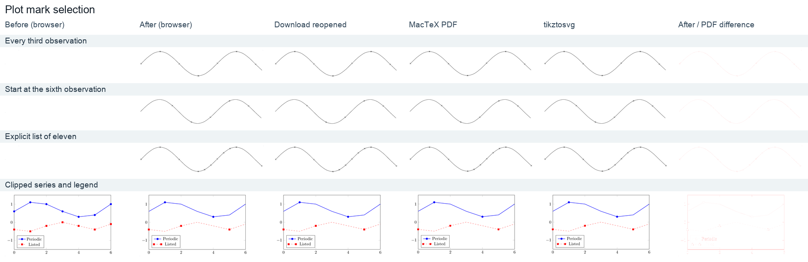

# Selecting plot marks without thinning the curve

`mark repeat`, `mark phase` and `mark indices` select which observations
receive an ink mark. They do **not** drop samples from the line. Previously
TikZKit often drew a mark at every sample, or lost the marks altogether
on a path without a stroke. This applies to the GitHub version.

## How native PGF decides

The following files were read in the local MacTeX 2025 installation:

- `pgflibraryplothandlers.code.tex:843-921`: each marker stream starts with
  a counter of `repeat - phase` and advances it **before** looking at the
  point. The periodic handler resets after painting; the explicit-list handler
  compares the printed integer and does not reset. A phase larger than the
  repeat really delays the first mark; it does not wrap around.
- `pgffor.code.tex`: numeric dots use TeX dimensions and retain the literal
  operands for the next range. In an explicit list, `01` and `1.0` are not
  the integer token `1`.
- `tikz.code.tex:3336-3440`: TikZ constructs the contour first and replays
  marks with the other foreground objects. The stock shapes use quick
  paint operations; their pen does not add an extra half-width to the page.
  A declared mark using ordinary stroked paint does enlarge it.
- `pgfmoduleplot.code.tex:66-85,329-381`: the ordinary plot-file reader
  sends each pair to `\pgfpointxy`. Blank datasets, outliers and undefined
  points are pen events, not additional observations. A file can come from
  the caller or from an embedded `filecontents` block.
- `pgfplots.markers.code.tex` and `pgfplots.code.tex`: PGFPlots can skip
  out-of-range centers before counting. The small line in a legend is its
  own three-point plot with its own repeat and phase.

The sine examples are from `pgfmanual-en-tikz-plots.tex:426-483`. They use
20 observations from `plots/pgfmanual-sine.table`. With repeat 3 the visible
marks are **1, 4, 7, 10, 13, 16, 19**; adding phase 6 leaves **6, 9, 12, 15, 18**.
The published explicit list selects **1, 4, 7, 10, 11, 12, 13, 14, 15, 16, 20**.

## Reproduce

```sh
TIKZKIT_TEST_PDFLATEX=1 node --test test/tikz-plot-mark-selection.test.js test/tikz-plot-file.test.js test/pgfplots-mark-selection.test.js
```

The native TikZ test records every painted mark's physical position from
inside PGF and compares the ordered stream in scaled points. Browser file
plots use supplied data, not TeX search paths, arbitrary file reads, or
external plot programs. Arbitrary TeX mark definitions and PGFPlots scatter
hooks are not implied by these tests.

## Browser and original TeX output



The first column is a real Chrome render of `d54df919`; the blank sine
panels are not missing screenshots. That build silently painted no file
curve. In the current build every file curve paints all 20 observations, with
crosses at only the requested positions. In the last row the old build painted
eight blue and eight red marks. The fixed and native outputs have **three blue
and five red**, including one blue and two red in the independent legend paths.

Chrome 158 opened each [case source](../../test/fixtures/examples/plot-mark-selection/manifest.json),
clicked Render, downloaded the SVG, then reopened the actual download.
The PDF was compiled from the original source by MacTeX 2025. The reference
SVG came from `/Library/TeX/texbin/tikztosvg` with pdflatex and was rasterized
with `rsvg-convert`. All panels use one physical scale and origin; the final
column shows pixel differences in red. Native crosses are two independent
diagonals (`M L M L`) over one cubic contour, with a y-inverting transform,
butt caps and miter joins. Neither renderer uses an SVG arrow marker here.

Matching the actual painted centers after transforms gave a maximum error
under **0.0016 mm** against tikztosvg across these four cases; the browser
and reopened download agreed to six decimal places in millimetres. There
are still small differences in rasterization and legend text. A separate
[clipped comb check](../../test/fixtures/examples/pgfplots/clipped-comb-marks.tex)
has four constructed stems and three round marks. Its fourth endpoint is
outside the axis, so there is no dot on the top edge. The browser matches that
behavior, with a roughly **0.07 mm** vertical page offset from the reference.

[Archived SVGs, PNGs and measurements](../../test/fixtures/examples/plot-mark-selection/evidence.tar.xz)
are available without regenerating the gallery. To repeat the comparison, run
the following from the repository root with a local Playwright installation,
Pillow, Poppler and librsvg. `BEFORE_TREE` is a checkout of `d54df919` with
its dependencies installed; `PW` is the absolute path to Playwright's `index.mjs`.

```sh
F=test/fixtures/examples/plot-mark-selection
OUT=outputs/qa/plot-mark-replay
node scripts/render-example-fixtures.js --fixtures "$F" --output "$OUT" --native-reference --native-latex-engine pdflatex --strict-tikztosvg --tikztosvg-engine pdflatex --no-comparison-grid --math-renderer svg-text
node "$F/capture.mjs" "$BEFORE_TREE" "$OUT" "$PW" before
node "$F/capture.mjs" . "$OUT" "$PW" after
python3 "$F/compare.py" "$OUT" "$OUT/comparison.png"
```

Full repository run with both native TeX gates enabled: **4,316 passed,
0 failed, 14 skipped** (optional external corpora not installed).
