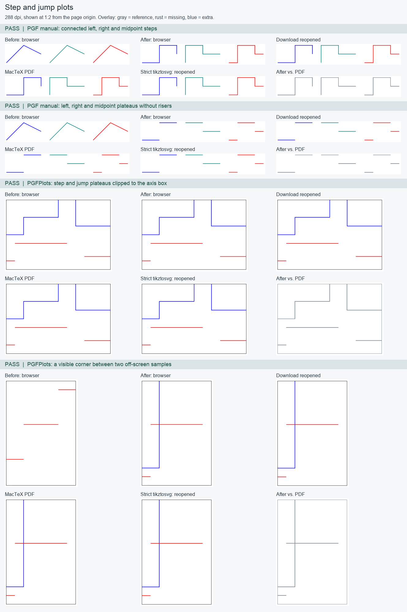

# Step plots: hold the observation, then clip

The ordinary TikZ plot handler used to draw straight diagonals for every
step option. PGFPlots already drew steps from coordinate lists, but clipped
sampled *chords* before it constructed their corners. That can erase an
entire visible line or introduce a plateau that was never in the data.

## Supported here

| TikZ or PGFPlots key | Between successive observations A and B |
| --- | --- |
| `const plot`, `const plot mark left` | Hold A's height up to B's x, then draw the riser. |
| `const plot mark right` | Change height at A's x, then hold B's height. |
| `const plot mark mid` | Change height halfway between the two x positions. |
| `jump mark left`, `jump mark right`, `jump mark mid` | Same holds, but lift the pen for the height change. |

"Left" and "right" refer to the order of input, not sorted x values. The
keys select a path handler; they do not request visible markers. When a
marker is requested its position and index still refer to the original
observation, never to a constructed corner.

## What MacTeX does

- `tikz.code.tex:1247-1253` binds the seven keys. In
  `pgflibraryplothandlers.code.tex:610-808`, all six handlers honor the
  first pen action (ordinary `plot` vs. `-- plot`). The jump variants
  use a move instead of a line, not an approximation with a dashed stroke.
- The midpoint handlers save the first point before transforming it. On
  *later* observations they save the registers left by `pgfpathlineto`,
  which has already applied the current transform
  (`pgfcorepathconstruct.code.tex:179-185`). This distinction is visible
  under a rotated or scaled scope. The left/right handlers save the
  untransformed component instead.
- For a TikZ `plot file`, the default PGF stream-jump callback is a no-op
  for these six handlers (`pgfmoduleplot.code.tex:126-137`). Blank
  datasets and omitted rows do not reset the last held observation. This
  differs from PGFPlots' `unbounded coords=jump`, which starts a new run
  (`pgfplotsplothandlers.code.tex:688-691`);
  `discard` omits the bad observation without restarting the run.
- PGFPlots replays plot coordinates through the selected PGF handler
  (`pgfplotscoordprocessing.code.tex:7544-7590`). The axis installs a
  paint clip (`pgfplots.code.tex:9183-9188`) that clips the result,
  not the hypothetical line joining the original samples. Native traces
  record both the rectangular clip and the pen commands for sampled and
  parametric plots with `domain`, `samples`, and explicit axis limits.

The [ordinary TikZ input](../../test/fixtures/native-step-plot-tests/cases.tex)
and [unmodified native trace](../../test/fixtures/native-step-plot-tests/texlive-2025.trace)
cover repeated and descending x values, local options, transforms, file
breaks, first actions and a relative continuation. They compare operations
and coordinates (within four TeX scaled points), page bounds and physical
size. The [PGFPlots tests](../../test/pgfplots-staircase.test.js) also
check that clipping never creates a mark.

## Visible results



The [four sources](../../test/fixtures/examples/step-plots/manifest.json)
are part of the workbench. The first two adapt the installed manual's
`pgfmanual-en-library-plot-handlers.tex:100-228` examples:
`(0,0), (1,1), (2,.5)`. Against the same three observations:

- The connected example changed from three identical diagonal polylines to
  stairs turning at the next, previous and midpoint x positions.
- The jump example now has two blue, two teal and three red horizontal
  plateaus, with white space between levels.
- The explicit-coordinate axis is a control: its existing blue entry/exit
  heights and the gap between the red plateaus must not change.
- In the sampled axis, the blue observations `(-2,1)` and `(1,10)` are
  both outside. Their corner at `(1,1)` is inside. The missing blue line
  now enters at `(0,1)` and exits at `(1,6)`. The two visible red plateaus
  are at `y=.5` and `3.5`; the old upper-right plateau was spurious.

Native `tikztosvg` (at `/Library/TeX/texbin/tikztosvg`) emits paths
with butt caps, miter joins, a y-inverting transform and independent
move-to commands for jumps. Some collinear lines are coalesced by the PDF
driver; the TikZKit scene retains the sampled vertices. Identical SVG path
strings or byte-identical antialiasing are not prerequisites for the same
painted geometry.

This checks the seven built-in keys in ordinary TikZ and 2D Cartesian
PGFPlots. It does not certify arbitrary user-defined handlers, 3D
projections, every axis transformation or every combination with fills.

## Reproduce

[Evidence archive](../../test/fixtures/examples/step-plots/evidence.tar.xz):
before/after browser captures, reopened downloads, original MacTeX PDFs,
strict reference and JS SVGs/PNGs, and the per-case measurements. Chrome
158 clicked Render and Download on each fixture, then reopened the actual
download and local reference with the network restricted to the local
workbench. All four reported zero diagnostics.

The captures use a common physical scale and page origin, not independent
ink fits. At 288 dpi the check allows a two-device-pixel neighborhood for
antialiasing and up to three pixels in viewport rounding. No missing or
extra ink outside that neighborhood is allowed, either per color or overall.
All four cases passed against both MacTeX and strict `tikztosvg`. The
coordinate control also passed on the old build; the other three did not.

Full repository run with both MacTeX test switches enabled: 4,334 passed,
0 failed, 14 skipped because their optional external corpora were not installed.

From the repository root, with MacTeX, `tikztosvg`, librsvg, Poppler,
Chrome, Pillow and Playwright installed:

```sh
TIKZKIT_TEST_PDFLATEX=1 node --test test/step-plots-native.test.js test/pgfplots-staircase.test.js

F=test/fixtures/examples/step-plots
OUT=outputs/qa/step-plots
CAP=test/fixtures/examples/plot-mark-selection/capture.mjs
node scripts/render-example-fixtures.js --fixtures "$F" --output "$OUT" --native-reference --native-latex-engine pdflatex --strict-tikztosvg --tikztosvg-engine pdflatex --no-comparison-grid --math-renderer svg-text
# BEFORE_TREE: checkout of e68e43c8 with dependencies; PW: absolute Playwright index.mjs
node "$CAP" "$BEFORE_TREE" "$OUT" "$PW" before
node "$CAP" . "$OUT" "$PW" after
python3 "$F/compare.py" "$OUT"
```
